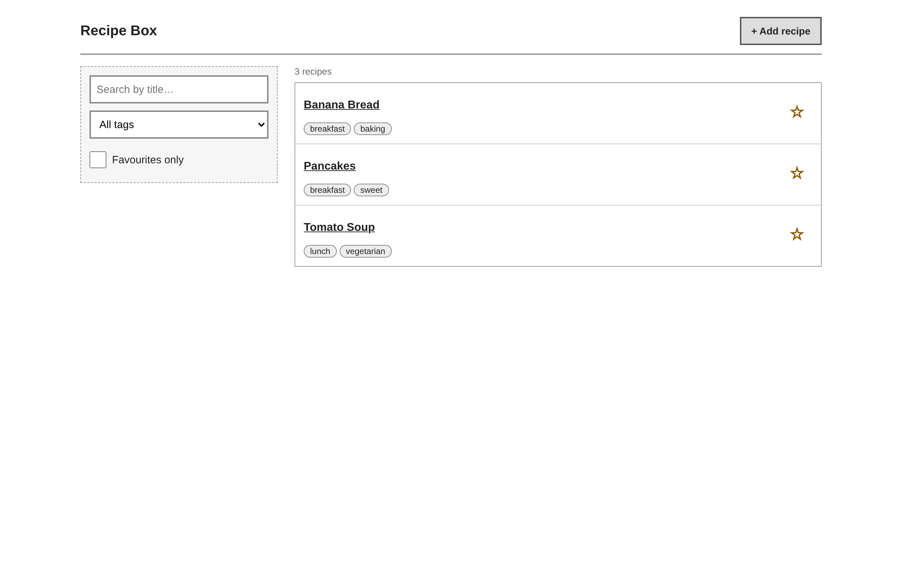
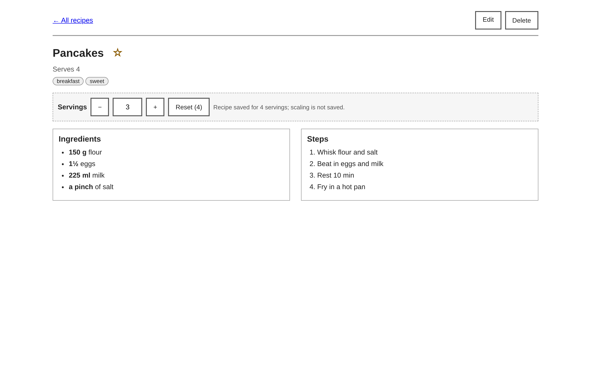
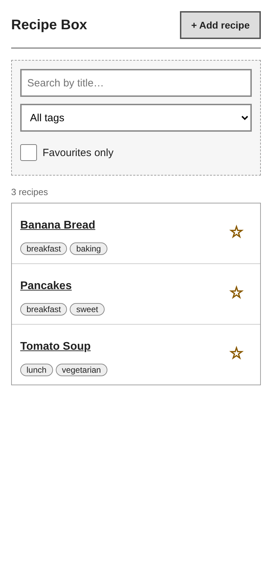
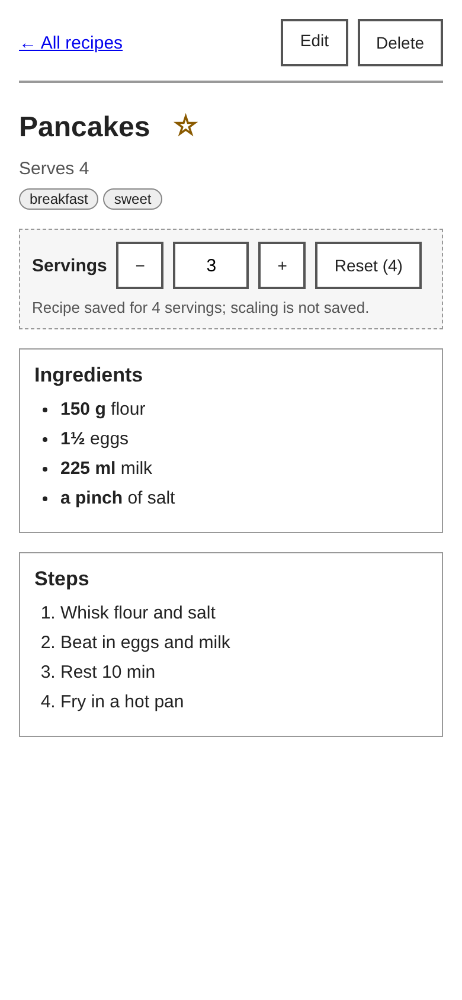
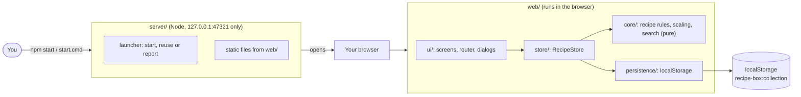

# Recipe Box

A small personal recipe box that runs on your own computer. It keeps your recipes in your browser, and nothing is sent anywhere.

> **Status: handover.** Every flow in the spec is built and covered by automated unit and browser tests. The layout works on a phone-sized window (390 px). The final check of the spec's definition of done on your own computer, after a restart, is still for the owner to do.









## Architecture



- **Launcher (`server/`):** starts the app on the fixed address `http://127.0.0.1:47321/`, bound to your computer only, opens the browser, and reuses a copy that is already running. It serves the `web/` folder and nothing else.
- **Screens (`web/js/ui/`):** the recipe list, the recipe view and the recipe form, plus the shared router, confirm dialogs and the status banner.
- **Recipe store (`web/js/store/`):** the only way the screens reach recipe data. Every change is saved straight away.
- **Pure logic (`web/js/core/`):** recipe rules and validation, the kitchen-fraction scaling (nearest ¼) and the search and filter. No DOM and no storage.
- **Local persistence (`web/js/persistence/`):** reads and writes the recipe list in your browser's storage. If the stored data cannot be read, the app switches to read-only and never overwrites it.

The architecture as built is in [`docs/ARCHITECTURE.md`](docs/ARCHITECTURE.md). The full design is in [`docs/LLD.md`](docs/LLD.md) (section 0 is the overview and sections 1 to 11 are the modules), with the product spec in [`docs/SPEC.md`](docs/SPEC.md) and the coding rules in [`docs/CONVENTIONS.md`](docs/CONVENTIONS.md). A guided code tour is in [`docs/WALKTHROUGH.md`](docs/WALKTHROUGH.md).

## Features

- Add, edit and delete recipes: title, servings, ingredients (amount, unit, name), numbered steps and tags.
- A list sorted A–Z with tags and a favourite star.
- Search by title as you type, filter by tag, and show only favourites. The three work together.
- Open a recipe and change its servings. Amounts are recalculated and shown as kitchen fractions rounded to the nearest ¼.
- Save, edit and favourite changes are kept after a restart.
- Works without an internet connection.

## Tech stack

- **Start-up server:** Node.js 24 or newer, with built-in `http`, `fs` and `child_process`. No runtime npm packages.
- **Screens:** plain HTML, CSS and JavaScript modules, with no build step.
- **Types:** JSDoc comments checked by TypeScript (`tsc --noEmit`, strict).
- **Storage:** your browser's `localStorage`, one entry for the whole recipe list.
- **Unit tests:** `node:test`, with coverage.
- **Browser tests:** Playwright (a development dependency). It uses Microsoft Edge when Edge is installed, and otherwise a Chromium browser (see How to test).
- **Checks:** ESLint, Prettier and dependency-cruiser (layer rules).
- **Continuous integration:** GitHub Actions (`.github/workflows/ci.yml`).

## Requirements

- Windows 10 or 11
- Node.js 24 or newer (from https://nodejs.org)
- Git, to clone the project (Git Bash is used to run `scripts/check.sh`)
- Microsoft Edge or a Chromium browser, only needed for the browser tests

The app itself needs no other install.

## How to run

These steps take you from a fresh clone to the running app.

1. Clone the project and open a terminal in its folder (the folder that contains this README):

   ```
   git clone <URL of this repository> recipe-box
   cd recipe-box
   ```

2. Check that Node.js is version 24 or newer:

   ```
   node --version
   ```

3. Install the development tools (once). This runs `npm ci`, which installs only the tools used by the checks and tests. The app itself needs no install.

   ```
   npm ci
   ```

   `npm ci` also runs the `prepare` script, which sets the git hooks folder to `.githooks` (see the pre-commit hook below).

4. Optional: create a `.env` file by copying `.env.example`. The file lists two settings, and the defaults are right for most people:
   - `RECIPE_BOX_PORT` is `47321`. Leave it as it is. Your recipes are tied to the address `http://127.0.0.1:47321/`, so a different port opens an empty recipe box. There is no external account or service to get this from.
   - `RECIPE_BOX_NO_OPEN` is blank. Set it to `1` if you do not want the browser to open when the app starts. There is no external source for this value either.

   The start command does not read `.env`. To use a setting, set it in the terminal before starting, for example in Command Prompt: `set RECIPE_BOX_NO_OPEN=1`. The app needs no secrets, so no key has to be obtained from anywhere.

5. Start the app with either command:
   - `npm start` in the terminal, or
   - double-click `start.cmd` in the project folder.

6. Your browser opens `http://127.0.0.1:47321/` on the recipe list. The window shows:
   `Recipe Box is running at http://127.0.0.1:47321/ - opening your browser. Close this window to stop it.`

7. To stop the app, close that window (or press Ctrl+C in the terminal).

If the app is already running and you start it again, the browser simply opens the running copy.

Always use the address `http://127.0.0.1:47321/`. The browser treats `localhost:47321` as a different address with its own empty storage.

### Optional: the pre-commit hook

`.githooks/pre-commit` runs the fast checks (lint, format, types and layer rules; no tests) before each commit. `npm ci` points git at the `.githooks` folder, but the hook file is not executable in a fresh clone, so it does not run automatically. To turn it on, make it executable once, in Git Bash:

```
chmod +x .githooks/pre-commit
```

The hook skips its checks when `node_modules` is missing, so run `npm ci` first.

## Using Recipe Box

- **Add a recipe:** click **+ Add recipe** (or **Add your first recipe** when the list is empty). Enter a title, the number of servings (a whole number, 1 or more), ingredient rows, step rows and tags, then click **Save**. The new recipe opens in its view.
  - A title, at least one ingredient and at least one step are required.
  - Tags are saved in lower case, and a tag repeated in the same recipe is ignored.
  - If you leave the form with unsaved text, Recipe Box asks "Discard changes?".
- **List:** the front page shows your recipes sorted A–Z by title, each with its tags, a favourite star and a count (for example "3 recipes").
- **Search:** type in the search box to narrow the list by title as you type. Matching ignores upper and lower case and finds part of a title, so "pan" finds "Pancakes".
- **Tag filter:** choose a tag from the tag menu (**All tags** shows everything) to see only recipes with that tag.
- **Favourites only:** tick **Favourites only** to see only your favourite recipes.
- **Combined filters:** search, tag and Favourites only work together, and a recipe must match all of them. If nothing matches, the list says "No recipes match your search". Click **Clear filters** to show all recipes again.
- **Favourites:** click the star beside a recipe in the list, or beside its title on the recipe page, to mark it (★) or unmark it (☆). The change is saved straight away and is still there after a restart.
- **Filters and navigation:** the search text, tag and Favourites only setting stay the same when you open a recipe and go back with **← All recipes**. They are not saved, so reloading the page shows all recipes again.
- **Open:** click a recipe's title to read its servings, ingredients and numbered steps. Use **← All recipes** to go back.
- **Scale the servings:** open a recipe and use **−** and **+** (or type a whole number) in the servings box. Every amount is recalculated for the new number of servings and shown as a kitchen fraction rounded to the nearest ¼ (for example 1½ eggs). A value below 1, or text that is not a whole number, is not accepted and the previous number stays. **−** is disabled at 1. Click **Reset** to go back to the recipe's own servings.
  - Scaling is not saved. Reopening the recipe shows its own servings again.
- **Edit:** on a recipe's page, click **Edit**. The form opens filled in with the recipe. Change any field, then click **Save** to see the updated recipe, or **Cancel** to go back without saving. The same checks as for a new recipe apply.
  - If you have changed something, Recipe Box asks "Discard changes?" before it leaves the form. Closing the browser tab with unsaved changes also shows the browser's own leave-page prompt.
- **Delete:** on a recipe's page, click **Delete**. Recipe Box asks "Delete '<title>'? Are you sure?" with **Cancel** and **Delete**. **Cancel**, the Esc key or a click outside the box keeps the recipe. **Delete** removes it permanently and returns you to the list. There is no undo and no backup, so a deleted recipe cannot be brought back.

**Read-only banner.** If Recipe Box cannot read your saved recipes, a banner at the top says that they could not be read, so Recipe Box will not change them, and that nothing has been deleted. Recipe Box keeps showing the recipes it had last. While the banner is shown, a new recipe cannot be saved, a recipe cannot be edited, saved or deleted, and the favourite stars, **Edit** and **Delete** are disabled. Changing the servings still works, because it is not saved. A second banner, "This browser is blocking storage for Recipe Box", means the browser will not let the app use its storage at all, and the same controls are disabled.

## Layout and accessibility

- **Phone-sized windows:** the app works down to 390 px wide. Everything stacks into one column and nothing needs sideways scrolling.
- **Wider windows:** from about 800 px wide, the list shows the filters beside the recipes, and the recipe and form screens show ingredients and steps side by side.
- **Touch targets:** buttons, links, text fields and the dialog buttons are at least 40 px tall. The favourite star is larger still.
- **Keyboard:** every control can be reached with the Tab key. Esc closes the confirm dialog. After you click a star, **−**, **+** or **Reset**, keyboard focus stays on that control.
- **Screen readers:** each screen has one main heading. Form fields have labels, and error messages are linked to the field they belong to. Icon-only buttons (↑, ↓, ✕) have names. Each star says whether the recipe is a favourite.

## Where your recipes are stored

- Recipes are saved in the storage of your browser, for the address `http://127.0.0.1:47321/`. They are not saved in a file.
- Use the same browser every time. Another browser cannot see them.
- There is no backup and no export. Clearing the browser's site data for this address deletes all your recipes permanently.
- Recipes stay saved when you close the browser, stop the app or restart the computer.

## Port problems

The app always uses port 47321 on purpose. Your recipes are tied to the address `http://127.0.0.1:47321/`, so the app never switches to another port.

If you see this message:

> Port 47321 is used by another program, so Recipe Box cannot start. Close that program and run the command again (see README "Port problems").

another program on your computer is already using port 47321. Close that program and run `npm start` (or double-click `start.cmd`) again. If you are not sure which program it is, restart the computer and try again.

If you see this message:

> Windows does not allow Recipe Box to use port 47321 (reserved port range). See README "Port problems".

Windows reserves some port ranges for itself. To list them, run `netsh interface ipv4 show excludedportrange protocol=tcp` in Command Prompt. If 47321 falls inside a listed range, Recipe Box cannot run on this computer until that range changes.

The port can be changed with the `RECIPE_BOX_PORT` environment variable (a number from 1024 to 65535). Do not do this lightly: the new address is a different origin, so it opens an empty recipe box, and your existing recipes stay at the old address.

## How to test

Run these from the project folder in Git Bash, after `npm ci`.

- `bash scripts/check.sh` runs lint, formatting, type checks, layer rules, and the unit tests with coverage. It must pass. It stops at the first failing step.
- `CHECK_NO_COVERAGE=1 bash scripts/check.sh` is the same, but skips only the coverage thresholds.
- `bash scripts/check.sh --e2e` runs all of the above and then the browser tests. `npm run test:e2e` runs only the browser tests.

The browser tests are eight spec files in `tests/e2e/`, one per flow: add, list, view and scale, favourites, edit, delete, persistence, and layout. The layout tests run at 390 px and at a 1280 px desktop size.

The browser used for the browser tests is chosen in this order (`tests/e2e/playwright.config.js`):

1. Microsoft Edge, if it is installed.
2. Otherwise a Chromium browser in the folder named by the `PLAYWRIGHT_BROWSERS_PATH` environment variable, if `<that folder>/chromium` exists.
3. Otherwise Playwright's own Chromium. Install it once with `npx playwright install chromium`.

Run single files while you work:

- `node --test tests/unit/store/recipe-store.test.js` runs one unit test file.
- `npm run test:e2e -- delete.spec.js` runs one browser test file. Add `--project=narrow` to run only the 390 px project.

The browser tests start their own copy of the app on port 47399 with a temporary, empty recipe box. They never touch your recipes on port 47321.

## Continuous integration

`.github/workflows/ci.yml` runs on every push and every pull request:

- **check** job: `npm ci`, then `bash scripts/check.sh`.
- **e2e** job: `npm ci`, then `npx playwright install --with-deps chromium`, then `bash scripts/check.sh --e2e`. The browser tests use Edge if it is present, otherwise Playwright's Chromium (D-08).

## Project structure

- `server/`: the start-up program. It serves the app on 127.0.0.1 and opens the browser.
- `web/`: the app itself, which runs in the browser (HTML, CSS and JavaScript). `web/js/` holds `core/`, `store/`, `persistence/` and `ui/`.
- `tests/`: the automated tests. `tests/unit/` (unit tests), `tests/e2e/` (browser tests, with `helpers/`) and `tests/helpers/` (shared fakes and sample recipes).
- `scripts/`: `check.sh` (runs all checks) and `screenshot.mjs` (takes screenshots of the running app).
- `docs/`: the spec (`SPEC.md`), the design (`HLD.md`, `LLD.md`), the as-built architecture (`ARCHITECTURE.md`), the code tour (`WALKTHROUGH.md`), the coding conventions (`CONVENTIONS.md`) and the research notes (`research.md`). Start with `docs/SPEC.md`, or with `docs/WALKTHROUGH.md` to read the code.
- `docs/images/`: the screenshots shown at the top of this README.
- `.github/workflows/`: the CI workflow (`ci.yml`).
- `.githooks/`: the git pre-commit hook (see above).
- `start.cmd`: double-click start for Windows, the same as `npm start`.
- `.devteam/`: settings for the AI team tooling. You do not need it to run the app.

## How to extend

Read these first:

- [`docs/WALKTHROUGH.md`](docs/WALKTHROUGH.md) is a guided tour of one request from the browser to storage, the layer rules, and the tests.
- [`docs/ARCHITECTURE.md`](docs/ARCHITECTURE.md) is the as-built component table, the key flows, the data model and the known limitations.
- [`docs/CONVENTIONS.md`](docs/CONVENTIONS.md) lists the layer rules and size limits that `scripts/check.sh` enforces.

The walkthrough's "How to extend it" table lists the files for each change. Three common changes:

- **Add a pure rule (for example a servings cap).** Edit `web/js/core/scaling/servings.js` and add a test in `tests/unit/core/scaling/`. Copy the style of the existing `parseServingsInput` and `stepServings` tests. Pure code cannot touch the DOM or storage, so this stays easy to test.
- **Add a recipe field.** This is a data change. Update `web/js/core/recipe/types.js` and `web/js/core/recipe/validation.js` (strict check on writes), `web/js/persistence/collection-codec.js` (lenient check on reads, so old data stays readable), `web/js/ui/form-model.js` and a form section (`web/js/ui/form-top.js` or a new `form-*.js`), and `web/js/ui/screens/view-screen.js` to show it. Do not change `SCHEMA_VERSION` without an upgrade path (see `docs/LLD.md` §10.5). Add unit tests under `tests/unit/core/` and `tests/unit/persistence/`, and an e2e check in the matching `tests/e2e/*.spec.js`.
- **Add a screen.** Add a member to `Route` and to `parseRoute` / `routeToHash` in `web/js/ui/router.js`. Create `web/js/ui/screens/<name>-screen.js` that exports one mount function, following `not-found-screen.js` (the smallest). Register it in the `SCREENS` map in `web/js/ui/app.js`. Add router tests in `tests/unit/ui/router.test.js` and a browser test in `tests/e2e/<name>.spec.js`, using `data-testid` selectors and the seed helpers in `tests/e2e/helpers/`.

Keep the layer rules in mind: `ui` uses `store`, `store` uses `core`, and only `web/js/persistence/` talks to `localStorage`. `npm run deps` fails if an import breaks them. Before you commit, run `bash scripts/check.sh`.

## Known limitations

The full list is in [`docs/ARCHITECTURE.md`](docs/ARCHITECTURE.md) §9. The most important ones:

- There is no backup and no export. Clearing the site data for `127.0.0.1:47321` deletes all recipes (SPEC §11).
- The browser tests use the fixed port 47399, so two browser test runs at the same time clash.
- `scripts/screenshot.mjs` still uses Microsoft Edge only.
- The pre-commit hook is not executable in a fresh clone (see above).
