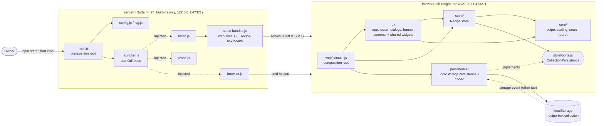
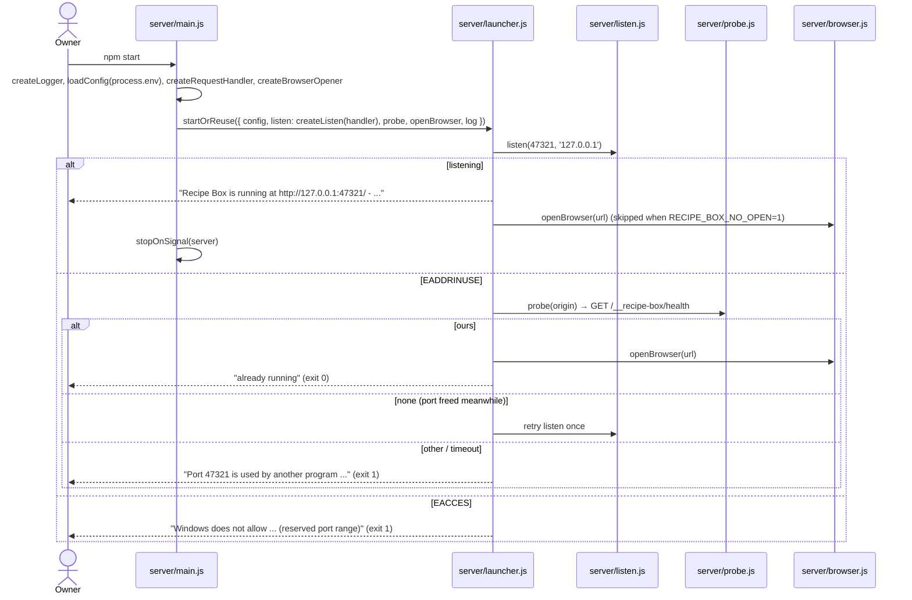
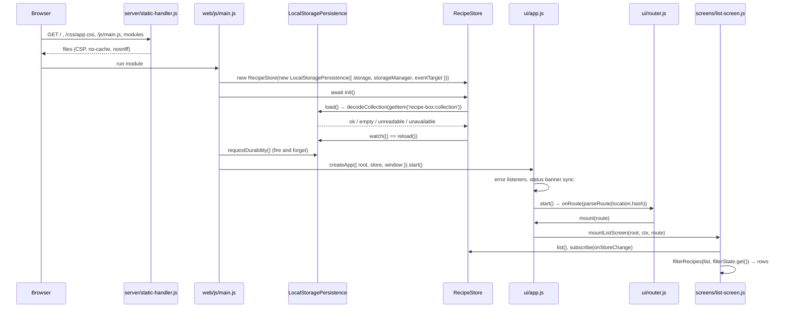
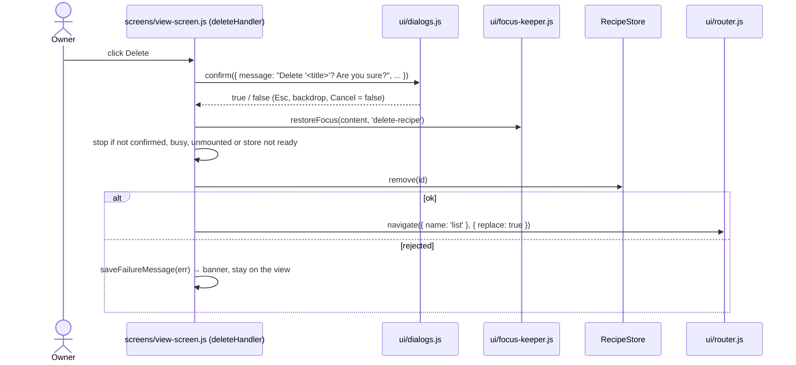
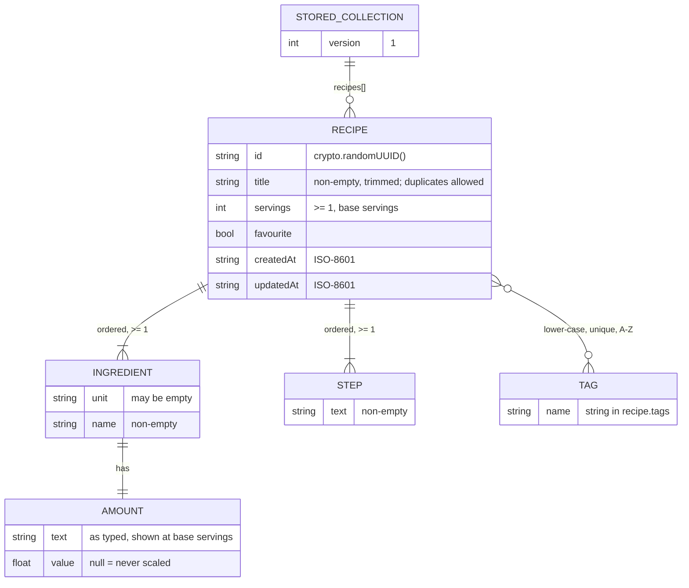

# Architecture (as built) — Recipe Box

> Final, as-built description written at handover by the architect, from the code, not
> from the original plan. Deviations from the plan are listed in §7.
> Section numbers in the form "LLD §n" refer to `docs/LLD.md`; decision ids (D-xx, A-xx) refer to `DECISIONS.md`.

## 1. What it is
A personal recipe box for one person on one Windows computer. `npm start` (or `start.cmd`) runs a tiny Node
server that serves a no-build, vanilla-JavaScript web app on `http://127.0.0.1:47321/` and opens the browser;
all recipes live in that browser's `localStorage`. You can add, edit, delete, search, filter by tag, star
favourites, and scale a recipe's servings with amounts shown as kitchen fractions (nearest ¼).

## 2. System diagram

Nothing leaves the computer: the server binds to `127.0.0.1` only, rejects foreign `Host` headers, and sends a
strict `Content-Security-Policy` (`server/static-handler.js`). There are zero runtime npm packages.

## 3. Components
| Component | Path | Responsibility | Depends on |
|---|---|---|---|
| Server composition root | `server/main.js` (`main`, `stopOnSignal`) | Builds logger, config, handler, browser opener; calls `startOrReuse`; maps outcome / `ConfigError` to exit codes | every other `server/` module |
| Config | `server/config.js` (`loadConfig`, `ConfigError`) | Port (`RECIPE_BOX_PORT`, default 47321), host `127.0.0.1`, `webRoot`, version from `package.json`, `RECIPE_BOX_NO_OPEN` | Node built-ins |
| Launcher | `server/launcher.js` (`startOrReuse`, `exitCodeFor`) | Listen; on `EADDRINUSE` probe the port and reuse a running copy; exact console messages | injected `listen`, `probe`, `openBrowser`, `log` |
| Listen | `server/listen.js` (`createListen`) | `http.createServer(handler)` bound to the given host/port | `node:http` |
| Probe | `server/probe.js` (`probeExistingInstance`) | `GET /__recipe-box/health` → `ours` / `other` / `none` (1500 ms timeout) | `node:http` |
| Browser opener | `server/browser.js` (`createBrowserOpener`) | Platform command (`cmd /c start`, `open`, `xdg-open`); errors logged, never fatal | injected `spawn` |
| Static handler | `server/static-handler.js` (`createRequestHandler`, `contentTypeFor`, `HEALTH_PATH`) | Serves `web/`, health JSON, 403 host guard, 404 traversal guard, 405, 500 + security headers | `config.js` (`ConfigError`) |
| Logger | `server/log.js` (`createLogger`) | The only server file that writes to the console | — |
| Browser composition root | `web/js/main.js` | `new LocalStoragePersistence(...)` → `new RecipeStore(...)` → `init()` → `requestDurability()` → `createApp(...).start()` | store, persistence, `ui/app.js` |
| App shell | `web/js/ui/app.js` (`createApp`) | Screen map, `ScreenContext`, status banner sync, global error → banner | router, dialogs, banner, filter-state, screens |
| Router | `web/js/ui/router.js` (`parseRoute`, `routeToHash`, `createRouter`) | Hash routes `#/`, `#/new`, `#/recipe/<id>`, `#/recipe/<id>/edit`; `canLeave` guard; `replace` navigation. Holds the `Route`/`ScreenContext`/`MountScreen` typedefs | — |
| Shared UI helpers | `web/js/ui/{dom,dialogs,banner,filter-state,focus-keeper,save-failure,favourite-toggle}.js` | `h()` element builder (no `innerHTML`), confirm `<dialog>`, banner, in-tab filter state, focus kept across re-renders, rejected-write → text, the star button | store errors (save-failure), `focus-keeper` |
| List screen | `web/js/ui/screens/list-screen.js` + `web/js/ui/list-filters.js` | A–Z list, search / tag / favourites-only, count, empty and no-match states | `core/search`, store, shared helpers |
| View screen | `web/js/ui/screens/view-screen.js` + `web/js/ui/servings-control.js` | One recipe, view-only servings scaling, star, Edit, Delete with confirm | `core/scaling`, store, shared helpers |
| Form screen | `web/js/ui/screens/form-screen.js` + `web/js/ui/{form-model,form-top,form-ingredients,form-steps,form-tags,form-widgets,form-save}.js` | Add and edit: draft editing, inline validation, Save (disabled live while read-only), discard guard | `core/recipe`, store, shared helpers |
| Not-found screen | `web/js/ui/screens/not-found-screen.js` | "Page not found" for unknown hashes and unknown edit ids | `dom.js` |
| Recipe model | `web/js/core/recipe/{types,amount,tags,validation,errors}.js` | Types, `parseAmount`, `normaliseTag(s)`, `validateDraft`, `assertRecipeInput`, `ValidationError` | — |
| Scaling | `web/js/core/scaling/{fractions,scaling,servings}.js` | `roundToQuarter`, `formatQuarter`, `scaleAmount`, `formatIngredientLine`, `parseServingsInput`, `stepServings` | `core/recipe` types |
| Search | `web/js/core/search/search.js` | `filterRecipes`, `sortByTitle`, `listTags`, `hasActiveFilters` | `core/recipe` types |
| Recipe store | `web/js/store/recipe-store.js` (`RecipeStore`), `ports.js`, `errors.js` | The single gateway to data: frozen snapshot, serialised writes, save-before-commit, status, subscribe, cross-tab `reload()` | `core/recipe/validation.js`, `CollectionPersistence` port |
| Persistence | `web/js/persistence/local-storage-persistence.js` (`LocalStoragePersistence`), `collection-codec.js` | One JSON document under `recipe-box:collection`; versioned decode; refuses to overwrite data it cannot read; `storage` event watch | `store/ports.js`, `store/errors.js` |

## 4. Key flows (as implemented)

### Start: one command, reuse a running copy (F-0)

Files involved, in order: `server/main.js` → `server/config.js` → `server/static-handler.js` → `server/browser.js` → `server/launcher.js` → `server/listen.js` → (`server/probe.js`) → `server/log.js`.

### Page load: wire the app and show the list

Files involved, in order: `web/index.html` → `web/js/main.js` → `web/js/persistence/local-storage-persistence.js` → `web/js/persistence/collection-codec.js` → `web/js/store/recipe-store.js` → `web/js/ui/app.js` → `web/js/ui/router.js` → `web/js/ui/screens/list-screen.js` → `web/js/ui/list-filters.js` → `web/js/core/search/search.js` → `web/js/ui/favourite-toggle.js`.

### Save a recipe (add F-1 / edit F-5)
```mermaid
sequenceDiagram
  actor Owner
  participant F as screens/form-screen.js
  participant FS as ui/form-save.js
  participant V as core/recipe/validation.js
  participant S as RecipeStore
  participant LS as LocalStoragePersistence
  participant R as ui/router.js
  Owner->>F: click Save (form submit)
  F->>FS: save()
  FS->>FS: return early if saving or store.status !== 'ready'
  FS->>V: validateDraft(view.currentDraft())
  alt invalid
    FS->>F: view.render(errors) → inline errors, focus first invalid field
  else valid
    FS->>S: create(value) or update(id, value)
    S->>V: assertRecipeInput(input) + structuredClone (at call time)
    S->>S: enqueue on the write chain; guard status === 'ready'
    S->>LS: save(next)
    LS->>LS: refuse if stored value is foreign; setItem(encodeCollection(next))
    alt saved
      S->>S: commit frozen snapshot, notify subscribers
      FS->>R: navigate({ name: 'view', id }, { replace: true })
    else PersistenceWriteError / RecipeNotFoundError / StoreReadOnlyError
      S-->>FS: reject (snapshot unchanged)
      FS->>FS: saveFailureMessage(err) → banner (none for StoreReadOnlyError)
    end
  end
```
Files involved, in order: `web/js/ui/screens/form-screen.js` → `web/js/ui/form-save.js` → `web/js/core/recipe/validation.js` → `web/js/store/recipe-store.js` → `web/js/persistence/local-storage-persistence.js` → `web/js/persistence/collection-codec.js` → `web/js/ui/router.js` → `web/js/ui/app.js` → `web/js/ui/screens/view-screen.js` (or `web/js/ui/save-failure.js` → `web/js/ui/banner.js` on failure).

### Delete with confirm (F-6)

Files involved, in order: `web/js/ui/screens/view-screen.js` → `web/js/ui/dialogs.js` → `web/js/ui/focus-keeper.js` → `web/js/store/recipe-store.js` → `web/js/persistence/local-storage-persistence.js` → `web/js/ui/router.js`.

### Another tab changes storage (cross-tab reload, read-only mode, CR-1)
```mermaid
sequenceDiagram
  participant Other as Other tab
  participant LS as LocalStoragePersistence.watch
  participant S as RecipeStore
  participant App as ui/app.js (status sync)
  participant Scr as mounted screen
  Other->>LS: storage event, key recipe-box:collection
  LS->>S: reload() (on the write chain)
  S->>LS: load()
  alt ok / empty
    S->>S: status ready, snapshot replaced
  else unreadable / unavailable
    S->>S: status changes, last good snapshot kept (read-only)
  end
  S->>App: notify → banner shown / cleared
  S->>Scr: notify → re-render; write controls disabled unless ready
```
Files involved, in order: `web/js/persistence/local-storage-persistence.js` (`watch`) → `web/js/store/recipe-store.js` (`reload`, `#load`, `#notify`) → `web/js/ui/app.js` (`createStatusSync`) → `web/js/ui/screens/*.js` (store subscribers) → `web/js/ui/form-save.js` (`createSaveSync`).

## 5. Data model
One `localStorage` entry at origin `http://127.0.0.1:47321`, key `recipe-box:collection` (`STORAGE_KEY` in
`web/js/persistence/collection-codec.js`), value `{"version":1,"recipes":[...]}` (`SCHEMA_VERSION = 1`).
Types are JSDoc typedefs in `web/js/core/recipe/types.js`.

- Writes are checked strictly by `assertRecipeInput` (`web/js/core/recipe/validation.js`); reads are checked
  leniently by `decodeCollection` (`web/js/persistence/collection-codec.js`, types only), so tightening a write
  rule can never make stored data unreadable (A-08).
- Not JSON, an unknown `version`, or an invalid recipe → `unreadable`; the store goes read-only and the value is
  never written over (store guard + `isForeignData` check in `LocalStoragePersistence.save`, A-09).
- Scaling state, filter state and drafts are never stored.

## 6. Design decisions
| Decision | Chosen | Why | Alternative rejected | Ref |
|---|---|---|---|---|
| Stack | Node built-in `http` + vanilla ES modules, no build step, zero runtime packages | "One command" stays trivially true; nothing to install or upgrade to run | Vite + Preact (needs install and build) | D-02, LLD §0.1 |
| Where data lives | `localStorage` behind the `CollectionPersistence` port (`web/js/store/ports.js`) | Matches SPEC §6; simplest; data ≪ 5 MiB | JSON file on disk via the server (designed in LLD §10.6, not built) | D-01 |
| Address | Fixed `http://127.0.0.1:47321/`, loopback only; never switch port | Browser storage is per origin, so a fixed port keeps the recipes findable | Random/free port | D-04, LLD §0.6 D2 |
| Already running | Probe `/__recipe-box/health` on `EADDRINUSE`, reuse if it is ours | Second start opens the running copy instead of failing | pid/lock file | LLD §1.5 |
| Types | JSDoc + `tsc --noEmit` (strict, `checkJs`) | Type safety with no build step | TypeScript sources | D-04 |
| Amounts | `{ text, value }`: text as typed, number or `null`; hand-written ¼ rounding | Shows the owner's own text at base servings; unscalable text ("a pinch") is kept | `fraction.js` | D-04, LLD §6, §7 |
| Writes | Serialised promise chain; save to storage first, then commit the frozen snapshot and notify | A failed write never changes what is shown; no lost updates within a tab | Optimistic UI update | LLD §9.4 |
| Unreadable data | Read-only mode with banner; last good snapshot stays visible | Never lose or overwrite data silently | Show nothing / overwrite | D-09 (CR-1), D-10 |
| Save while read-only | Save button disabled live, following `store.status` | Same rule as every other write control | Leave enabled, reject on click | D-11 |
| Delete failure text | Reuse the shared "Could not save…" mapping | One reason→text map (`save-failure.js`) | A separate "Could not delete" text (dropped with T-21) | D-13 |
| Browser tests | `@playwright/test` with installed Edge, else a Chromium already on the machine | Real-browser checks of every SPEC flow at 1280 and 390 px, no download | Manual checklist only | D-03, D-08 |
| Layer rules | dependency-cruiser contracts in `.dependency-cruiser.cjs` | Keeps `ui → store → core`, persistence only via the port, server/web separate | ESLint `no-restricted-imports` | D-04, LLD §11.4 |

## 7. Deviations from the original design
| Planned (LLD v1) | Built | Why | Ref |
|---|---|---|---|
| Launcher creates its own server | `server/listen.js` `createListen(handler)` injected by `server/main.js` | Testable bound address; DI | A-06 |
| Static handler silent on errors | Optional `log`; unexpected error → 500 + `Request failed` log; missing `web/` → `ConfigError` at start | Fail loudly | D-06 |
| Browser-open failure undefined | `createBrowserOpener({ onError })`: logged, never fatal | Server must keep running | A-06 |
| Failed load → `list()` returns `[]` | A failed reload keeps the last good snapshot visible, read-only | §9.5 contradicted §3.5/§4.5 | D-09, D-10 (CR-1) |
| Save rejects with `StoreReadOnlyError` while read-only | Save disabled live (`createSaveSync` in `web/js/ui/form-save.js`); store guard remains as safety net | Consistent with other write controls | D-11 |
| One stored-shape check | Lenient decode (`collection-codec.js`) separate from strict `assertRecipeInput`; adapter refuses to overwrite foreign data | Stored data stays readable; never destroy a newer tab's data | A-08, A-09 |
| Form in one screen file | Split into `form-model`, `form-top`, `form-ingredients`, `form-steps`, `form-tags`, `form-widgets`, `form-save` | 300-line / 40-line-function limits | LLD §5.1 |
| List screen in one file | Filter panel in `web/js/ui/list-filters.js`, built once per mount | Search box keeps focus while results re-render | LLD §3.1 |
| Star, focus and failure text per screen | Shared `favourite-toggle.js`, `focus-keeper.js` (`renderKeepingFocus`, `restoreFocus`), `save-failure.js`, `servings-control.js` | One behaviour for list and view; no copies | A-17, A-19 |
| Form registers `beforeunload` on `window` | `ScreenContext.onBeforeUnload` provided by `web/js/ui/app.js` | No screen touches globals | A-17 |
| Edit of unknown id → form-local not-found state | Reuses `mountNotFoundScreen` | Simpler, same text | A-15 |
| Disabled Edit as `<a>` without `href` | Disabled `<button>` with the same test id; "Reset (N)" is a `<button>` too | Real disabled control | A-14 |
| `PersistenceWriteError` text from `err.message` | Reason→text map on `err.reason` | Removed a doubled "Could not save" | A-17 |
| E2E only in Edge | Edge if installed, else `$PLAYWRIGHT_BROWSERS_PATH/chromium`, else Playwright default | e2e must run without Edge | D-08 |
| `hasActiveFilters` drives the no-match state | Not used by the UI (no-match = list non-empty and 0 matches); still unit-tested | Simpler condition | LLD §3, §8.1 |

## 8. Quality gates
`scripts/check.sh` (run from Git Bash after `npm ci`) runs, and fails on the first error:

| Step | npm script | Enforces |
|---|---|---|
| Lint | `npm run lint` (`eslint.config.js`) | Complexity ≤ 10, function ≤ 40 lines, file ≤ 300 lines, ≤ 5 params, depth ≤ 4, no `console` outside `server/log.js` / `web/js/ui/app.js` / `scripts/**/*.mjs`, no `innerHTML`/`outerHTML`/`eval`, no storage globals (`localStorage`, `sessionStorage`, `indexedDB`) in `web/js/{ui,store,persistence}/`, no browser globals in `web/js/core/` |
| Format | `npm run format:check` | Prettier (`.prettierrc.json`) |
| Types | `npm run typecheck` | `tsc` strict over `tsconfig.web.json` and `tsconfig.node.json` |
| Layers | `npm run deps` | `.dependency-cruiser.cjs`: no cycles, no runtime npm imports, no Node built-ins in `web/`, `server/` ↔ `web/` separate, `core` pure, store not importing ui/persistence, persistence only via `store/ports.js` + `store/errors.js`, ui never imports persistence |
| Unit tests + coverage | `npm test` (`node --test` over `tests/unit/**/*.test.js`) | Lines, branches and functions ≥ 80 % over `server/**` and `web/js/**`, excluding the DOM-bound `web/js/ui/screens/**`, `web/js/ui/{app,dialogs,dom,banner}.js`, both `main.js` files |
| E2E (optional) | `bash scripts/check.sh --e2e` → `npm run test:e2e` | 8 Playwright specs, `desktop` 1280×800 and `narrow` 390×844 projects, app on port 47399 |

- `CHECK_NO_COVERAGE=1 bash scripts/check.sh` skips only the coverage thresholds.
- `.githooks/pre-commit` (hooked up by the `prepare` script, `git config core.hooksPath .githooks`) runs the fast
  checks (lint, format, typecheck, deps; no tests) before each commit once made executable
  (`chmod +x .githooks/pre-commit`; it is not executable in a fresh clone, see §9), and skips them when
  `node_modules` is missing.
- CI: `.github/workflows/ci.yml` (added at handover) runs two jobs on every push and pull request: `check`
  (`npm ci`, then `bash scripts/check.sh`) and `e2e` (`npm ci`, `npx playwright install --with-deps chromium`,
  then `bash scripts/check.sh --e2e`).
- Current coverage: the thresholds above are enforced on every run; this document does not quote a measured
  percentage (read the `npm test` summary). DOM-heavy modules that no unit test imports (`list-filters.js`,
  `favourite-toggle.js`, `servings-control.js`, `form-*.js` except `form-model.js`) are outside the numbers and
  covered by e2e (LLD §11.1).

## 9. Known limitations / tidy-up list
The full, owner-approved list is in `docs/LLD.md` under "Known deferred minors" (M1–M5 tidy-up lists). The ones
most worth knowing:

- **Delete after another tab deleted the recipe (D-13):** if `store.remove` rejects with `RecipeNotFoundError`
  (the recipe vanished while the confirm dialog was open), the banner shows the generic "Could not save. Your last
  change was not stored." while the view already shows "Recipe not found". The owner dropped T-21; behaviour is
  as documented in LLD §2.5 (`web/js/ui/save-failure.js`).
- **Star:** no in-flight guard (a fast double click toggles twice); its "Could not save" banner is not cleared by
  a later successful toggle; un-starring a row while "Favourites only" is on drops focus to `<body>`.
- **Servings:** no upper bound (huge values give `Infinity` amounts); if another tab changes a recipe's base
  servings while it is open unscaled, the view shows "Reset (N)".
- **Banner region is shared:** the status sync's `banner.clear()` can wipe a generic-error banner; errors thrown
  before `createApp(...).start()` miss the banner.
- **Write queue:** a `save` that never settles stalls the store's write chain (no timeout).
- **Server:** `probe.js` has no overall deadline or body-size cap; `HEALTH_PATH` is defined in both
  `static-handler.js` and `probe.js`; `listen.js` constructs `http.createServer` although CONVENTIONS says only
  `main.js` constructs dependencies.
- **Code tidy-ups:** `listTags` sorts by code unit, not `localeCompare`; `isForeignData` repeats the codec's
  version check; `form-screen.js` casts `cancelTo`; `tsconfig.node.json` lacks `DOM.Iterable`.
- **Tests:** no unit tests for `form-save.js` or `restoreFocus`; no e2e for "Back while the delete dialog is open";
  a few weak or mis-titled e2e assertions; `tests/e2e/helpers/recipes.js` duplicates `tests/helpers/recipes.fixture.js`.
- **Tooling:** e2e uses the fixed port 47399, so two parallel e2e runs clash; `scripts/screenshot.mjs` still
  hard-codes Edge; `.githooks/pre-commit` is not executable in fresh clones; `docs/diagrams/lld-components.mmd`
  omits the shared UI modules (this document's §2 and §3 are current).
- **Product limits (by design, SPEC §11):** no backup/export; clearing site data for `127.0.0.1:47321` deletes
  everything; a different port or `localhost` is a different, empty recipe box.
