# High-level design — Recipe Box

> Written by the planner from the approved `docs/SPEC.md` (2026-11-11). Technology-neutral: no frameworks,
> packages or storage products are chosen here. Items marked **D-n** are decision points the architect
> settles in the LLD (stack/storage choices need the owner's approval as Tier 1).

## Problem & goal
Jake's recipes are scattered. Goal: one small personal recipe box that runs on his own Windows computer,
opened with one command in the default browser, where he can add/edit/delete recipes, find them by title or
tag, mark favourites, and scale a recipe to any number of servings with amounts shown as kitchen fractions
(nearest ¼). Data stays on that computer (in that browser), survives restarts, and costs nothing to run.

## Users & main use cases
| User | Main use cases (flows) |
|---|---|
| Jake (sole user, no login, one computer) | F-0 start the app · F-1 add · F-2 browse/search/filter · F-3 open and scale · F-4 favourite · F-5 edit · F-6 delete |

## Scope
- In: US-01 … US-11 from SPEC §3: recipe CRUD with validation, A–Z list with empty/no-match states, title
  search as you type, single-tag filter, favourites toggle and "Favourites only" filter (all combinable),
  view-only scaling with ¼ kitchen fractions, local persistence across restarts, one-command local start
  with no internet, desktop-first layout usable at 390px.
- Out (SPEC §11, confirmed by the owner): export / import / backup · accounts, multiple users, sharing or
  sync across browsers/devices · hosting / putting the app online · importing recipes from websites / URLs ·
  photos or images · unit conversion · nutrition info · meal planning · shopping lists · printing / print layout.

## Success metrics
All checkable by hand on the owner's computer (SPEC §12 definition of done):
1. One documented command opens the recipe list in the default browser within a few seconds, offline.
2. The SPEC §5 examples all produce the listed outputs (Pancakes add; search "pan"/"b"/"xyz"; tag `breakfast`;
   scaling 4→6, 4→3, 4→1, Banana Bread 8→2, 8→1; favourite filter; edit; delete with confirm).
3. After restarting the computer and running the command again, all recipes, edits and favourites are there.
4. Re-running the command while the app runs opens the running app (or a clear "already running" message).
5. The app is not reachable from another device on the network.
6. Zero running cost; no external services.

## Modules
| Module | Responsibility | Talks to |
|---|---|---|
| M1 Launcher | The one start command: starts the app on a **fixed** local address bound to this computer only, opens the default browser on the recipe list, detects an already-running instance and opens it instead (or says so); stops when the command window closes. Documents any one-time setup in the README. | Browser (opens it); serves M2–M10 |
| M2 App shell & navigation | Screen routing (list ↔ view ↔ form), header/back links, shared confirm dialogs ("Discard changes?", delete confirm), unsaved-changes guard on leaving the form, responsive layout (desktop-first, usable at 390px). | M3, M4, M5 |
| M3 Recipe list screen | Renders rows (title, tags, star) A–Z, search box, tag picker (tags derived from saved recipes), "Favourites only", empty state, no-match state with "Clear filters", "Add recipe". | M8 (query), M9 (favourite toggle), M2 |
| M4 Recipe view screen | Shows title, tags, star, servings control (− / number / +, Reset, − disabled at 1, rejects invalid input), scaled ingredient list, numbered steps, Edit / Delete. Scaling state is view-only, never saved. | M9 (load, favourite, delete), M7 (scale), M2 |
| M5 Recipe form screen | Add and edit: title, servings, ingredient rows (add/remove), step rows (add/remove/move up/down), tags input, Save/Cancel, inline validation messages; pre-filled on edit. | M6 (validate/normalise), M9 (load, save), M2 |
| M6 Recipe model & validation | The recipe shape (title, base servings, ingredients [amount, unit, name], ordered steps, tags, favourite) and rules: required title, servings whole ≥ 1, ≥1 ingredient and ≥1 step, amount parsing (2, 0.5, ½, 1½, or no number = unscalable), tags lower-cased/trimmed/de-duplicated, duplicate titles allowed. Pure logic, no UI or storage. | Used by M5, M9, M7 |
| M7 Scaling & kitchen fractions | Multiply numeric amounts by new ÷ base servings; round to nearest ¼ with halfway rounding up; non-zero never shows 0 (min ¼); applies to all units incl. g/ml; non-numeric amounts unchanged; format as whole + ¼/½/¾. Pure logic. | Used by M4; uses M6 amount type |
| M8 Search & filter | Combine title search (case-insensitive, partial), one tag, and favourites-only (all must match); sort A–Z by title; list the available tags. Pure logic over the recipe collection. | Used by M3; reads from M9 |
| M9 Recipe store | The single gateway to recipe data: list, get, create, update, delete, toggle favourite; assigns recipe IDs; each change is persisted immediately. Hides where data lives. | M6, M10; used by M3, M4, M5, M8 |
| M10 Local persistence | Durable storage of the recipe collection on the owner's computer; survives closing the browser, stopping the app and restarting the computer. Location is decision **D1**. | M9 |

### User story → module mapping
| Story | Modules |
|---|---|
| US-01 Add recipe | M5, M6, M9, M10, M2 |
| US-02 Browse list (A–Z, empty state) | M3, M8, M9 |
| US-03 Search by title | M3, M8 |
| US-04 Filter by tag | M3, M8 |
| US-05 Open recipe | M4, M9 |
| US-06 Scale servings | M4, M7, M6 |
| US-07 Favourite + "Favourites only" | M3, M4, M8, M9, M10 |
| US-08 Data persists across restart | M9, M10, M1 (fixed address) |
| US-09 Edit recipe | M5, M6, M9, M10, M2 |
| US-10 Delete with confirm | M4, M2, M9, M10 |
| US-11 One-command start | M1 |

## Data flow
Source also saved as `docs/diagrams/hld-dataflow.mmd`.

```mermaid
flowchart LR
  owner(["Owner at his computer"])
  launcher["M1 Launcher<br/>one start command"]
  browser["Default browser<br/>fixed local address"]
  shell["M2 App shell<br/>navigation, dialogs, unsaved-changes guard"]
  list["M3 Recipe list screen"]
  view["M4 Recipe view screen"]
  form["M5 Recipe form screen"]
  domain["M6 Recipe model and validation<br/>amount parsing, tag normalising"]
  scale["M7 Scaling and kitchen fractions"]
  finder["M8 Search and filter"]
  store["M9 Recipe store<br/>create, read, update, delete, favourite"]
  persist[("M10 Local persistence<br/>survives restart; location = LLD decision D1")]

  owner -- "runs command" --> launcher
  launcher -- "serves app on loopback only, opens or reuses tab" --> browser
  browser --> shell
  shell --> list
  shell --> view
  shell --> form
  list -- "query: text, tag, favourites only" --> finder
  finder -- "matching recipes A-Z" --> list
  finder -- "all recipes" --> store
  view -- "recipe + chosen servings" --> scale
  scale -- "scaled amounts as fractions" --> view
  form -- "draft recipe" --> domain
  domain -- "errors or valid recipe" --> form
  form -- "save new / save edit" --> store
  view -- "toggle favourite, delete" --> store
  list -- "toggle favourite" --> store
  store -- "load recipe" --> view
  store -- "load recipe for editing" --> form
  store <-- "read on start, write on every change" --> persist
```

Key paths:
- **Start (F-0):** command → M1 starts the app on the fixed local address (or detects it is already running) → browser opens the list → M9 loads the collection from M10.
- **Write (F-1, F-4, F-5, F-6):** screen → M6 validates/normalises (add/edit) → M9 applies the change → M10 persists it immediately → screen re-reads from M9.
- **Read (F-2, F-3):** M3 asks M8 for matches over M9's collection; M4 gets one recipe from M9 and passes it with the chosen servings to M7. Scaling never reaches M9/M10.

## Data storage (HLD level)
- One collection of recipes; each recipe: ID, title, base servings (whole ≥ 1), ordered ingredients
  (amount: number or none/free text; unit; name), ordered steps (text), tags (lower-case, unique), favourite flag.
- Amount must be stored so that "½", "1½", "0.5" and "a pinch" all round-trip exactly as the owner typed
  them or as a well-defined normalised value (D4).
- Volume: tens to a few hundred text-only recipes; the whole collection can be held in memory and filtered
  on every keystroke.
- No backup, export or migration tooling (non-goal); a schema version marker is still advisable (D5).

## Decision points for the LLD (architect)
| # | Decision | Why it matters / constraints from the spec |
|---|---|---|
| D1 | **Where data persists.** (a) Browser-side storage for the app's local address, or (b) a file on disk owned by the locally running app. | SPEC §6 says data "lives inside one browser on one computer". (a) matches the spec wording but depends on the address never changing (D2) and on the browser not clearing/evicting site data; (b) is more robust to browser clearing but changes the spec's stated location, so it needs the owner's explicit OK. Either is Tier 1 (owner approves). |
| D2 | **Fixed local address and port**, and what happens if the port is taken by another program. | With browser-side storage a different address = an empty recipe box. Need a stable address plus a clear message on conflict, not a silent fallback to another port. |
| D3 | **Launcher behaviour**: how "already running" is detected, how the browser is opened on Windows, loopback-only binding, what "one-time setup" (if any) is needed, stop on window close. | US-11, F-0 assumptions, §9 "reachable only from the owner's computer", "opens in a few seconds", offline. |
| D4 | **Amount representation**: parse to a number for scaling while preserving what to display for unscaled view; how "1½" vs "1.5" is shown at base servings. | US-01 round-trip "all fields intact"; US-06 fractions. |
| D5 | **Storage format/versioning** and behaviour if stored data is unreadable (show error, don't overwrite). | No backup exists, so never silently wipe data. |
| D6 | **Stack** (language, UI approach, how the app is served). Keep zero cost, offline, Windows, minimal setup. | SPEC §10: architect proposes, owner approves. |

## Milestones
| # | Milestone | Outcome |
|---|---|---|
| 1 | Walking skeleton | Running the one command opens an (empty) recipe list in the browser on the fixed local address; "No recipes yet" state shows; already-running case handled. |
| 2 | Add, list and open | Owner can add "Pancakes" with validation, see it in the A–Z list and open it; it is still there after closing everything and restarting. |
| 3 | Find and favourite | Search as you type, tag filter, favourites star and "Favourites only" work together; no-match state with "Clear filters". |
| 4 | Scale | Servings control scales amounts to ¼ kitchen fractions; all SPEC §5 F-3 examples match exactly. |
| 5 | Edit, delete and finish | Edit with discard-changes guard, delete with confirm, layout checked at desktop and 390px, README start instructions; full definition of done passes after a computer restart. |

## Risks & assumptions
**Risks**
| Risk | Impact | Mitigation |
|---|---|---|
| Browser site data is cleared or evicted (if D1 = browser storage) | All recipes lost; no backup by owner's choice | Raise in D1; if browser storage, ask the browser for persistent storage where available; document the risk in the README. |
| Local address/port changes or is occupied | App opens on a different origin and appears empty (browser storage), or fails to start | D2: fixed port, explicit conflict message, never auto-switch silently. |
| Fraction rounding edge cases (halfway, tiny amounts, ½ input parsing) | Wrong amounts while cooking | M7/M6 are pure logic: unit-test against every SPEC §5 example and edge case. |
| Corrupt or old-format stored data | Data loss if overwritten | D5: detect, show an error, never overwrite unreadable data. |
| Launcher behaves differently across Windows shells / default browsers | One-command start fails | D3: test on the owner's Windows setup with Chrome/Edge/Firefox. |
| App exposed on the local network by default | Privacy (§9) | Bind to loopback only (D3). |

**Assumptions (approved by the owner on the spec card, 2026-11-11)**
- No deadline.
- App reachable only from the owner's computer.
- Opens within a few seconds of the start command.
- Closing the command window stops the app; data stays saved.
- Re-running the start command while running opens the running app (or a clear message).
- Desktop-first; usable at 390px.
- Single user, one browser, Windows; a few hundred recipes at most, text only.
