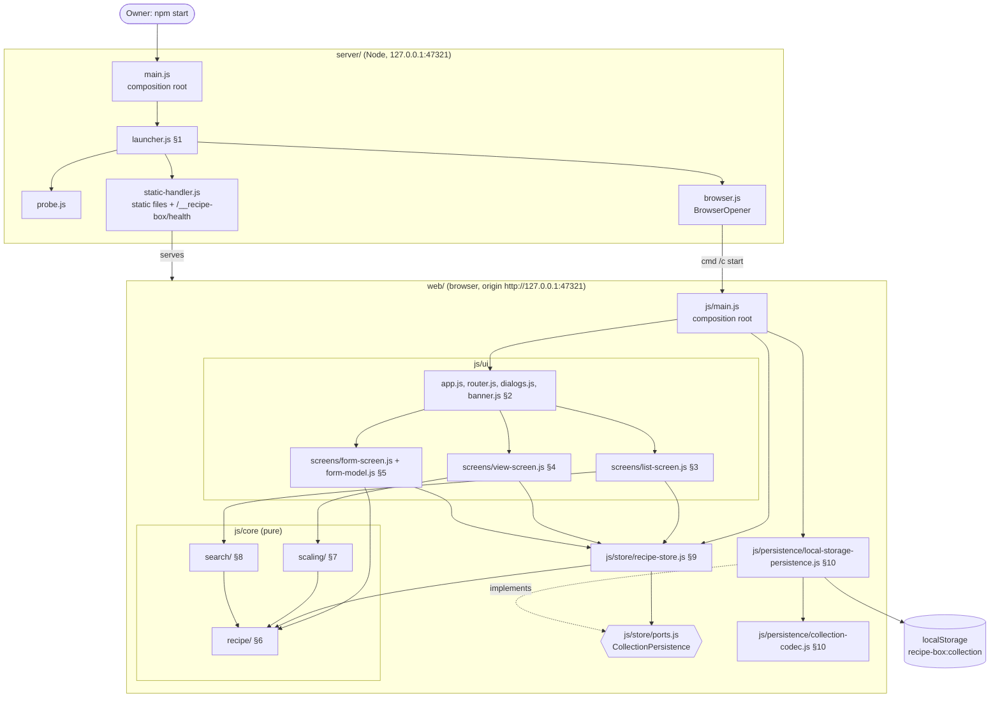
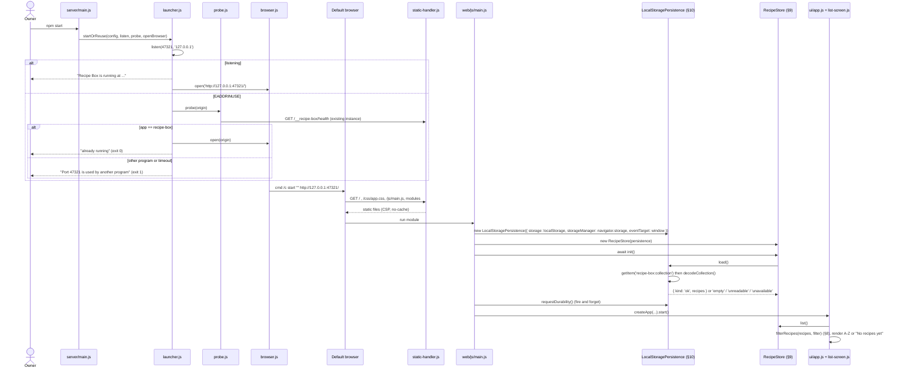
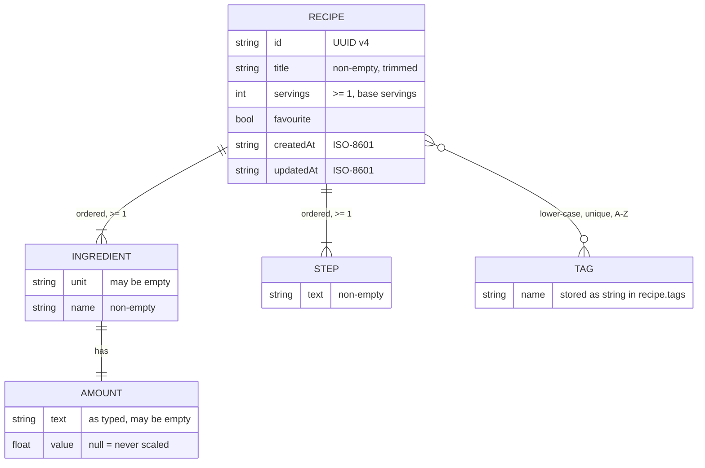
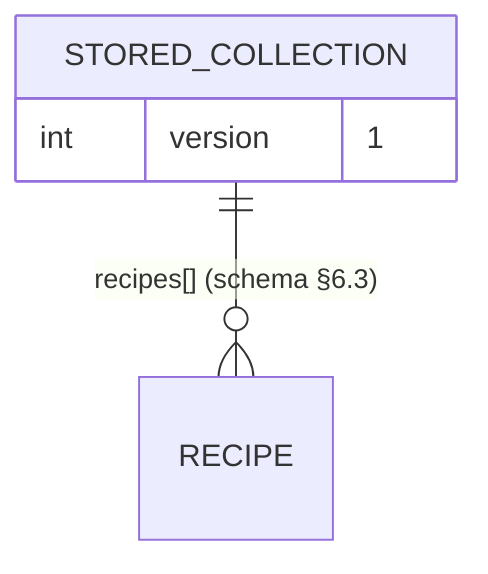

# Low-level design — Recipe Box

> Every section is numbered and self-contained, so a task can be briefed with only the
> sections it needs (e.g. `LLD §7, §6.1`). Each module section holds its responsibility,
> interfaces, contracts and schema in one place; it refers to other modules only by number.
> **Numbers are stable**: at milestone as-built syncs and change requests, update sections in
> place and give new sections new numbers. Never renumber; mark removed sections `(removed)`.
>
> Section numbers match the HLD modules: §1 = M1 … §10 = M10. §11 = dev tooling and tests.
> Written 2026-11-11 from the approved SPEC and HLD. Decisions D1–D6 are settled in §0.6;
> D1 (persistence location), D6 (stack) and the Playwright dev dependency await the owner's approval.

## §0 Overview

### §0.1 Stack
| Layer | Choice | Why | Rejected alternative |
|---|---|---|---|
| Runtime / server (M1) | Node.js ≥ 24 (owner has v24.11.0), built-in `node:http`, `node:fs`, `node:child_process`; **zero runtime npm packages** | Node is already installed; no install step needed to run the app; ~150 lines of server code; nothing to upgrade | Express/Fastify (adds deps, gains nothing for static files + 1 route) |
| UI (M2–M5) | Plain HTML + CSS + vanilla JavaScript ES modules served as-is (no build step), hash routing, native `<dialog>` | 3 screens, 2 dialogs; "one command" stays trivially true because nothing is built before start | Vite + Preact (needs `npm install` of ~100s of packages and a build before the start command; see §0.6 D6) |
| Types | JavaScript with JSDoc types, checked by `tsc --noEmit` (`checkJs`, `strict`) | Strict type checking without a build step; browser runs the same files | TypeScript sources (browser cannot run `.ts`, so a build step returns) |
| Pure logic (M6–M8) | Hand-written functions, no libraries | Rounding to ¼ is ~20 lines; `fraction.js` would still need the rounding written by hand | `fraction.js` (extra dep, does not remove code) |
| Persistence (M10) | Browser `localStorage`, one JSON document under one key, behind the `CollectionPersistence` port (§9.1) | Matches approved SPEC §6 ("inside one browser"); simplest; data volume < 1 MB vs ~5 MiB limit | (c) JSON file on disk via the local server, designed in §10.6, built only if the owner picks it (D1); IndexedDB (async complexity, no gain at this size) |
| Unit tests | `node:test` + built-in coverage (`--experimental-test-coverage` with thresholds) | Built into Node; zero install; ideal for pure ESM logic | Vitest (pulls in Vite) |
| E2E tests | `@playwright/test` driving the **installed Edge** (`channel: 'msedge'`), dev-only | Real-browser checks of SPEC §5 flows, 390 px layout, screenshots; no browser download | none / manual only (see §0.6 item P1) |
| Lint / format / layers | ESLint (flat config, core rules) + Prettier + dependency-cruiser | Enforce CONVENTIONS limits and the layer map (§0.3) | typescript-eslint (not needed: sources are JS) |

### §0.2 Folder structure
```
recipe-box/
├─ package.json                 # "type": "module", engines node >=24, scripts (§11.1), devDependencies only
├─ package-lock.json            # committed; exact dev-tool pins
├─ start.cmd                    # optional double-click shortcut: cd to repo, node server\main.js
├─ README.md                    # docs role: start command, fixed address, port problems, data-loss warning
├─ eslint.config.js             # §11.2
├─ .prettierrc.json  .prettierignore
├─ tsconfig.base.json  tsconfig.web.json  tsconfig.node.json   # §11.3
├─ .dependency-cruiser.cjs      # §11.4 (layer contracts)
├─ scripts/check.sh             # §11.5 (Git Bash)
├─ server/                      # §1 M1 Launcher (Node only)
│  ├─ main.js                   #   composition root (server side)
│  ├─ config.js  launcher.js  probe.js  browser.js  static-handler.js  log.js
├─ web/                         # everything served to the browser (static root)
│  ├─ index.html  favicon.svg
│  ├─ css/app.css               # §2 layout, 800 px breakpoint, usable at 390 px
│  └─ js/
│     ├─ main.js                # composition root (browser side)
│     ├─ core/                  # pure logic: no DOM, no storage, no I/O
│     │  ├─ recipe/             # §6 M6  types.js amount.js tags.js validation.js errors.js
│     │  ├─ scaling/            # §7 M7  fractions.js scaling.js servings.js
│     │  └─ search/             # §8 M8  search.js
│     ├─ store/                 # §9 M9  recipe-store.js ports.js errors.js
│     ├─ persistence/           # §10 M10 collection-codec.js local-storage-persistence.js
│     └─ ui/                    # §2–§5 app.js router.js dialogs.js dom.js banner.js filter-state.js form-model.js
│        └─ screens/            #        list-screen.js view-screen.js form-screen.js
└─ tests/
   ├─ helpers/                  # fake-storage.js, memory-persistence.js, recipes.fixture.js (SPEC §5 data)
   ├─ unit/                     # node:test, mirrors source: server/ core/ store/ persistence/ ui/
   └─ e2e/                      # Playwright: playwright.config.js, *.spec.js (only if P1 approved)
```

### §0.3 Layer map and module dependencies
```
Browser:   ui (§2–§5)  →  store (§9)  →  core (§6, §7, §8)
                              ↑ ports.js (interface)
           persistence (§10) ─┘ implements, may also use core/recipe types
           main.js = composition root: the ONLY file that imports persistence and touches window.localStorage
Server:    server/main.js (root) → launcher → probe, browser, static-handler, config, log
           server/ and web/ never import each other.
```
| § | Depends on (interfaces only) |
|---|---|
| §1 Launcher | none (Node built-ins) |
| §2 Shell | §3, §4, §5 (screen mount contract §2.1), §9 store |
| §3 List | §8, §9, §2 (router, dialogs, filter-state) |
| §4 View | §7, §9, §2 |
| §5 Form | §6, §9, §2 |
| §6 Model | none |
| §7 Scaling | §6 (`Amount` type) |
| §8 Search | §6 (`Recipe` type) |
| §9 Store | §6, `CollectionPersistence` port (defined in §9.1, implemented by §10) |
| §10 Persistence | §6 types, §9 `ports.js` + `errors.js` only |

Inside `core/`: `scaling/` and `search/` may import `recipe/`; `recipe/` imports nothing. Rules are enforced by §11.4.

Component diagram (source `docs/diagrams/lld-components.mmd`, copy in `.results/lld/lld-components.mmd`):


**Variation points (get an interface):** `CollectionPersistence` (§9.1; D1: localStorage now, file-on-disk alternative §10.6) and the server's `BrowserOpener` / `listen` / `probe` functions (§1.1, injected so the launcher is testable and platform-swappable). Everything else is concrete functions.

### §0.4 Packages
**Runtime: none.** Running the app needs only Node. All packages are `devDependencies` used by checks and tests.

| Package | Version (pin exact at install) | Purpose | Alternative rejected |
|---|---|---|---|
| `eslint` | 9.x latest | Lint + complexity/size limits (§11.2) | Biome (fewer complexity rules) |
| `@eslint/js` | same as eslint | Recommended rule set | — |
| `globals` | 16.x latest | Browser vs Node globals per folder | hand-written globals lists |
| `prettier` | 3.x latest | Formatting | ESLint stylistic rules |
| `typescript` | 5.9.x | `tsc --noEmit` type check of JSDoc-typed JS | no type check; TS 6/7 (JSDoc `checkJs` behaviour less proven) |
| `@types/node` | 24.x latest | Node API types for `server/` and tests | — |
| `dependency-cruiser` | 17.x latest | Layer contracts (§11.4), no runtime npm imports | eslint `no-restricted-imports` (no cycle detection) |
| `@playwright/test` | 1.59.x (avoid 1.60, reported compat issue) | E2E in installed Edge, 390 px checks, screenshots — **only if P1 approved** | Puppeteer (no test runner); manual checks only |

Version caveat: these majors are from the research and general knowledge, not verified with `npm view` in this session. Whoever runs `npm install` pins the latest patch inside the listed major with `--save-exact`; the as-built sync records the exact versions. Copy of this table: `.results/lld/packages.md`.

### §0.5 Config and secrets
No secrets, no `.env` needed. Environment variables (documented in README, all optional):

| Var | Default | Used by | Notes |
|---|---|---|---|
| `RECIPE_BOX_PORT` | `47321` | §1 `loadConfig` | Integer 1024–65535. **Changing it shows a different, empty recipe box** (browser storage is per address); README warns. Tests use other ports so they never touch real data. |
| `RECIPE_BOX_NO_OPEN` | unset | §1 | `1` = do not open a browser (tests, Playwright). |

Host is not configurable: always `127.0.0.1`. Browser-side constants live in `web/js/persistence/collection-codec.js` (`STORAGE_KEY`, `SCHEMA_VERSION`).

### §0.6 Decisions D1–D6 (settled here; Tier 1 items await the owner)
| # | Decision | Chosen | Status |
|---|---|---|---|
| D1 | Where data persists | (a) `localStorage` at `http://127.0.0.1:47321`, behind `CollectionPersistence`; (c) file on disk designed in §10.6 | **Owner choice** |
| D2 | Fixed address and port conflict | `http://127.0.0.1:47321/`, bind `127.0.0.1` only; port taken → clear message, exit 1, never switch port | proposed (obvious) |
| D3 | Launcher behaviour | `npm start` → `node server/main.js`; already-running = probe `GET /__recipe-box/health` on `EADDRINUSE`; browser via `cmd /c start "" <url>`; one-time setup = clone the repo (no install to run); Ctrl+C / closing window stops it | proposed (obvious) |
| D4 | Amount representation | `{ text, value }`: typed text kept verbatim and shown at base servings; `value` number or `null`; ¼ rounding hand-written | proposed (obvious) |
| D5 | Storage format/versioning | `{ "version": 1, "recipes": [...] }` under key `recipe-box:collection`; unreadable/unknown version → read-only mode with banner, never written | proposed (obvious) |
| D6 | Stack | Node built-in http + vanilla ES modules + JSDoc/tsc, no build | **Owner choice** (alternative: Vite + Preact) |
| P1 | E2E dev dependency | `@playwright/test` using installed Edge | **Owner choice** |

---

## §1 M1 Launcher
- **Responsibility:** The one start command: serve `web/` on `http://127.0.0.1:47321/` (loopback only), open the default browser there, detect an already-running instance and reuse it, report port problems clearly.
- **Path(s):** `server/*.js`, `start.cmd`, `package.json` `"start"` script
- **Depends on:** none (Node built-ins only). Never imports `web/`.

### §1.1 Interfaces / signatures
```js
// server/config.js
/** @typedef {{ host: '127.0.0.1', port: number, origin: string, webRoot: string,
 *   openBrowser: boolean, appId: 'recipe-box', version: string }} Config */
/** @param {NodeJS.ProcessEnv} env @returns {Config} @throws {ConfigError} bad RECIPE_BOX_PORT */
export function loadConfig(env) {}
export class ConfigError extends Error {}

// server/static-handler.js
/** @param {{ webRoot: string, identity: { app: string, version: string }, allowedHosts: string[] }} opts
 *  @returns {(req: import('node:http').IncomingMessage, res: import('node:http').ServerResponse) => void} */
export function createRequestHandler(opts) {}
export const HEALTH_PATH = '/__recipe-box/health';
/** @param {string} ext @returns {string | undefined} */ export function contentTypeFor(ext) {}

// server/probe.js
/** @typedef {'ours' | 'other' | 'none'} ProbeResult */
/** @param {string} origin @param {{ appId: string, timeoutMs?: number }} opts @returns {Promise<ProbeResult>} */
export function probeExistingInstance(origin, opts) {}   // timeoutMs default 1500

// server/browser.js
/** @typedef {(url: string) => void} BrowserOpener */
/** @param {{ platform: NodeJS.Platform, spawn: typeof import('node:child_process').spawn }} deps @returns {BrowserOpener} */
export function createBrowserOpener(deps) {}

// server/launcher.js
/** @typedef {'started' | 'already-running' | 'port-conflict' | 'port-forbidden'} LaunchOutcome */
/** @typedef {{ config: Config,
 *   listen: (port: number, host: string) => Promise<import('node:http').Server>,
 *   probe: (origin: string) => Promise<ProbeResult>,
 *   openBrowser: BrowserOpener, log: Logger }} LauncherDeps */
/** @param {LauncherDeps} deps @returns {Promise<{ outcome: LaunchOutcome, server?: import('node:http').Server }>} */
export async function startOrReuse(deps) {}
/** @param {LaunchOutcome} outcome @returns {0 | 1 | null} null = keep running */
export function exitCodeFor(outcome) {}

// server/log.js  (the only server file allowed to call console)
/** @typedef {{ info(msg: string): void, error(msg: string, fields?: Record<string, unknown>): void }} Logger */
export function createLogger(stream = process) {}

// server/main.js — composition root: loadConfig(process.env) → createRequestHandler → startOrReuse
//   → on 'started': keep running, SIGINT/SIGTERM → server.close() → exit 0; else process.exitCode = exitCodeFor(outcome)
```

### §1.2 Contracts
| Method | Path | Request | Response | Errors |
|---|---|---|---|---|
| GET | `/__recipe-box/health` | — | `200 application/json` `{"app":"recipe-box","version":"<package.json version>"}` | — |
| GET/HEAD | `/` | — | `200` `web/index.html` | — |
| GET/HEAD | `/<path>` (e.g. `/js/main.js`, `/css/app.css`, `/favicon.svg`) | — | `200` file from `web/` with MIME from `contentTypeFor` (`.html` `text/html; charset=utf-8`, `.js` `text/javascript; charset=utf-8`, `.css` `text/css; charset=utf-8`, `.svg` `image/svg+xml`, `.json` `application/json`) | `404 text/plain "Not found"` (missing, directory, unknown extension, path outside `web/` after `path.resolve`, any `..` or `%00`) |
| other methods | any | — | — | `405` with `Allow: GET, HEAD` |
| any | any, `Host` not in `127.0.0.1:<port>` / `localhost:<port>` | — | — | `403 "Forbidden host"` (DNS-rebinding guard) |

Headers on every response: `Cache-Control: no-cache`, `X-Content-Type-Options: nosniff`, `Referrer-Policy: no-referrer`,
`Content-Security-Policy: default-src 'self'; script-src 'self'; style-src 'self'; img-src 'self' data:; object-src 'none'; base-uri 'none'; frame-ancestors 'none'; form-action 'self'` (also guarantees no network dependency: offline).

Console messages (ASCII only; exact text, tested):
| Outcome | Message | Exit |
|---|---|---|
| started | `Recipe Box is running at http://127.0.0.1:47321/ - opening your browser. Close this window to stop it.` | keeps running |
| already-running | `Recipe Box is already running at http://127.0.0.1:47321/ - opened it in your browser.` | 0 |
| port-conflict | `Port 47321 is used by another program, so Recipe Box cannot start. Close that program and run the command again (see README "Port problems").` | 1 |
| port-forbidden (`EACCES`, Windows reserved range) | `Windows does not allow Recipe Box to use port 47321 (reserved port range). See README "Port problems".` | 1 |
| bad `RECIPE_BOX_PORT` | `RECIPE_BOX_PORT must be a whole number between 1024 and 65535.` | 1 |

### §1.4 Key sequence (start → open → load recipes)
Source: `docs/diagrams/lld-sequence.mmd` (copy in `.results/lld/lld-sequence.mmd`).


### §1.5 Errors and edge cases
- `listen` rejects with `EADDRINUSE` → probe. Probe outcomes: `ours` → open + exit 0; `other` (non-200, wrong JSON, timeout 1500 ms) → port-conflict; `none` (`ECONNREFUSED`: the other instance exited meanwhile) → retry `listen` once, then port-conflict.
- `EACCES` on listen → port-forbidden. README explains `netsh interface ipv4 show excludedportrange protocol=tcp`; milestone 1 verifies 47321 is free on the owner's machine.
- Browser opened only after `listening` fires (or after a positive probe). `RECIPE_BOX_NO_OPEN=1` skips it. Non-Windows platforms: `open` (darwin) / `xdg-open` (linux) for completeness; the URL is always printed so the owner can click it if opening fails; spawn errors are logged, never fatal.
- `createBrowserOpener` on win32: `spawn('cmd', ['/c', 'start', '""', url], { windowsVerbatimArguments: true, detached: true, stdio: 'ignore' }).unref()`. The URL is built only from config (no user input; contains no `&`).
- Closing the console window or Ctrl+C ends the process; no state to clean up (no pid/lock file).
- Server never writes files (option a). Static root is resolved once at start; symlinks are not followed outside `web/`.
- `start.cmd`: `@echo off` / `cd /d "%~dp0"` / `node server\main.js` / `if errorlevel 1 pause` (keeps error messages visible on double-click).

---

## §2 M2 App shell and navigation
- **Responsibility:** Bootstraps the UI, routes between screens, owns shared dialogs, the store-status banner, the unsaved-changes guard and the responsive layout.
- **Path(s):** `web/index.html`, `web/css/app.css`, `web/js/main.js`, `web/js/ui/{app,router,dialogs,dom,banner,filter-state}.js`
- **Depends on:** §3, §4, §5 (screen contract §2.1), §9 (`RecipeStore`). `main.js` additionally constructs §10.

### §2.1 Interfaces / signatures
```js
// web/js/ui/router.js
/** @typedef {{ name: 'list' } | { name: 'view', id: string } | { name: 'new' }
 *   | { name: 'edit', id: string } | { name: 'notFound' }} Route */
/** @param {string} hash e.g. '#/recipe/abc/edit' @returns {Route} */ export function parseRoute(hash) {}
/** @param {Route} route @returns {string} */                        export function routeToHash(route) {}
/** @param {{ window: Window, onRoute: (r: Route) => void, canLeave: () => Promise<boolean> }} deps */
export function createRouter(deps) {}  // → { start(): void, navigate(r: Route, opts?: { replace?: boolean }): void }

// Screen contract (every file in ui/screens/ exports one mount function of this shape)
/** @typedef {{ store: import('../store/recipe-store.js').RecipeStore, router: Router,
 *   dialogs: Dialogs, banner: Banner, filterState: FilterState }} ScreenContext */
/** @typedef {{ unmount(): void, canLeave?(): Promise<boolean> }} ScreenHandle */
/** @typedef {(container: HTMLElement, ctx: ScreenContext, route: Route) => ScreenHandle} MountScreen */

// web/js/ui/dialogs.js — native <dialog id="confirm-dialog"> in index.html
/** @param {{ message: string, confirmLabel: string, cancelLabel: string }} opts @returns {Promise<boolean>} */
export function confirmDialog(opts) {}  // Esc / backdrop = cancel; focus starts on the cancel button

// web/js/ui/banner.js
export function createBanner(el) {}  // → { show(kind: 'error' | 'info', message: string): void, clear(): void }

// web/js/ui/filter-state.js — survives list → view → list while the tab is open (not persisted)
/** @typedef {{ query: string, tag: string | null, favouritesOnly: boolean }} RecipeFilter */
export function createFilterState() {}  // → { get(): RecipeFilter, set(patch: Partial<RecipeFilter>): void, reset(): void }

// web/js/ui/dom.js
/** @param {string} tag @param {Record<string, unknown>} [attrs] @param {...(Node|string|null|false)} children */
export function h(tag, attrs, ...children) {}  // sets textContent only, never innerHTML
export function clear(el) {}

// web/js/ui/app.js
/** @param {{ root: HTMLElement, store: RecipeStore, window: Window }} deps */
export function createApp(deps) {}  // → { start(): void } builds router, dialogs, banner, filterState; mounts screens

// web/js/main.js — composition root (≤ 30 lines): new LocalStoragePersistence(...) → new RecipeStore(...)
//   → await store.init() → persistence.requestDurability() → createApp(...).start()
```

### §2.4 Key sequence — leaving the form with unsaved changes
1. Hash changes (back button, header link). Router calls `canLeave()` → current screen's `canLeave()`.
2. Form is dirty → `confirmDialog({ message: 'Discard changes?', confirmLabel: 'Discard', cancelLabel: 'Keep editing' })`.
3. Keep editing → router restores the previous hash with `history.replaceState` (no second `hashchange`), screen stays mounted. Discard → old screen `unmount()`, new screen mounts.
4. While the form is dirty, a `beforeunload` listener triggers the browser's native leave prompt (closing the tab).

### §2.5 Errors and edge cases
- Routes: `#/` or empty → list; `#/recipe/<id>` → view; `#/recipe/<id>/edit` → edit; `#/new` → add; anything else → `notFound` screen ("Page not found" + "All recipes" link).
- After a successful save or delete, navigate with `{ replace: true }` so Back does not return to the form/deleted recipe.
- Store status banner (shown on every screen, `role="alert"`):
  - `unreadable`: "Your saved recipes could not be read, so Recipe Box will not change them. Nothing has been deleted." All write controls disabled (Add, star, Edit, Delete, Save).
  - `unavailable`: "This browser is blocking storage for Recipe Box, so recipes cannot be loaded or saved." Same disabling.
  - write failure (§9.5): "Could not save: <reason>. Your last change was not stored." (info persists until next success).
- Unhandled promise rejections in UI → `banner.show('error', 'Something went wrong. Reload the page to continue.')` and `console.error` (the only console call in web code, in `app.js`).
- Layout (`app.css`): mobile-first single column; `@media (min-width: 800px)` → filters sidebar 280 px on list, two-column ingredients/steps on view and form, page max-width 1100 px (matches wireframes). At 390 px nothing overflows horizontally; tap targets ≥ 40 px.
- Accessibility: header `<h1>` per screen, buttons are `<button>`, star is `<button aria-pressed>` with `aria-label`.
- Test ids (stable, for §11 e2e): `add-recipe`, `banner`, `confirm-dialog`, `confirm-ok`, `confirm-cancel`, `back-to-list`.

---

## §3 M3 Recipe list screen
- **Responsibility:** Render the filtered A–Z recipe list with search, tag filter, favourites-only, counts, empty and no-match states.
- **Path(s):** `web/js/ui/screens/list-screen.js`
- **Depends on:** §8 (`filterRecipes`, `listTags`, `hasActiveFilters`), §9 (`list`, `toggleFavourite`, `subscribe`, `status`), §2 (screen contract, filter-state, router).

### §3.1 Interfaces / signatures
```js
/** @type {import('../router.js').MountScreen} */
export function mountListScreen(container, ctx, route) {}
```
Internal structure: the filter panel (search input, tag `<select>`, favourites checkbox) is rendered **once** per mount; only the results region (`count` + rows / state) re-renders on input or store change, so the search box keeps focus and caret while typing.

### §3.4 Behaviour
| Trigger | Effect |
|---|---|
| mount | read `filterState.get()` into controls; render results |
| search `input` event | `filterState.set({ query })`; re-render results (no debounce: a few hundred items) |
| tag `<select>` change | options = "All tags" + `listTags(store.list())`; value `''` = all → `tag: null` |
| favourites checkbox | `favouritesOnly` |
| star click | `store.toggleFavourite(id)`; row re-renders via `subscribe` |
| row title click | `<a href="#/recipe/<id>">` |
| "Clear filters" | `filterState.reset()`, controls reset, focus search box |
| store change | re-render results; if selected tag no longer exists in `listTags`, reset tag to all |

States (exact texts): count line `"1 recipe"` / `"N recipes"` (count of shown rows); `store.list().length === 0` → "No recipes yet" + button "Add your first recipe" (`#/new`); else 0 matches → "No recipes match your search" + button "Clear filters". Row: title, tag chips in stored order (A–Z), star `★` (favourite, `aria-label="Remove from favourites"`) / `☆` (`aria-label="Mark as favourite"`).

Test ids: `search-input`, `tag-filter`, `favourites-only`, `recipe-count`, `recipe-row` (with `data-recipe-id`), `recipe-row-title`, `favourite-toggle`, `empty-state`, `add-first-recipe`, `no-match-state`, `clear-filters`.

### §3.5 Errors and edge cases
- Read-only store status → stars and add buttons disabled (`disabled` attribute), list still readable.
- `toggleFavourite` rejection → banner (§2.5), star stays in the stored state.

---

## §4 M4 Recipe view screen
- **Responsibility:** Show one recipe with a view-only servings control and scaled amounts; favourite, edit and delete actions.
- **Path(s):** `web/js/ui/screens/view-screen.js`
- **Depends on:** §7 (`formatIngredientLine`, `parseServingsInput`, `stepServings`), §9 (`get`, `toggleFavourite`, `remove`, `subscribe`), §2 (dialogs, router).

### §4.1 Interfaces / signatures
```js
/** @type {import('../router.js').MountScreen} */
export function mountViewScreen(container, ctx, route) {}  // route.name === 'view'
```
Screen-local state: `servings` (starts at `recipe.servings`, never saved; a new mount always starts at base).

### §4.4 Behaviour
| Trigger | Effect |
|---|---|
| `−` / `+` | `servings = stepServings(servings, ∓1)`; `−` disabled when `servings === 1` |
| typing in servings input (`input` event) | `next = parseServingsInput(text, servings)`; if valid, apply immediately; invalid/empty → keep previous applied value |
| servings input `blur` / Enter | input text reset to the applied `servings` |
| "Reset (N)" link | `servings = recipe.servings`; link + note "Recipe saved for N servings; scaling is not saved." shown only while `servings !== recipe.servings` |
| ingredients | `<ul>`; each `formatIngredientLine(ing, recipe.servings, servings)` → bold amount+unit span, then name |
| steps | `<ol>` in stored order |
| star | `store.toggleFavourite(id)` |
| Edit | `navigate({ name: 'edit', id })` |
| Delete | `confirmDialog({ message: "Delete '<title>'? Are you sure?", confirmLabel: 'Delete', cancelLabel: 'Cancel' })` → true: `await store.remove(id)`, `navigate({ name: 'list' }, { replace: true })`; false: nothing |
| store change | re-read `store.get(id)`; if gone (other tab deleted it) → not-found state |

Test ids: `recipe-title`, `recipe-tags`, `servings-input`, `servings-dec`, `servings-inc`, `servings-reset`, `ingredient-line`, `ingredient-amount`, `step-line`, `favourite-toggle`, `edit-recipe`, `delete-recipe`, `not-found`.

### §4.5 Errors and edge cases
- Unknown id → "Recipe not found" + "All recipes" link (no crash).
- Read-only store → star, Edit, Delete disabled; scaling still works.
- `remove` rejection → banner, stay on view.

---

## §5 M5 Recipe form screen
- **Responsibility:** Add and edit a recipe: editable draft, row operations, inline validation, save, cancel with discard guard.
- **Path(s):** `web/js/ui/screens/form-screen.js` (DOM), `web/js/ui/form-model.js` (pure draft operations, unit-tested)
- **Depends on:** §6 (`validateDraft`, `normaliseTag`, `RecipeDraft`), §9 (`get`, `create`, `update`), §2 (dialogs, router, `canLeave`).

### §5.1 Interfaces / signatures
```js
// web/js/ui/form-model.js — pure, immutable (every function returns a new draft)
/** @returns {RecipeDraft} title '', servings '', 1 empty ingredient row, 1 empty step row, tags [] */
export function emptyDraft() {}
/** @param {Recipe} r @returns {RecipeDraft} amount text = r.ingredients[i].amount.text; servings = String(r.servings) */
export function draftFromRecipe(r) {}
export function addIngredientRow(d) {}            /** removeIngredientRow(d, i): removing the last row leaves one empty row */
export function removeIngredientRow(d, i) {}
/** @param {'amount'|'unit'|'name'} field */ export function setIngredientField(d, i, field, value) {}
export function addStepRow(d) {}
export function removeStepRow(d, i) {}            // last row → one empty row
/** @param {-1 | 1} dir no-op at the ends */       export function moveStep(d, i, dir) {}
export function setStep(d, i, text) {}
/** @param {string} raw adds normaliseTag(raw) if non-empty and not present */ export function addTag(d, raw) {}
export function removeTag(d, tag) {}
/** deep-equal of the two drafts (after trimming) */ export function isDirty(initial, current) {}

// web/js/ui/screens/form-screen.js
/** @type {import('../router.js').MountScreen} */
export function mountFormScreen(container, ctx, route) {}  // route.name 'new' | 'edit'
```

### §5.4 Behaviour
- Header: "Add recipe" / "Edit recipe". Edit of unknown id → not-found state.
- Tags input: Enter or comma adds a chip (`addTag`); chip ✕ removes; on Save any pending text in the tag box is added first. Help text "Tags are saved in lower case."
- Ingredient help text: "Amount: 2, 0.5, ½ or 1½. Leave empty for "a pinch", "to taste" (never scaled)."
- Save: `result = validateDraft(draft)` (§6). Errors → render each message under its field (texts in §6.2), mark inputs `aria-invalid`, focus the first invalid field; nothing saved. Valid → `create(result.value)` → `navigate({ name: 'view', id }, { replace: true })`; edit → `update(id, result.value)` → same.
- Cancel / any navigation away: `canLeave()` = `!isDirty(initial, draft)` or `confirmDialog({ message: 'Discard changes?', confirmLabel: 'Discard', cancelLabel: 'Keep editing' })`. Cancel target: edit → view of that recipe; add → list.
- Re-render strategy: re-render the affected section (ingredients / steps / tags) on row operations; keep focus on the row's input after add/move.

Test ids: `title-input`, `servings-input`, `ingredient-row`, `ingredient-amount-input`, `ingredient-unit-input`, `ingredient-name-input`, `remove-ingredient`, `add-ingredient`, `step-row`, `step-input`, `step-up`, `step-down`, `remove-step`, `add-step`, `tag-input`, `tag-chip`, `remove-tag`, `save-recipe`, `cancel-edit`, `error-title`, `error-servings`, `error-ingredients`, `error-steps`, `error-ingredient-row`.

### §5.5 Errors and edge cases
- Save rejected by the store (`StoreReadOnlyError`, `PersistenceWriteError`, `RecipeNotFoundError` when another tab deleted the recipe) → banner with the reason, form stays dirty and open.
- Double-click on Save: button disabled while the save promise is pending.

---

## §6 M6 Recipe model and validation
- **Responsibility:** The recipe types, amount parsing, tag normalising and draft validation. Pure functions, no DOM/storage.
- **Path(s):** `web/js/core/recipe/{types,amount,tags,validation,errors}.js`
- **Depends on:** none.

### §6.1 Interfaces / signatures
```js
// types.js (JSDoc typedefs only)
/** @typedef {{ text: string, value: number | null }} Amount
 *  text = exactly as typed (trimmed); value = parsed number, null = never scaled */
/** @typedef {{ amount: Amount, unit: string, name: string }} Ingredient */
/** @typedef {{ id: string, title: string, servings: number, ingredients: Ingredient[], steps: string[],
 *   tags: string[], favourite: boolean, createdAt: string, updatedAt: string }} Recipe   // ISO-8601 timestamps */
/** @typedef {Pick<Recipe, 'title' | 'servings' | 'ingredients' | 'steps' | 'tags'>} RecipeInput */
/** @typedef {{ amount: string, unit: string, name: string }} IngredientDraft */
/** @typedef {{ title: string, servings: string, ingredients: IngredientDraft[], steps: string[], tags: string[] }} RecipeDraft */
/** @typedef {{ title?: string, servings?: string, ingredients?: string, steps?: string,
 *   ingredientRows?: Record<number, string> }} FieldErrors */
/** @typedef {{ ok: true, value: RecipeInput } | { ok: false, errors: FieldErrors }} ValidationResult */

// amount.js
/** @param {string} text @returns {Amount} */ export function parseAmount(text) {}
export const UNICODE_FRACTIONS = { '¼': 0.25, '½': 0.5, '¾': 0.75, '⅓': 1/3, '⅔': 2/3, '⅛': 0.125, '⅜': 0.375, '⅝': 0.625, '⅞': 0.875 };

// tags.js
/** trim, lower-case (toLocaleLowerCase), collapse inner whitespace to one space */ export function normaliseTag(raw) {}
/** normalise, drop empty, de-duplicate, sort A–Z @returns {string[]} */          export function normaliseTags(list) {}

// validation.js
export const MESSAGES = Object.freeze({
  titleRequired: 'Title is required', servingsMin: 'Servings must be 1 or more',
  ingredientsMin: 'Add at least one ingredient', stepsMin: 'Add at least one step',
  ingredientName: 'Enter the ingredient name' });
/** @param {RecipeDraft} draft @returns {ValidationResult} */ export function validateDraft(draft) {}
/** structural check of a normalised input (used by §9) @throws {ValidationError} */ export function assertRecipeInput(input) {}

// errors.js
export class ValidationError extends Error { /** @param {FieldErrors} fieldErrors */ constructor(fieldErrors) {} }
```

### §6.2 Rules (contract for `parseAmount` / `validateDraft`)
`parseAmount(text)` after trim (empty → `{ text: '', value: null }`):
| Input form | Example | value |
|---|---|---|
| integer | `2`, `300` | 2, 300 |
| decimal (dot) | `0.5`, `.5`, `1.25` | 0.5, 0.5, 1.25 |
| unicode fraction, optionally after a whole number (optional space) | `½`, `1½`, `1 ½` | 0.5, 1.5, 1.5 |
| slash fraction, optionally after a whole number | `1/2`, `1 1/2` | 0.5, 1.5 |
| anything else, or denominator 0 | `a pinch`, `2-3`, `1/0` | `null` (kept as text, never scaled) |

`validateDraft(draft)`:
1. `title = draft.title.trim()`; empty → `titleRequired`. Duplicate titles allowed.
2. `servings` must match `^\d+$` after trim and be ≥ 1 → else `servingsMin`.
3. Ingredient rows: trim all fields; rows with all three empty are dropped. Remaining row with empty name → `ingredientRows[i] = ingredientName` (index in the original draft). After dropping, 0 rows → `ingredients = ingredientsMin`. Each kept row → `{ amount: parseAmount(amount), unit, name }`.
4. Steps: trim, drop empty; 0 left → `stepsMin`. Order kept.
5. Tags → `normaliseTags` (so `Breakfast`, `sweet ` → `breakfast`, `sweet`).
6. Any error → `{ ok: false, errors }` (all errors reported at once); else `{ ok: true, value }`.

### §6.3 Data / schema owned


### §6.5 Errors and edge cases
- `value` 0 (typed `0`) is valid and scales to `0` (§7).
- Comma decimals (`0,5`) are not parsed → `null` (shown as typed, not scaled). Can be added later without a data change.

---

## §7 M7 Scaling and kitchen fractions
- **Responsibility:** Turn an amount, base servings and target servings into the displayed text; servings-input parsing. Pure.
- **Path(s):** `web/js/core/scaling/{fractions,scaling,servings}.js`
- **Depends on:** §6 (`Amount`, `Ingredient` types).

### §7.1 Interfaces / signatures
```js
// fractions.js
/** nearest 0.25, exact halfway rounds up, value > 0 never returns 0 (min 0.25)
 *  q = Math.floor(x * 4 + 0.5 + 1e-9) / 4; if (x > 0 && q === 0) q = 0.25 */
export function roundToQuarter(x) {}
/** whole part + glyph: 0.25 → '¼', 1.5 → '1½', 62.5 → '62½', 3 → '3', 0 → '0' */
export function formatQuarter(q) {}

// scaling.js
/** @param {Amount} amount @param {number} base @param {number} target @returns {string}
 *  value null → amount.text; target === base → amount.text (as typed);
 *  else formatQuarter(roundToQuarter(value * target / base)) */
export function scaleAmount(amount, base, target) {}
/** @returns {{ amount: string, name: string }} amount = scaled amount + (unit ? ' ' + unit : ''), '' when no amount and no unit */
export function formatIngredientLine(ingredient, base, target) {}

// servings.js
export const MIN_SERVINGS = 1;
/** @param {string} raw @param {number} previous @returns {number} whole number ≥ 1, else previous */
export function parseServingsInput(raw, previous) {}
/** @returns {number} max(MIN_SERVINGS, current + delta) */
export function stepServings(current, delta) {}
```
Compute `value * target / base` with multiplication first (all SPEC examples are binary-exact); the `1e-9` nudge makes near-halfway float results (e.g. 0.37499999) round up as specified.

### §7.2 Contract examples (each is a unit test)
| Recipe | base → target | Expected display |
|---|---|---|
| Pancakes: 200 g flour, 2 eggs, 300 ml milk, (none) a pinch of salt | 4 → 6 | `300 g`, `3`, `450 ml`, salt unchanged |
| same | 4 → 3 | `150 g`, `1½`, `225 ml` |
| same | 4 → 1 | `50 g`, `½`, `75 ml` |
| same | 4 → 4 | as typed (`200 g`, `2`, `300 ml`) |
| Banana Bread: 3 bananas, 1 tsp baking soda, 250 g flour | 8 → 2 | `¾`, `¼ tsp`, `62½ g` |
| same | 8 → 1 | `½` (0.375 rounds up), `¼ tsp` (0.125 → never 0), `31¼ g` |
| typed `1 1/2` cup | 2 → 2 | `1 1/2 cup` (as typed) |
| typed `½` | 1 → 3 | `1½` |
| `parseServingsInput` | `'0'`, `''`, `'abc'`, `'2.5'`, `'-1'` with previous 3 | 3 |
| `parseServingsInput` | `' 6 '` | 6 |

---

## §8 M8 Search and filter
- **Responsibility:** Combine title search, one tag and favourites-only; sort A–Z; list available tags. Pure.
- **Path(s):** `web/js/core/search/search.js`
- **Depends on:** §6 (`Recipe` type).

### §8.1 Interfaces / signatures
```js
/** @typedef {{ query: string, tag: string | null, favouritesOnly: boolean }} RecipeFilter */
/** all conditions must match; result sorted by sortByTitle @returns {Recipe[]} (new array) */
export function filterRecipes(recipes, filter) {}
/** localeCompare(a.title, b.title, undefined, { sensitivity: 'base' }), ties by createdAt then id */
export function sortByTitle(recipes) {}
/** union of all tags, unique, A–Z */ export function listTags(recipes) {}
/** query.trim() !== '' || tag !== null || favouritesOnly */ export function hasActiveFilters(filter) {}
```
Matching: `title.toLocaleLowerCase().includes(query.trim().toLocaleLowerCase())`; empty query matches all; `tag` exact match against `recipe.tags`.

### §8.2 Contract examples (unit tests, SPEC §5 F-2 data)
| Filter | Result |
|---|---|
| none | Banana Bread, Pancakes, Tomato Soup |
| query `b` | Banana Bread |
| query `PAN` | Pancakes |
| tag `breakfast` | Banana Bread, Pancakes |
| query `xyz` | [] |
| favouritesOnly (Banana Bread starred) | Banana Bread |
| tag `breakfast` + query `pan` + favouritesOnly | [] |

---

## §9 M9 Recipe store
- **Responsibility:** The single gateway to recipe data: in-memory collection, CRUD, favourite toggle, IDs and timestamps, change notification; persists every change through the `CollectionPersistence` port before committing it.
- **Path(s):** `web/js/store/{recipe-store,ports,errors}.js`
- **Depends on:** §6 (`assertRecipeInput`, types), `CollectionPersistence` (§9.1, implemented by §10).

### §9.1 Interfaces / signatures
```js
// ports.js — the D1 variation point
/** @typedef {{ kind: 'ok', recipes: Recipe[] } | { kind: 'empty' }
 *   | { kind: 'unreadable', reason: string } | { kind: 'unavailable', reason: string }} LoadResult */
/** @typedef {{
 *   load(): Promise<LoadResult>,
 *   save(recipes: readonly Recipe[]): Promise<void>,          // rejects with PersistenceWriteError
 *   watch(onExternalChange: () => void): () => void,         // returns unsubscribe; may be a no-op
 *   requestDurability(): Promise<boolean>                    // best effort
 * }} CollectionPersistence */

// errors.js
export class RecipeNotFoundError extends Error {}   // .id
export class StoreReadOnlyError extends Error {}    // .status: 'unreadable' | 'unavailable' | 'loading'
export class PersistenceWriteError extends Error {} // .reason: 'quota' | 'unavailable' | 'io'

// recipe-store.js
/** @typedef {'loading' | 'ready' | 'unreadable' | 'unavailable'} StoreStatus */
export class RecipeStore {
  /** @param {CollectionPersistence} persistence
   *  @param {{ newId?: () => string, now?: () => string }} [deps] defaults crypto.randomUUID, new Date().toISOString() */
  constructor(persistence, deps) {}
  /** loads once, sets status, starts watch() @returns {Promise<StoreStatus>} */ async init() {}
  /** @returns {StoreStatus} */ get status() {}
  /** @returns {string | null} reason for unreadable/unavailable */ get statusReason() {}
  /** @returns {readonly Recipe[]} frozen snapshot, insertion order */ list() {}
  /** @returns {Recipe | undefined} */ get(id) {}
  /** @param {RecipeInput} input @returns {Promise<Recipe>} favourite false, new id, createdAt = updatedAt = now */ async create(input) {}
  /** keeps id, favourite, createdAt; sets updatedAt @throws RecipeNotFoundError */ async update(id, input) {}
  /** @throws RecipeNotFoundError */ async remove(id) {}
  /** flips favourite, sets updatedAt @returns {Promise<Recipe>} */ async toggleFavourite(id) {}
  /** @param {() => void} listener @returns {() => void} unsubscribe */ subscribe(listener) {}
  /** re-load after another tab changed storage; notifies */ async reload() {}
}
```

### §9.4 Key sequence (every write)
1. Guard: `status !== 'ready'` → reject `StoreReadOnlyError`. `create`/`update` call `assertRecipeInput` → `ValidationError`.
2. Writes are serialised on an internal promise chain (one at a time).
3. Build the next array (new frozen objects), `await persistence.save(next)`.
4. Success → replace the in-memory array, notify subscribers, resolve with the recipe. Failure → in-memory state unchanged, reject with the `PersistenceWriteError`.

### §9.5 Errors and edge cases
- `init()` result mapping: `ok` → `ready` with recipes; `empty` → `ready` with `[]` (nothing written until the first change); `unreadable` / `unavailable` → that status, `list()` returns `[]`, all writes rejected.
- Cross-tab: `watch` callback → `reload()`; if the reload yields `unreadable`, switch to read-only. Last write wins between tabs (acceptable for one user).
- Returned recipes are deep-frozen; UI never mutates them.

---

## §10 M10 Local persistence
- **Responsibility:** Durable storage of the recipe collection; encoding, versioning, and refusing to touch unreadable data. Implements `CollectionPersistence` (§9.1).
- **Path(s):** `web/js/persistence/collection-codec.js`, `web/js/persistence/local-storage-persistence.js`
- **Depends on:** §6 types, §9 `ports.js` + `errors.js`.

### §10.1 Interfaces / signatures
```js
// collection-codec.js — pure, shared by any CollectionPersistence implementation
export const STORAGE_KEY = 'recipe-box:collection';
export const SCHEMA_VERSION = 1;
/** @param {readonly Recipe[]} recipes @returns {string} JSON.stringify({ version: 1, recipes }) */
export function encodeCollection(recipes) {}
/** @param {string | null} raw @returns {import('../store/ports.js').LoadResult}
 *  null → empty; JSON parse error → unreadable 'not JSON'; version missing/≠ 1 → unreadable 'unknown version N';
 *  any recipe failing the shape check (§6.3 types, servings int ≥ 1, ≥ 1 ingredient/step) → unreadable 'invalid recipe at index i' */
export function decodeCollection(raw) {}

// local-storage-persistence.js
/** @implements {CollectionPersistence} */
export class LocalStoragePersistence {
  /** @param {{ storage: Storage, storageManager?: StorageManager, eventTarget?: EventTarget }} deps
   *  injected by web/js/main.js (window.localStorage, navigator.storage, window); tests pass fakes */
  constructor(deps) {}
  async load() {}        // getItem(STORAGE_KEY) → decodeCollection; any thrown error (SecurityError) → unavailable
  async save(recipes) {} // setItem(STORAGE_KEY, encodeCollection(recipes)); QuotaExceededError → PersistenceWriteError('quota'); other → ('unavailable')
  watch(cb) {}           // 'storage' event with e.key === STORAGE_KEY (or null = clear) → cb(); returns remover
  async requestDurability() {} // storageManager?.persisted() true → true; else persist() ; errors → false
}
```

### §10.3 Data / schema owned
One `localStorage` entry at origin `http://127.0.0.1:47321`:
```
key:   recipe-box:collection
value: {"version":1,"recipes":[{"id":"6f1c…","title":"Pancakes","servings":4,
        "ingredients":[{"amount":{"text":"200","value":200},"unit":"g","name":"flour"},
                       {"amount":{"text":"","value":null},"unit":"","name":"a pinch of salt"}],
        "steps":["Whisk flour and salt","…"],"tags":["breakfast","sweet"],"favourite":false,
        "createdAt":"2026-11-11T10:00:00.000Z","updatedAt":"2026-11-11T10:00:00.000Z"}]}
```

Size: a few hundred recipes ≈ well under 1 MB vs the ~5 MiB per-origin limit.

### §10.5 Errors and edge cases
- Never writes when the store is not `ready` (§9.5), so an unreadable value is left exactly as it was.
- Future schema versions: add `decodeV2`; `decodeCollection` upgrades older versions in memory, written back on the next change. Not needed in v1.
- Private/incognito windows lose data at session end (README note). Clearing site data for `127.0.0.1` deletes all recipes (owner accepted; README warns).
- `requestDurability()` is called once per start; Firefox may show a permission prompt the first time.

### §10.6 Alternative (built only if the owner chooses D1 = file on disk)
Replaces only `web/js/persistence/local-storage-persistence.js` with `http-file-persistence.js` and adds a server module; §2–§9 are unchanged.
- Browser: `HttpFilePersistence` implements §9.1: `load()` → `GET /api/collection` (200 body → `decodeCollection`, 204 → empty); `save()` → `PUT /api/collection` body `encodeCollection(recipes)`, `Content-Type: application/json`; `watch()` no-op; `requestDurability()` → `true`.
- Server `server/collection-file.js`: file `%LOCALAPPDATA%\RecipeBox\recipes.json`. Write = serialised queue → write `recipes.json.tmp` → `filehandle.sync()` → copy current to `recipes.json.bak` → `rename` tmp over target with 3 retries × 50 ms on `EPERM`/`EBUSY`; on failure keep the old file, respond `500`.
- Contracts: `GET /api/collection` → `200 application/json` raw file / `204`; `PUT /api/collection` (≤ 5 MB, must parse as JSON with `version` field) → `204`; errors `400` bad JSON, `413` too large, `415` wrong content type, `403` if `Origin` is not `http://127.0.0.1:47321` (blocks other web pages), `500` write failed.
- Consequences: data independent of the browser and of the port; adds ~120 lines server code + tests, a server-side write path to secure, and changes SPEC §6 wording ("lives in a file on this computer").

---

## §11 Dev tooling, checks and tests
- **Responsibility:** Make CONVENTIONS checks runnable with one command from Git Bash; define test layout.
- **Path(s):** `package.json`, `eslint.config.js`, `.prettierrc.json`, `.prettierignore`, `tsconfig.*.json`, `.dependency-cruiser.cjs`, `scripts/check.sh`, `tests/**`

### §11.1 npm scripts
```json
{
  "start": "node server/main.js",
  "lint": "eslint .",
  "format": "prettier --write .",
  "format:check": "prettier --check .",
  "typecheck": "tsc -p tsconfig.web.json && tsc -p tsconfig.node.json",
  "deps": "depcruise server web/js --config .dependency-cruiser.cjs",
  "test": "node --test --experimental-test-coverage --test-coverage-include=\"server/**\" --test-coverage-include=\"web/js/**\" --test-coverage-exclude=\"web/js/ui/screens/**\" --test-coverage-exclude=\"web/js/ui/{app,dialogs,dom,banner}.js\" --test-coverage-exclude=\"web/js/main.js\" --test-coverage-exclude=\"server/main.js\" --test-coverage-lines=80 --test-coverage-branches=80 --test-coverage-functions=80 \"tests/unit/**/*.test.js\"",
  "test:e2e": "playwright test -c tests/e2e/playwright.config.js",
  "check": "bash scripts/check.sh"
}
```
DOM-bound files excluded from unit coverage are covered by e2e (§11.6) or, without P1, by the tester's manual checklist.

### §11.2 ESLint (`eslint.config.js`, flat config)
- `@eslint/js` recommended for all `**/*.js`; `ignores`: `node_modules`, `.results`, `docs`, `test-results`, `playwright-report`.
- Globals: `web/js/**` → `globals.browser`; **`web/js/core/**` → no browser globals** (ES2023 only, so `window`/`document`/`localStorage` fail `no-undef`); `server/**`, `tests/**`, config files → `globals.node`.
- Rules (all files): `complexity: ['error', 10]`, `max-lines-per-function: ['error', { max: 40, skipBlankLines: true, skipComments: true }]` (off for `tests/**`), `max-params: ['error', 5]`, `max-lines: ['error', { max: 300, skipBlankLines: true, skipComments: true }]`, `max-depth: ['error', 4]`, `no-console: 'error'` (except `server/log.js`, `web/js/ui/app.js`), `eqeqeq`, `no-var`, `prefer-const`, `no-restricted-syntax` for `innerHTML`/`outerHTML` assignments and `eval`.
- `web/js/{ui,store,persistence}/**`: `no-restricted-globals` + `no-restricted-properties` for `localStorage`, `sessionStorage`, `indexedDB` (only `web/js/main.js` touches them).

### §11.3 TypeScript check
- `tsconfig.base.json`: `allowJs`, `checkJs`, `noEmit`, `strict`, `noUncheckedIndexedAccess`, `exactOptionalPropertyTypes: false`, `module`/`moduleResolution` `NodeNext`, `target` `ES2023`, `skipLibCheck`.
- `tsconfig.web.json`: include `web/js/**/*.js`; `lib: ["ES2023", "DOM", "DOM.Iterable"]`; `types: []`.
- `tsconfig.node.json`: include `server/**/*.js`, `tests/**/*.js`; `lib: ["ES2023", "DOM"]` (tests import web modules); `types: ["node"]`.

### §11.4 Layer contracts (`.dependency-cruiser.cjs`)
```js
module.exports = {
  forbidden: [
    { name: 'no-circular', severity: 'error', from: {}, to: { circular: true } },
    { name: 'no-unresolvable', severity: 'error', from: {}, to: { couldNotResolve: true } },
    { name: 'no-runtime-npm', severity: 'error', comment: 'app code uses no npm packages',
      from: { path: '^(server|web)/' }, to: { dependencyTypes: ['npm', 'npm-dev', 'npm-optional', 'npm-peer', 'npm-no-pkg', 'npm-unknown'] } },
    { name: 'web-no-node-builtins', severity: 'error', from: { path: '^web/' }, to: { dependencyTypes: ['core'] } },
    { name: 'web-server-separate', severity: 'error', from: { path: '^web/' }, to: { path: '^server/' } },
    { name: 'server-web-separate', severity: 'error', from: { path: '^server/' }, to: { path: '^web/' } },
    { name: 'core-is-pure', severity: 'error', from: { path: '^web/js/core/' },
      to: { path: '^web/js/(store|persistence|ui)/|^web/js/main\\.js$' } },
    { name: 'recipe-model-is-base', severity: 'error', from: { path: '^web/js/core/recipe/' },
      to: { path: '^web/js/core/(scaling|search)/' } },
    { name: 'store-not-ui-or-impl', severity: 'error', from: { path: '^web/js/store/' },
      to: { path: '^web/js/(ui|persistence)/|^web/js/main\\.js$' } },
    { name: 'persistence-only-ports', severity: 'error', from: { path: '^web/js/persistence/' },
      to: { path: '^web/js/(ui|store|core/(scaling|search))/|^web/js/main\\.js$',
            pathNot: '^web/js/store/(ports|errors)\\.js$' } },
    { name: 'ui-not-persistence', severity: 'error', from: { path: '^web/js/ui/' },
      to: { path: '^web/js/persistence/|^web/js/main\\.js$' } }
  ],
  options: { doNotFollow: { path: 'node_modules' }, moduleSystems: ['es6'] }
};
```

### §11.5 `scripts/check.sh` (Git Bash; requires dev deps installed)
```bash
#!/usr/bin/env bash
set -euo pipefail
cd "$(dirname "$0")/.."
npm run --silent lint
npm run --silent format:check
npm run --silent typecheck
npm run --silent deps
npm run --silent test
if [[ "${1:-}" == "--e2e" ]]; then npm run --silent test:e2e; fi
echo "check.sh: all checks passed"
```

### §11.6 Tests
- Unit (`node:test`, `node:assert/strict`): `tests/unit/<area>/<file>.test.js` mirroring source. Fakes in `tests/helpers/`: `fake-storage.js` (in-memory `Storage` with switchable `QuotaExceededError` / `SecurityError`), `memory-persistence.js` (implements §9.1), `recipes.fixture.js` (SPEC §5 Pancakes / Tomato Soup / Banana Bread). Server tests start the handler on port `0` and call `startOrReuse` with fake `listen` / `probe` / `openBrowser`.
- Required unit coverage: every row of §7.2, §8.2, §6.2; codec (empty, ok, bad JSON, unknown version, invalid recipe); store write rollback; launcher outcomes and messages of §1.2; static handler 200/404/405/403 + traversal.
- E2E (only if P1 approved) `tests/e2e/playwright.config.js`: `use: { channel: 'msedge', baseURL: 'http://127.0.0.1:47399' }`, `webServer: { command: 'node server/main.js', env: { RECIPE_BOX_PORT: '47399', RECIPE_BOX_NO_OPEN: '1' }, url: 'http://127.0.0.1:47399/__recipe-box/health' }`, projects `desktop` (1280×800) and `narrow` (390×844). Specs per flow: `list.spec.js` (F-2), `add.spec.js` (F-1), `view-scale.spec.js` (F-3), `favourite.spec.js` (F-4), `edit.spec.js` (F-5), `delete.spec.js` (F-6), `persistence.spec.js` (reload keeps data; corrupt value → banner, value untouched). Seed data with `page.addInitScript` writing `recipe-box:collection`. Port 47399 ≠ 47321, so e2e never touches the owner's recipes.

---

## Changes since last milestone
| Milestone | Section | Change | Why | Ref |
|---|---|---|---|---|
