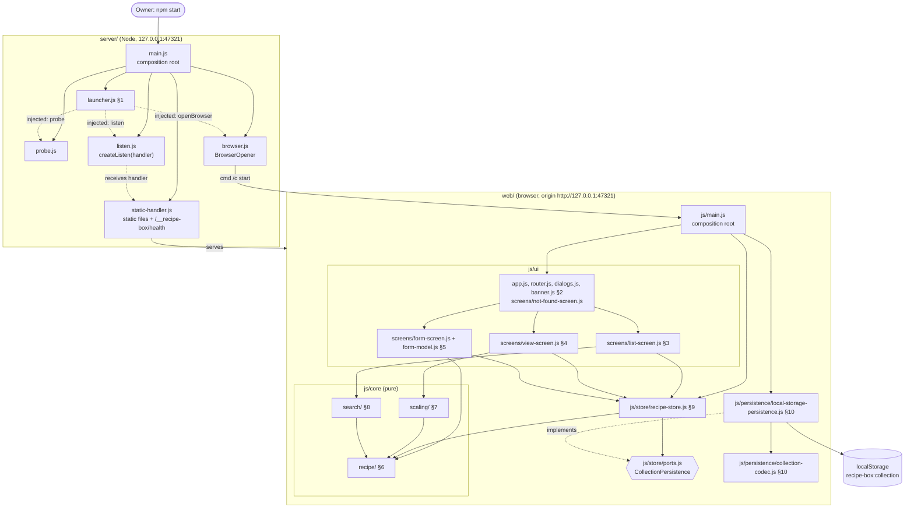
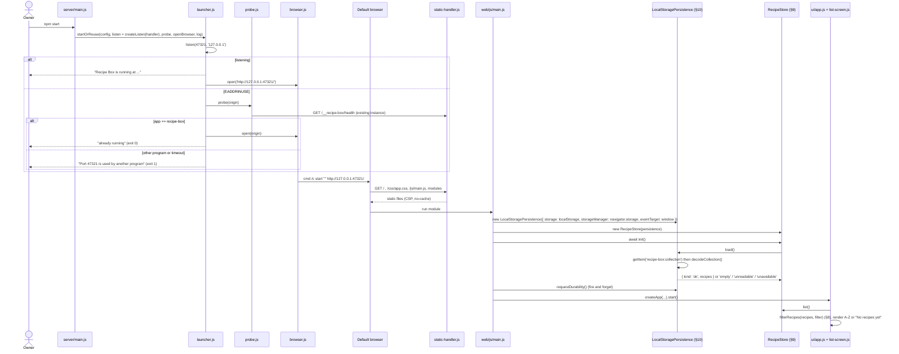
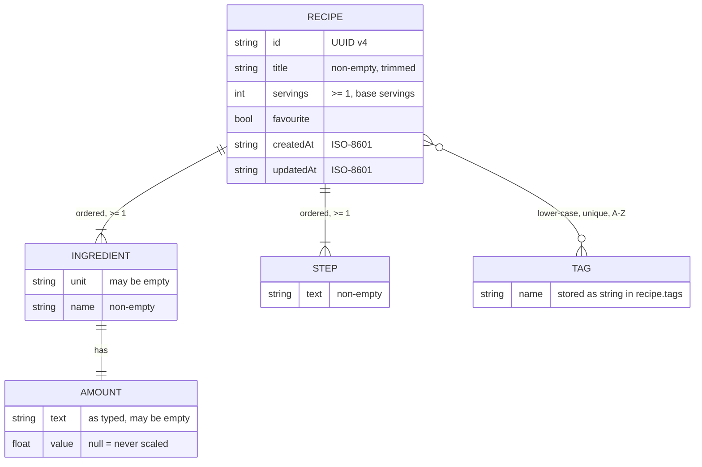
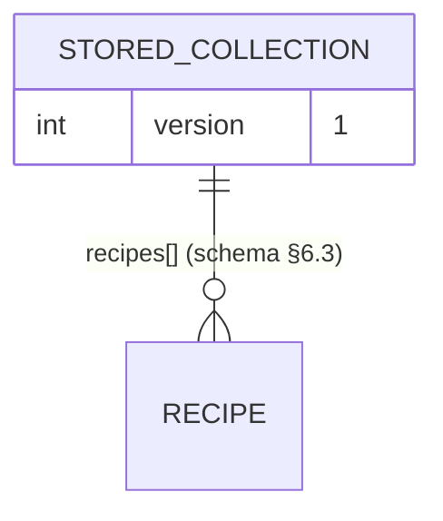

# Low-level design — Recipe Box

> Every section is numbered and self-contained, so a task can be briefed with only the
> sections it needs (e.g. `LLD §7, §6.1`). Each module section holds its responsibility,
> interfaces, contracts and schema in one place; it refers to other modules only by number.
> **Numbers are stable**: at milestone as-built syncs and change requests, update sections in
> place and give new sections new numbers. Never renumber; mark removed sections `(removed)`.
>
> Section numbers match the HLD modules: §1 = M1 … §10 = M10. §11 = dev tooling and tests.
> Written 2026-11-11 from the approved SPEC and HLD. Decisions D1–D6 are settled in §0.6;
> D1 (persistence location), D6 (stack) and the Playwright dev dependency await the owner's approval.
> **As-built sync M1 (2026-11-12):** §0–§2, §6, §7, §9, §10, §11 checked against the code at the end of
> milestone M1 (T-01..T-08, T-16). Changes are marked "As built (M1)" in place and listed in
> "Changes since last milestone" at the end; deferred minors are listed under "Known deferred minors".
> **Change request CR-1 (2026-11-12, owner decision D-09):** after a good load, a reload that yields
> `unreadable`/`unavailable` keeps the last loaded recipes visible, read-only. Changed text is marked "(CR-1)"
> in §2.5, §3.5, §4.5, §5.5, §9.1, §9.5, §10.5 and listed in "Changes since last milestone".
> **As-built sync M2 (2026-11-12):** §0, §2, §3, §4, §5, §8, §9.5, §11 checked against the code at the end of
> milestone M2 (T-05b, T-09..T-13). Changes are marked "As built (M2)" in place and listed in "Changes since
> last milestone". §5.5 is aligned to owner decision **D-11** (Save disabled live while the store is read-only);
> that part is **not built yet** (T-18). Parts of §3/§4/§5 still belong to later tasks (T-14, T-15, T-17, T-18, T-19);
> each "As built (M2)" note says what is missing.
> **As-built sync M3 (2026-11-12):** §0.2, §1.4, §2.5, §3, §4, §8.1, §11 checked against the code at the end of
> milestone M3 (T-14 filter panel and no-match state, T-15 favourite star). Changes are marked "As built (M3)" in
> place and listed in "Changes since last milestone"; M3 tidy-up minors are under "Known deferred minors (M3 tidy-up list)".
> Still to come: edit form and D-11 live Save (T-18), servings control (T-17), Delete (T-19).

## §0 Overview

### §0.1 Stack
| Layer | Choice | Why | Rejected alternative |
|---|---|---|---|
| Runtime / server (M1) | Node.js ≥ 24 (owner has v24.11.0), built-in `node:http`, `node:fs`, `node:child_process`; **zero runtime npm packages** | Node is already installed; no install step needed to run the app; ~150 lines of server code; nothing to upgrade | Express/Fastify (adds deps, gains nothing for static files + 1 route) |
| UI (M2–M5) | Plain HTML + CSS + vanilla JavaScript ES modules served as-is (no build step), hash routing, native `<dialog>` | 3 screens, 2 dialogs; "one command" stays trivially true because nothing is built before start | Vite + Preact (needs `npm install` of ~100s of packages and a build before the start command; see §0.6 D6) |
| Types | JavaScript with JSDoc types, checked by `tsc --noEmit` (`checkJs`, `strict`) | Strict type checking without a build step; browser runs the same files | TypeScript sources (browser cannot run `.ts`, so a build step returns) |
| Pure logic (M6–M8) | Hand-written functions, no libraries | Rounding to ¼ is ~20 lines; `fraction.js` would still need the rounding written by hand | `fraction.js` (extra dep, does not remove code) |
| Persistence (M10) | Browser `localStorage`, one JSON document under one key, behind the `CollectionPersistence` port (§9.1) | Matches approved SPEC §6 ("inside one browser"); simplest; data volume < 1 MB vs ~5 MiB limit | (c) JSON file on disk via the local server, designed in §10.6, built only if the owner picks it (D1); IndexedDB (async complexity, no gain at this size) |
| Unit tests | `node:test` + built-in coverage (`--experimental-test-coverage` with thresholds) | Built into Node; zero install; ideal for pure ESM logic | Vitest (pulls in Vite) |
| E2E tests | `@playwright/test` driving the **installed Edge** (`channel: 'msedge'`), dev-only; as built (M2, D-08): falls back to a Chromium already on the machine when Edge is missing (§11.6) | Real-browser checks of SPEC §5 flows, 390 px layout, screenshots; no browser download | none / manual only (see §0.6 item P1) |
| Lint / format / layers | ESLint (flat config, core rules) + Prettier + dependency-cruiser | Enforce CONVENTIONS limits and the layer map (§0.3) | typescript-eslint (not needed: sources are JS) |

### §0.2 Folder structure
```
recipe-box/
├─ package.json                 # "type": "module", engines node >=24, scripts (§11.1), devDependencies only
├─ package-lock.json            # committed; exact dev-tool pins
├─ start.cmd                    # optional double-click shortcut: cd to repo, node server\main.js
├─ README.md                    # docs role: start command, fixed address, port problems, data-loss warning
├─ eslint.config.js             # §11.2
├─ .prettierrc.json  .prettierignore
├─ tsconfig.base.json  tsconfig.web.json  tsconfig.node.json   # §11.3
├─ .dependency-cruiser.cjs      # §11.4 (layer contracts)
├─ scripts/check.sh             # §11.5 (Git Bash)
├─ server/                      # §1 M1 Launcher (Node only)
│  ├─ main.js                   #   composition root (server side)
│  ├─ config.js  launcher.js  probe.js  browser.js  static-handler.js  log.js  listen.js (as built M1, A-06)
├─ web/                         # everything served to the browser (static root)
│  ├─ index.html  favicon.svg
│  ├─ css/app.css               # §2 layout, 800 px breakpoint, usable at 390 px
│  └─ js/
│     ├─ main.js                # composition root (browser side)
│     ├─ core/                  # pure logic: no DOM, no storage, no I/O
│     │  ├─ recipe/             # §6 M6  types.js amount.js tags.js validation.js errors.js
│     │  ├─ scaling/            # §7 M7  fractions.js scaling.js servings.js
│     │  └─ search/             # §8 M8  search.js
│     ├─ store/                 # §9 M9  recipe-store.js ports.js errors.js
│     ├─ persistence/           # §10 M10 collection-codec.js local-storage-persistence.js
│     └─ ui/                    # §2–§5 app.js router.js dialogs.js dom.js banner.js filter-state.js form-model.js
│        │                      #        form-widgets.js form-ingredients.js form-steps.js form-tags.js (as built M2, §5.1)
│        │                      #        list-filters.js (§3.1) favourite-toggle.js (§3.1, used by §3 and §4) (as built M3)
│        └─ screens/            #        list-screen.js view-screen.js form-screen.js not-found-screen.js (as built M1)
└─ tests/
   ├─ helpers/                  # fake-storage.js, memory-persistence.js, recipes.fixture.js (SPEC §5 data)
   ├─ unit/                     # node:test, mirrors source: server/ core/ store/ persistence/ ui/
   └─ e2e/                      # Playwright: playwright.config.js, *.spec.js, helpers/seed.js (as built M1), helpers/recipes.js (as built M2)
```

### §0.3 Layer map and module dependencies
```
Browser:   ui (§2–§5)  →  store (§9)  →  core (§6, §7, §8)
                              ↑ ports.js (interface)
           persistence (§10) ─┘ implements, may also use core/recipe types
           main.js = composition root: the ONLY file that imports persistence and touches window.localStorage
Server:    server/main.js (root) → config, log, static-handler, listen, probe, browser, launcher
           (as built M1: main.js constructs every dependency and injects listen/probe/openBrowser/log
            into launcher.startOrReuse; launcher.js imports types only; static-handler → config (ConfigError))
           server/ and web/ never import each other.
```
| § | Depends on (interfaces only) |
|---|---|
| §1 Launcher | none (Node built-ins) |
| §2 Shell | §3, §4, §5 (screen mount contract §2.1), §9 store |
| §3 List | §8, §9, §2 (router, dialogs, filter-state) |
| §4 View | §7, §9, §2 |
| §5 Form | §6, §9, §2 |
| §6 Model | none |
| §7 Scaling | §6 (`Amount` type) |
| §8 Search | §6 (`Recipe` type) |
| §9 Store | §6, `CollectionPersistence` port (defined in §9.1, implemented by §10) |
| §10 Persistence | §6 types, §9 `ports.js` + `errors.js` only |

Inside `core/`: `scaling/` and `search/` may import `recipe/`; `recipe/` imports nothing. Rules are enforced by §11.4.

Component diagram (source `docs/diagrams/lld-components.mmd`, copy in `.results/lld/lld-components.mmd`):


**Variation points (get an interface):** `CollectionPersistence` (§9.1; D1: localStorage now, file-on-disk alternative §10.6) and the server's `BrowserOpener` / `listen` / `probe` functions (§1.1, injected so the launcher is testable and platform-swappable). Everything else is concrete functions.

### §0.4 Packages
**Runtime: none.** Running the app needs only Node. All packages are `devDependencies` used by checks and tests.

| Package | Version (pin exact at install) | Purpose | Alternative rejected |
|---|---|---|---|
| `eslint` | 9.x latest | Lint + complexity/size limits (§11.2) | Biome (fewer complexity rules) |
| `@eslint/js` | same as eslint | Recommended rule set | — |
| `globals` | 16.x latest | Browser vs Node globals per folder | hand-written globals lists |
| `prettier` | 3.x latest | Formatting | ESLint stylistic rules |
| `typescript` | 5.9.x | `tsc --noEmit` type check of JSDoc-typed JS | no type check; TS 6/7 (JSDoc `checkJs` behaviour less proven) |
| `@types/node` | 24.x latest | Node API types for `server/` and tests | — |
| `dependency-cruiser` | 17.x latest | Layer contracts (§11.4), no runtime npm imports | eslint `no-restricted-imports` (no cycle detection) |
| `@playwright/test` | 1.59.x (avoid 1.60, reported compat issue) | E2E in installed Edge, 390 px checks, screenshots — **only if P1 approved** | Puppeteer (no test runner); manual checks only |

Version caveat: these majors are from the research and general knowledge, not verified with `npm view` in this session. Whoever runs `npm install` pins the latest patch inside the listed major with `--save-exact`; the as-built sync records the exact versions. Copy of this table: `.results/lld/packages.md`.

**As built (M1), exact pins in `package.json` `devDependencies`:** `eslint` 9.39.5 · `@eslint/js` 9.39.5 · `globals` 16.5.0 · `prettier` 3.9.10 · `typescript` 5.9.3 · `@types/node` 24.19.2 · `dependency-cruiser` 17.4.3 · `@playwright/test` 1.59.1 (P1 in use: e2e runs in M1). All inside the listed majors; no packages added or removed. Runtime dependencies: still none.
**As built (M2):** pins unchanged; no packages added or removed in M2.
**As built (M3):** pins unchanged (`package.json` checked); no packages added or removed in M3. Runtime dependencies: still none.

### §0.5 Config and secrets
No secrets, no `.env` needed. Environment variables (documented in README, all optional):

| Var | Default | Used by | Notes |
|---|---|---|---|
| `RECIPE_BOX_PORT` | `47321` | §1 `loadConfig` | Integer 1024–65535 (digits only); an empty value counts as unset (as built M1). **Changing it shows a different, empty recipe box** (browser storage is per address); README warns. Tests use other ports so they never touch real data. |
| `RECIPE_BOX_NO_OPEN` | unset | §1 | `1` = do not open a browser (tests, Playwright). |

Host is not configurable: always `127.0.0.1`. Browser-side constants live in `web/js/persistence/collection-codec.js` (`STORAGE_KEY`, `SCHEMA_VERSION`).

### §0.6 Decisions D1–D6 (settled here; Tier 1 items await the owner)
| # | Decision | Chosen | Status |
|---|---|---|---|
| D1 | Where data persists | (a) `localStorage` at `http://127.0.0.1:47321`, behind `CollectionPersistence`; (c) file on disk designed in §10.6 | **Owner choice** |
| D2 | Fixed address and port conflict | `http://127.0.0.1:47321/`, bind `127.0.0.1` only; port taken → clear message, exit 1, never switch port | proposed (obvious) |
| D3 | Launcher behaviour | `npm start` → `node server/main.js`; already-running = probe `GET /__recipe-box/health` on `EADDRINUSE`; browser via `cmd /c start "" <url>`; one-time setup = clone the repo (no install to run); Ctrl+C / closing window stops it | proposed (obvious) |
| D4 | Amount representation | `{ text, value }`: typed text kept verbatim and shown at base servings; `value` number or `null`; ¼ rounding hand-written | proposed (obvious) |
| D5 | Storage format/versioning | `{ "version": 1, "recipes": [...] }` under key `recipe-box:collection`; unreadable/unknown version → read-only mode with banner, never written | proposed (obvious) |
| D6 | Stack | Node built-in http + vanilla ES modules + JSDoc/tsc, no build | **Owner choice** (alternative: Vite + Preact) |
| P1 | E2E dev dependency | `@playwright/test` using installed Edge | **Owner choice** |

---

## §1 M1 Launcher
- **Responsibility:** The one start command: serve `web/` on `http://127.0.0.1:47321/` (loopback only), open the default browser there, detect an already-running instance and reuse it, report port problems clearly.
- **Path(s):** `server/*.js`, `start.cmd`, `package.json` `"start"` script
- **Depends on:** none (Node built-ins only). Never imports `web/`.

### §1.1 Interfaces / signatures
```js
// server/config.js
/** @typedef {{ host: '127.0.0.1', port: number, origin: string, webRoot: string,
 *   openBrowser: boolean, appId: 'recipe-box', version: string }} Config */
/** @param {NodeJS.ProcessEnv} env @returns {Config}
 *  @throws {ConfigError} bad RECIPE_BOX_PORT; package.json without a version string (as built M1)
 *  version is read from package.json; webRoot = <repo>/web/ */
export function loadConfig(env) {}
export class ConfigError extends Error {}   // name 'ConfigError'

// server/static-handler.js
/** @param {{ webRoot: string, identity: { app: string, version: string }, allowedHosts: string[],
 *   log?: Logger }} opts   // log optional (D-06); server/main.js passes createLogger()
 *  @returns {(req: import('node:http').IncomingMessage, res: import('node:http').ServerResponse) => void}
 *  @throws {ConfigError} `Web folder not found: <path>` when webRoot is missing or not a folder
 *   (root resolved once with realpath at construction, so a bad root fails loudly instead of 404-ing everything) */
export function createRequestHandler(opts) {}
export const HEALTH_PATH = '/__recipe-box/health';
/** @param {string} ext (case-insensitive) @returns {string | undefined} */ export function contentTypeFor(ext) {}
// An unexpected error while handling a request → opts.log?.error('Request failed', { error: <code|message>, url })
//   and 500 text/plain "Server error" (or res.end() if headers were already sent).

// server/listen.js  (as built M1, A-06: separate so a test can assert the bound address)
/** @param {import('node:http').RequestListener} handler
 *  @returns {(port: number, host: string) => Promise<import('node:http').Server>}
 *  creates http.createServer(handler); resolves on 'listening', rejects with the listen error (EADDRINUSE, EACCES, ...) */
export function createListen(handler) {}

// server/probe.js
/** @typedef {'ours' | 'other' | 'none'} ProbeResult */
/** @param {string} origin @param {{ appId: string, timeoutMs?: number }} opts @returns {Promise<ProbeResult>} */
export function probeExistingInstance(origin, opts) {}   // timeoutMs default 1500

// server/browser.js
/** @typedef {(url: string) => void} BrowserOpener */
/** @param {{ platform: NodeJS.Platform, spawn: typeof import('node:child_process').spawn,
 *   onError?: (err: Error) => void }} deps @returns {BrowserOpener}
 *  as built M1 (A-06): spawn throws and child 'error' events go to onError, never thrown */
export function createBrowserOpener(deps) {}

// server/launcher.js
/** @typedef {'started' | 'already-running' | 'port-conflict' | 'port-forbidden'} LaunchOutcome */
/** @typedef {{ config: Config,
 *   listen: (port: number, host: string) => Promise<import('node:http').Server>,
 *   probe: (origin: string) => Promise<ProbeResult>,
 *   openBrowser: BrowserOpener, log: Logger }} LauncherDeps */
/** @typedef {{ outcome: LaunchOutcome, server?: import('node:http').Server }} LaunchResult */
/** @param {LauncherDeps} deps @returns {Promise<LaunchResult>}
 *  a listen error other than EADDRINUSE / EACCES is rethrown (main.js reports it, exit 1) */
export function startOrReuse(deps) {}
/** @param {LaunchOutcome} outcome @returns {0 | 1 | null} null = keep running */
export function exitCodeFor(outcome) {}

// server/log.js  (the only server file allowed to call console)
/** @typedef {{ info(msg: string): void, error(msg: string, fields?: Record<string, unknown>): void }} Logger */
/** info → stdout `msg\n`; error → stderr `msg key=value ...\n` (strings JSON-quoted, non-printable-ASCII escaped) */
export function createLogger(stream = process) {}

// server/main.js — composition root: createLogger() → loadConfig(process.env)
//   → createRequestHandler({ webRoot, identity, allowedHosts: ['127.0.0.1:<port>', 'localhost:<port>'], log })
//   → createBrowserOpener({ platform, spawn, onError: log 'Could not open the browser; open the address by hand.' })
//   → startOrReuse({ config, listen: createListen(handler), probe: origin => probeExistingInstance(origin, { appId }),
//        openBrowser, log })
//   → on 'started': keep running, SIGINT/SIGTERM → server.close() → exit 0; else process.exitCode = exitCodeFor(outcome)
//   catch: ConfigError → log.error(err.message); anything else → log.error('Recipe Box could not start.', { error }); exit 1
```

### §1.2 Contracts
| Method | Path | Request | Response | Errors |
|---|---|---|---|---|
| GET | `/__recipe-box/health` | — | `200 application/json` `{"app":"recipe-box","version":"<package.json version>"}` | — |
| GET/HEAD | `/` | — | `200` `web/index.html` | — |
| GET/HEAD | `/<path>` (e.g. `/js/main.js`, `/css/app.css`, `/favicon.svg`) | — | `200` file from `web/` with MIME from `contentTypeFor` (`.html` `text/html; charset=utf-8`, `.js` `text/javascript; charset=utf-8`, `.css` `text/css; charset=utf-8`, `.svg` `image/svg+xml`, `.json` `application/json`) | `404 text/plain "Not found"` (missing, directory, unknown extension, path outside `web/` after `path.resolve`, any `..` or `%00`) |
| other methods | any | — | — | `405` with `Allow: GET, HEAD` |
| any | any, `Host` not in `127.0.0.1:<port>` / `localhost:<port>` | — | — | `403 "Forbidden host"` (DNS-rebinding guard; checked first, before the method) |
| any | any (unexpected handler error) | — | — | `500 text/plain "Server error"`, logged `Request failed error=… url=…` (as built M1) |

As built (M1): the health path matches with any query string; `HEAD /__recipe-box/health` returns headers only; `%2e%2e`, `%5c` and `\` are rejected (404) like `..` and `%00`; symlinks resolving outside `web/` → 404. 405 body is `Method not allowed`.

Headers on every response: `Cache-Control: no-cache`, `X-Content-Type-Options: nosniff`, `Referrer-Policy: no-referrer`,
`Content-Security-Policy: default-src 'self'; script-src 'self'; style-src 'self'; img-src 'self' data:; object-src 'none'; base-uri 'none'; frame-ancestors 'none'; form-action 'self'` (also guarantees no network dependency: offline).

Console messages (ASCII only; exact text, tested):
| Outcome | Message | Exit |
|---|---|---|
| started | `Recipe Box is running at http://127.0.0.1:47321/ - opening your browser. Close this window to stop it.` | keeps running |
| already-running | `Recipe Box is already running at http://127.0.0.1:47321/ - opened it in your browser.` | 0 |
| port-conflict | `Port 47321 is used by another program, so Recipe Box cannot start. Close that program and run the command again (see README "Port problems").` | 1 |
| port-forbidden (`EACCES`, Windows reserved range) | `Windows does not allow Recipe Box to use port 47321 (reserved port range). See README "Port problems".` | 1 |
| bad `RECIPE_BOX_PORT` | `RECIPE_BOX_PORT must be a whole number between 1024 and 65535.` | 1 |
| `web/` folder missing (as built M1, `ConfigError` from `createRequestHandler`) | `Web folder not found: <path>` | 1 |
| `package.json` has no version (as built M1, `ConfigError` from `loadConfig`) | `package.json has no version string.` | 1 |
| browser could not be opened (as built M1, stderr, not fatal) | `Could not open the browser; open the address by hand. error="<message>"` | keeps running |
| any other start-up error (as built M1) | `Recipe Box could not start. error="<error>"` | 1 |

### §1.4 Key sequence (start → open → load recipes)
Source: `docs/diagrams/lld-sequence.mmd` (copy in `.results/lld/lld-sequence.mmd`).

As built (M1): the last step is not built yet; M1's list screen renders `store.list()` in insertion order with no filter (see §3).
As built (M2): the list screen renders `sortByTitle(store.list())` (A–Z, §8); `filterRecipes` with the filter panel arrives in T-14.
As built (M3): the last step is built as drawn: the list screen renders `filterRecipes(store.list(), filterState.get())` (§3.1), or "No recipes yet" when `store.list()` is empty.

### §1.5 Errors and edge cases
- `listen` rejects with `EADDRINUSE` → probe. Probe outcomes: `ours` → open + exit 0; `other` (non-200, wrong JSON, timeout 1500 ms) → port-conflict; `none` (`ECONNREFUSED`: the other instance exited meanwhile) → retry `listen` once, then port-conflict.
- `EACCES` on listen → port-forbidden. README explains `netsh interface ipv4 show excludedportrange protocol=tcp`; milestone 1 verifies 47321 is free on the owner's machine.
- Browser opened only after `listening` fires (or after a positive probe). `RECIPE_BOX_NO_OPEN=1` skips it. Non-Windows platforms: `open` (darwin) / `xdg-open` (linux) for completeness; the URL is always printed so the owner can click it if opening fails; spawn errors are logged, never fatal.
- `createBrowserOpener` on win32: `spawn('cmd', ['/c', 'start', '""', url], { windowsVerbatimArguments: true, detached: true, stdio: 'ignore' }).unref()`. The URL is built only from config (no user input; contains no `&`).
- Closing the console window or Ctrl+C ends the process; no state to clean up (no pid/lock file).
- Server never writes files (option a). Static root is resolved once at start; symlinks are not followed outside `web/`.
- `start.cmd`: `@echo off` / `cd /d "%~dp0"` / `node server\main.js` / `if errorlevel 1 pause` (keeps error messages visible on double-click).
- As built (M1): `listen` comes from `server/listen.js` `createListen(handler)` (A-06), so a unit test can start the real server and assert it is bound to `127.0.0.1`. A listen error other than `EADDRINUSE`/`EACCES` propagates out of `startOrReuse` and `main.js` reports "Recipe Box could not start." (exit 1).
- As built (M1): a missing/non-folder `web/` makes `createRequestHandler` throw `ConfigError('Web folder not found: <path>')` at start (before listening); `main.js` prints the message and exits 1.

---

## §2 M2 App shell and navigation
- **Responsibility:** Bootstraps the UI, routes between screens, owns shared dialogs, the store-status banner, the unsaved-changes guard and the responsive layout.
- **Path(s):** `web/index.html`, `web/css/app.css`, `web/js/main.js`, `web/js/ui/{app,router,dialogs,dom,banner,filter-state}.js`, `web/js/ui/screens/not-found-screen.js` (as built M1)
- **Depends on:** §3, §4, §5 (screen contract §2.1), §9 (`RecipeStore`). `main.js` additionally constructs §10.

### §2.1 Interfaces / signatures
```js
// web/js/ui/router.js
/** @typedef {{ name: 'list' } | { name: 'view', id: string } | { name: 'new' }
 *   | { name: 'edit', id: string } | { name: 'notFound' }} Route */
/** @param {string} hash e.g. '#/recipe/abc/edit' @returns {Route} */ export function parseRoute(hash) {}
/** @param {Route} route @returns {string} notFound → '#/not-found' (A-02) */ export function routeToHash(route) {}
/** @typedef {{ start(): void, navigate(route: Route, opts?: { replace?: boolean }): void }} Router */
/** @param {{ window: Window, onRoute: (r: Route) => void, canLeave: () => Promise<boolean> }} deps @returns {Router} */
export function createRouter(deps) {}
// As built (M1): ids in '#/recipe/<id>' are URI-decoded (bad escape or empty id → notFound) and encoded by routeToHash;
//   '' and '#/' are the same location; a rejected canLeave() counts as "stay"; while a canLeave() prompt is open,
//   further hash changes are reverted to the hash being decided (re-entrancy guard); navigate(r, { replace: true })
//   uses history.replaceState and calls onRoute directly (no canLeave), otherwise it sets location.hash.

// Screen contract (every file in ui/screens/ exports one mount function of this shape)
/** @typedef {{ store: import('../store/recipe-store.js').RecipeStore, router: Router,
 *   dialogs: Dialogs, banner: Banner, filterState: FilterState }} ScreenContext */
/** @typedef {{ unmount(): void, canLeave?(): Promise<boolean> }} ScreenHandle */
/** @typedef {(container: HTMLElement, ctx: ScreenContext, route: Route) => ScreenHandle} MountScreen */

// web/js/ui/dialogs.js — native <dialog id="confirm-dialog"> in index.html (parts: confirm-message, confirm-ok, confirm-cancel)
/** @typedef {{ message: string, confirmLabel: string, cancelLabel: string }} ConfirmOptions */
/** @typedef {{ confirm(opts: ConfirmOptions): Promise<boolean> }} Dialogs   (as built M1: what ScreenContext.dialogs holds) */
/** @param {ConfirmOptions} opts @param {Document} [doc] default document @returns {Promise<boolean>} */
export function confirmDialog(opts, doc) {}  // Esc / backdrop click (outside the dialog box) = cancel; focus starts on Cancel
/** @returns {Dialogs} */ export function createDialogs() {}  // screens call ctx.dialogs.confirm(...)

// web/js/ui/banner.js
/** @typedef {{ show(kind: 'error' | 'info', message: string): void, clear(): void }} Banner */
/** @param {HTMLElement} el @returns {Banner} */
export function createBanner(el) {}  // show: data-kind + textContent + unhide; clear: empty + hidden

// web/js/ui/filter-state.js — survives list → view → list while the tab is open (not persisted)
/** @typedef {{ query: string, tag: string | null, favouritesOnly: boolean }} RecipeFilter */
/** @typedef {{ get(): RecipeFilter, set(patch: Partial<RecipeFilter>): void, reset(): void }} FilterState */
/** @returns {FilterState} */ export function createFilterState() {}  // get() returns a copy

// web/js/ui/dom.js
/** @param {string} tag @param {Record<string, unknown>} [attrs] @param {...(Node|string|null|false)} children
 *  @returns {HTMLElement} */
export function h(tag, attrs, ...children) {}  // sets textContent only, never innerHTML
// As built (M1): attrs key 'text' → textContent; function values → addEventListener(key minus 'on');
//   'class' → className; value/checked/disabled/selected set as properties; null/undefined/false skipped;
//   unsafe attrs silently skipped: on* given a string, href/src/action/formaction with javascript: or data: (A-01).
/** @param {HTMLElement} el */ export function clear(el) {}

// web/js/ui/app.js
/** @param {{ root: HTMLElement, store: RecipeStore, window: Window }} deps @returns {{ start(): void }} */
export function createApp(deps) {}  // builds router, dialogs, banner, filterState; mounts screens
// As built (M1): screens are looked up in a route-name map (M1: { list: mountListScreen }); any route without a
//   screen mounts mountNotFoundScreen (A-10). As built (M2): SCREENS = { list: mountListScreen,
//   view: mountViewScreen, new: mountFormScreen }; 'edit' still falls back to not-found until T-18 adds it.
//   start() installs, in order: window 'error' + 'unhandledrejection'
//   listeners → console.error + banner GENERIC_ERROR (this is where store listener errors reported through
//   reportError surface, §9.5 / A-07); a store subscriber that mirrors status unreadable/unavailable into the
//   banner (and clears it once the status returns to ready); then router.start().

// web/js/ui/screens/not-found-screen.js (as built M1)
/** @type {MountScreen} */ export function mountNotFoundScreen(container) {}  // "Page not found" + "All recipes" (#/)

// web/js/main.js — composition root (≤ 30 lines): new LocalStoragePersistence(...) → new RecipeStore(...)
//   → await store.init() → persistence.requestDurability() → createApp(...).start()
//   (as built M1: requestDurability is fire-and-forget; root = document.getElementById('app'))
```

### §2.4 Key sequence — leaving the form with unsaved changes
1. Hash changes (back button, header link). Router calls `canLeave()` → current screen's `canLeave()`.
2. Form is dirty → `confirmDialog({ message: 'Discard changes?', confirmLabel: 'Discard', cancelLabel: 'Keep editing' })`.
3. Keep editing → router restores the previous hash with `history.replaceState` (no second `hashchange`), screen stays mounted. Discard → old screen `unmount()`, new screen mounts.
4. While the form is dirty, a `beforeunload` listener triggers the browser's native leave prompt (closing the tab).

### §2.5 Errors and edge cases
- Routes: `#/` or empty → list; `#/recipe/<id>` → view; `#/recipe/<id>/edit` → edit; `#/new` → add; anything else → `notFound` screen ("Page not found" + "All recipes" link).
- As built (M1, A-10): only the list screen exists, so `#/new`, `#/recipe/<id>` and `#/recipe/<id>/edit` parse correctly but show "Page not found" until M2 adds their screens (the "Add recipe" / "Add your first recipe" buttons therefore lead there for now). As built (M2): `#/new` (§5, add only) and `#/recipe/<id>` (§4) have screens; `#/recipe/<id>/edit` still shows "Page not found" until T-18.
- As built (M1): the generic-error banner and the status banner share one region; a status change back to `ready` calls `banner.clear()`, which can also clear a generic error (deferred minor, see "Known deferred minors").
- After a successful save or delete, navigate with `{ replace: true }` so Back does not return to the form/deleted recipe.
- Store status banner (shown on every screen, `role="alert"`):
  - `unreadable`: "Your saved recipes could not be read, so Recipe Box will not change them. Nothing has been deleted." All write controls disabled (Add, star, Edit, Delete, Save).
  - `unavailable`: "This browser is blocking storage for Recipe Box, so recipes cannot be loaded or saved." Same disabling.
  - write failure (§9.5): "Could not save: <reason>. Your last change was not stored." (info persists until next success).
    As built (M2, form only): `<reason>` is filled from `err.message` of the `PersistenceWriteError`, and the §10 adapter
    passes no message, so the text reads "Could not save: Could not save (quota). Your last change was not stored."
    (deferred minor, see "Known deferred minors"). Any other non-field error → "Could not save. Your last change was not stored."
    The form clears its own banner after the next successful save.
    As built (M3, star): `favourite-toggle.js` maps a rejected `toggleFavourite` the same way (its own copy of the
    form's mapping, `failureMessage`): `StoreReadOnlyError` → no banner; `PersistenceWriteError` → "Could not save: <err.message>.
    Your last change was not stored." (same doubled text); anything else → "Could not save. Your last change was not stored.",
    shown with `banner.show('error', …)`. Unlike the form, a later successful toggle does **not** clear that banner
    (deferred minor, M3 list).
  - (CR-1) The status can change **while a screen is mounted** (cross-tab `reload()`, §9.5), in both directions. The banner and every screen's write controls follow `store.status` on every store notification, not only at mount. The two status texts above stay as they are for both cases (nothing loaded, or the last loaded recipes still shown): both say that nothing will be changed.
- Unhandled promise rejections in UI → `banner.show('error', 'Something went wrong. Reload the page to continue.')` and `console.error` (the only console call in web code, in `app.js`).
- Layout (`app.css`): mobile-first single column; `@media (min-width: 800px)` → filters sidebar 280 px on list, two-column ingredients/steps on view and form, page max-width 1100 px (matches wireframes). At 390 px nothing overflows horizontally; tap targets ≥ 40 px.
  As built (M3): `.list-layout` is `display: block` below 800 px (filter panel `section.filters` stacked above `div.results`) and `display: flex; gap: 24px` from 800 px, with `.filters { width: 280px; flex-shrink: 0 }`. `button.star` is ≥ 44×44 px, grey with `cursor: not-allowed` when disabled. `.sr-only` visually hides the search and tag labels. On the view, `.title-row` puts the star beside the `<h1>`.
- Accessibility: header `<h1>` per screen, buttons are `<button>`, star is `<button aria-pressed>` with `aria-label`. As built (M3): exactly this, on the list rows and on the view (§3.1 `favouriteToggle`); the search box and tag select have visually hidden `<label for>`s, the checkbox sits inside its visible "Favourites only" `<label>`.
- Test ids (stable, for §11 e2e): `add-recipe`, `banner`, `confirm-dialog`, `confirm-ok`, `confirm-cancel`, `back-to-list`; as built (M1) also `confirm-message` and `not-found` (the not-found page `<main>`).

---

## §3 M3 Recipe list screen
- **Responsibility:** Render the filtered A–Z recipe list with search, tag filter, favourites-only, counts, empty and no-match states.
- **Path(s):** `web/js/ui/screens/list-screen.js`; as built (M3): `web/js/ui/list-filters.js` (filter panel) and `web/js/ui/favourite-toggle.js` (star button, shared with §4)
- **Depends on:** §8 (`filterRecipes`, `listTags`, `hasActiveFilters`), §9 (`list`, `toggleFavourite`, `subscribe`, `status`), §2 (screen contract, filter-state, router). As built (M3): `hasActiveFilters` is not used by the UI (the no-match state is chosen by "list not empty and 0 matches"); `favourite-toggle.js` also imports §9 `errors.js` (`StoreReadOnlyError`, `PersistenceWriteError`) and uses `ctx.banner` (§2).

### §3.1 Interfaces / signatures
```js
/** @type {import('../router.js').MountScreen} */
export function mountListScreen(container, ctx, route) {}

// web/js/ui/list-filters.js (as built M3, T-14)
/** @typedef {{ element: HTMLElement,
 *   refreshTags(recipes: readonly Recipe[]): void,   // rebuild tag <option>s from listTags; if the selected tag is gone,
 *                                                    //   filterState.set({ tag: null }) and select "All tags"
 *   syncFromState(): void,                           // copy filterState.get() into the three controls
 *   focusSearch(): void }} FilterPanel */
/** Built once per mount; each control writes filterState.set(...) then calls onChange.
 *  @param {FilterState} filterState @param {() => void} onChange @returns {FilterPanel} */
export function createFilterPanel(filterState, onChange) {}

// web/js/ui/favourite-toggle.js (as built M3, T-15) — used by §3 rows and the §4 view header
/** <button type="button" class="star" data-testid="favourite-toggle" data-recipe-id aria-pressed aria-label>
 *  text ★/☆ and aria-pressed/aria-label from the STORED recipe.favourite (no optimistic change);
 *  disabled = store.status !== 'ready' (evaluated when the button is built, i.e. on every re-render);
 *  click → await store.toggleFavourite(id); rejection → banner per §2.5 (none for StoreReadOnlyError).
 *  @param {Recipe} recipe @param {RecipeStore} store @param {Banner} banner @returns {HTMLElement} */
export function favouriteToggle(recipe, store, banner) {}
/** Runs render(); if a favourite-toggle inside region had focus before, focuses the enabled toggle with the same
 *  data-recipe-id afterwards (keyboard users can keep toggling). @param {HTMLElement} region @param {() => void} render */
export function renderKeepingToggleFocus(region, render) {}
```
Internal structure: the filter panel (search input, tag `<select>`, favourites checkbox) is rendered **once** per mount; only the results region (`count` + rows / state) re-renders on input or store change, so the search box keeps focus and caret while typing.

**As built (M1, T-08 walking skeleton), the rest is M2 (T-09/T-10):** the screen renders a header (`<h1>Recipe Box</h1>` + `add-recipe` "+ Add recipe") and a separate results region (`div.results`) that re-renders on every store change via `store.subscribe` (the unsubscribe is the handle's `unmount`). Results: `store.list().length === 0` → `empty-state` "No recipes yet" + `add-first-recipe`; otherwise `recipe-count` + `<ul>` of `recipe-row` (title link `recipe-row-title` to `#/recipe/<encoded id>`, tag chips). In M1 rows were in store insertion order. Both add buttons navigate to `#/new`, which shows "Page not found" until M2 (A-10). Write controls are disabled when `store.status !== 'ready'`, computed once at mount (deferred minor; (CR-1) must be recomputed on every store notification, see §3.5). *(Superseded by the M2 and M3 notes below: filter panel, A–Z sort, stars and no-match state are built; `disabled` is recomputed on every notification.)*

**As built (M2, T-11):** rows are now `sortByTitle(store.list())` (A–Z, §8.1). Row tag chips are plain `<span class="tag">` (no test id). The results region sits in `div.list-layout`, so the filter panel can be a sibling that never re-renders. *(The M2 read-only star `<span data-testid="recipe-row-star">`, A-13, was replaced in T-15 by the `favourite-toggle` button; see the M3 note.)*

**As built (M3, T-14 + T-15):** structure `<main class="page">` → `header.list-header` (`<h1>Recipe Box</h1>` + `add-recipe` button "+ Add recipe") → `div.list-layout` → `section.filters[aria-label="Search and filter"]` (from `createFilterPanel`: `input[type=search]#search-input` placeholder "Search by title…", `select#tag-filter`, `label.check` holding the `favourites-only` checkbox + "Favourites only") and `div.results`.
- Mount: `add.disabled = store.status !== 'ready'`, `panel.refreshTags(store.list())`, `panel.syncFromState()` (restores the filter from `ctx.filterState`, so search text, tag and favourites-only survive list → view → list), `renderResults()`; the handle's `unmount` is the `store.subscribe` unsubscribe.
- `renderResults()`: clears `div.results`; `store.list()` empty → `empty-state` (Add-first disabled when not `ready`); else `filterRecipes(store.list(), filterState.get())` (A–Z, §8.1) → 0 rows → `no-match-state`, else `recipe-count` + `ul.recipe-list` of rows. Row = `li.recipe-row[data-recipe-id]` → `div.recipe-main` (title link `recipe-row-title` to `#/recipe/<encoded id>`, tag chips) + `favouriteToggle(recipe, store, banner)`.
- A control change calls `renderResults()` directly (not the focus-keeping wrapper; the focused control is outside `div.results`, so focus and caret stay).
- Store notification (`onStoreChange`): recompute `add.disabled`, `panel.refreshTags(store.list())` (drops a vanished selected tag), then `renderKeepingToggleFocus(results, renderResults)`. Because the rows, stars and Add-first button are rebuilt on every notification, **all list write controls follow `store.status` in both directions** (CR-1, §3.5).
- "Clear filters": `filterState.reset()`, `panel.syncFromState()`, `renderResults()`, `panel.focusSearch()`.

### §3.4 Behaviour
| Trigger | Effect |
|---|---|
| mount | read `filterState.get()` into controls; render results |
| search `input` event | `filterState.set({ query })`; re-render results (no debounce: a few hundred items) |
| tag `<select>` change | options = "All tags" + `listTags(store.list())`; value `''` = all → `tag: null` |
| favourites checkbox | `favouritesOnly` |
| star click | `store.toggleFavourite(id)`; row re-renders via `subscribe` |
| row title click | `<a href="#/recipe/<id>">` |
| "Clear filters" | `filterState.reset()`, controls reset, focus search box |
| store change | re-render results; if selected tag no longer exists in `listTags`, reset tag to all |

States (exact texts): count line `"1 recipe"` / `"N recipes"` (count of shown rows); `store.list().length === 0` → "No recipes yet" + button "Add your first recipe" (`#/new`); else 0 matches → "No recipes match your search" + button "Clear filters". Row: title, tag chips in stored order (A–Z), star `★` (favourite, `aria-label="Remove from favourites"`) / `☆` (`aria-label="Mark as favourite"`).

As built (M3): every row of the table above is built as written. Store change: the tag reset happens in `refreshTags` and is written back to `filterState` (so it also holds after navigation). Star click: the row star does not change until the save succeeds and the store notifies (no optimistic update); on rejection it stays as stored. Un-starring a row while "Favourites only" is on removes the row, and focus then falls to `<body>` (deferred minor). The texts of the States paragraph match exactly; the tag `<select>` option for all is "All tags" (`value=""`).

Test ids: `search-input`, `tag-filter`, `favourites-only`, `recipe-count`, `recipe-row` (with `data-recipe-id`), `recipe-row-title`, `favourite-toggle`, `empty-state`, `add-first-recipe`, `no-match-state`, `clear-filters`. As built (M3): all present; `favourite-toggle` also carries `data-recipe-id`. `recipe-row-star` (the M2 read-only span, A-13) is **retired**: T-15 replaced it with the `favourite-toggle` `<button aria-pressed>` and moved its `list.spec.js` assertions there.

### §3.5 Errors and edge cases
- Read-only store status → stars and add buttons disabled (`disabled` attribute), list still readable.
- (CR-1) Both read-only cases come from §9.5:
  - Read-only **at start** (first load `unreadable`/`unavailable`): `store.list()` is `[]`, so the list shows the "No recipes yet" state with "Add your first recipe" disabled, plus the status banner (§2.5). Nothing was loaded, so nothing is shown.
  - Read-only **after a good load** (a cross-tab reload failed): `store.list()` still returns the last loaded recipes. Rows, search, tag filter, favourites-only filter, counts and the no-match state keep working on them; row title links open the view (§4). Stars, "Add recipe" and "Add your first recipe" are disabled.
  - The disabled state is recomputed on **every store notification** (header Add button included, not only the results region), so it switches off when the status leaves `ready` and back on when a later reload returns `ready`. This closes the T-08 deferred minor "Add buttons go stale".
- `toggleFavourite` rejection → banner (§2.5), star stays in the stored state.
- As built (M3, T-15): **done.** Header `add-recipe` is recomputed in `onStoreChange`; stars and "Add your first recipe" are rebuilt with `disabled = store.status !== 'ready'` on every notification. Read-only after a good load keeps rows, search, tag filter, favourites-only, count and no-match state working (e2e `persistence.spec.js` "cross-tab corrupt write on the list": stars and Add disabled, search still filters, value untouched, then all enabled again after a good write). A `StoreReadOnlyError` from a click in the gap before the notification shows no extra banner. There is no in-flight guard: a quick double click sends two toggles, which flip the favourite twice (deferred minor).

---

## §4 M4 Recipe view screen
- **Responsibility:** Show one recipe with a view-only servings control and scaled amounts; favourite, edit and delete actions.
- **Path(s):** `web/js/ui/screens/view-screen.js`
- **Depends on:** §7 (`formatIngredientLine`, `parseServingsInput`, `stepServings`), §9 (`get`, `toggleFavourite`, `remove`, `subscribe`), §2 (dialogs, router).

### §4.1 Interfaces / signatures
```js
/** @type {import('../router.js').MountScreen} */
export function mountViewScreen(container, ctx, route) {}  // route.name === 'view'
```
Screen-local state: `servings` (starts at `recipe.servings`, never saved; a new mount always starts at base).

**As built (M2, T-12):** the view is read-only display. Structure: `<main class="page">` → `div.view-content`, which `render()` rebuilds on mount and on **every** store notification (`store.subscribe(render)`; the unsubscribe is `unmount`):
- As built (M3, T-15): `render()` runs through `renderKeepingToggleFocus(content, render)` on notifications (§3.1), so a focused star keeps focus after toggling.
- `header.view-bar`: `back-to-list` link "← All recipes" (`#/`) + the Edit control. Edit is an `<a class="btn" href="#/recipe/<encoded id>/edit">` while `store.status === 'ready'`, else a **disabled `<button>`** with the same `edit-recipe` test id (A-14). Recomputed on every notification, so it follows the status in both directions (CR-1).
- `div.view-head`: `div.title-row` (`<h1 data-testid="recipe-title">` + the `favourite-toggle` star from §3.1 `favouriteToggle`, as built M3), `<p class="serves" data-testid="recipe-serves">Serves N</p>`, `div[data-testid=recipe-tags]` of `<span class="tag" data-testid="recipe-tag">` in stored order.
- `div.cols` → `section.panel.ing[data-testid=ingredients-panel]` (`<h2>Ingredients</h2>` + `<ul>` of `ingredient-line`) and `section.panel.steps[data-testid=steps-panel]` (`<h2>Steps</h2>` + `<ol>` of `step-line`).
- Ingredient line = `formatIngredientLine(ing, recipe.servings, recipe.servings)` (base = target, so amounts are shown as typed): `<strong data-testid="ingredient-amount">` + a space, **only when the amount text is non-empty**, then the name.
- Unknown id (or recipe gone after a notification): `div.state[data-testid=not-found]` "Recipe not found" + `<a class="btn" data-testid="not-found-back" href="#/">All recipes</a>`.

Not built yet: servings control, Reset and the scaling note (T-17); Delete (T-19). (The star is built, M3/T-15.)

### §4.4 Behaviour
| Trigger | Effect |
|---|---|
| `−` / `+` | `servings = stepServings(servings, ∓1)`; `−` disabled when `servings === 1` |
| typing in servings input (`input` event) | `next = parseServingsInput(text, servings)`; if valid, apply immediately; invalid/empty → keep previous applied value |
| servings input `blur` / Enter | input text reset to the applied `servings` |
| "Reset (N)" link | `servings = recipe.servings`; link + note "Recipe saved for N servings; scaling is not saved." shown only while `servings !== recipe.servings` |
| ingredients | `<ul>`; each `formatIngredientLine(ing, recipe.servings, servings)` → bold amount+unit span, then name |
| steps | `<ol>` in stored order |
| star | `store.toggleFavourite(id)` |
| Edit | `navigate({ name: 'edit', id })` |
| Delete | `confirmDialog({ message: "Delete '<title>'? Are you sure?", confirmLabel: 'Delete', cancelLabel: 'Cancel' })` → true: `await store.remove(id)`, `navigate({ name: 'list' }, { replace: true })`; false: nothing |
| store change | re-read `store.get(id)`; if gone (other tab deleted it) → not-found state |

Test ids: `recipe-title`, `recipe-tags`, `servings-input`, `servings-dec`, `servings-inc`, `servings-reset`, `ingredient-line`, `ingredient-amount`, `step-line`, `favourite-toggle`, `edit-recipe`, `delete-recipe`, `not-found`. As built (M2): also `recipe-serves` ("Serves N"), `recipe-tag` (one chip), `ingredients-panel`, `steps-panel`, `not-found-back` (the "All recipes" link of the not-found state) and `back-to-list` (§2.5). `not-found` is used both by the not-found screen's `<main>` (§2) and by the view's not-found state `<div>`; only one is ever on screen.

### §4.5 Errors and edge cases
- Unknown id → "Recipe not found" + "All recipes" link (no crash).
- Read-only store → star, Edit, Delete disabled; scaling still works. As built (M2, A-14): "disabled Edit" is a `<button type="button" disabled>` with test id `edit-recipe` (never an `<a>` without `href`); while `ready` it is the `<a href>` link. Delete follows the same rule when T-19 adds it. As built (M3, T-15): the view star is the shared `favourite-toggle` `<button>`, `disabled` while `store.status !== 'ready'`, rebuilt on every store notification, so it is disabled when a cross-tab reload fails and enabled again when one returns `ready` (e2e `persistence.spec.js` "cross-tab corrupt write on the view"). Rejection handling as in §3.5.
- (CR-1) Reachable when a cross-tab reload fails after a good load (§9.5): `store.get(id)` still returns the recipe from the last loaded snapshot, so the view stays on screen with the banner (§2.5). Star, Edit and Delete are recomputed on every store notification (disabled while `store.status !== 'ready'`, enabled again when a reload returns `ready`). The re-render on a store notification **keeps the current screen-local `servings`** (it is not reset to base), so scaling keeps working across status changes.
- (CR-1) Read-only **at start** (nothing loaded): `store.get(id)` is `undefined` → "Recipe not found" + "All recipes" link, with the status banner explaining why.
- (CR-1) A reload that returns `ready` with fresh data where the recipe no longer exists → not-found state (same as "store change" in §4.4).
- `remove` rejection → banner, stay on view.

---

## §5 M5 Recipe form screen
- **Responsibility:** Add and edit a recipe: editable draft, row operations, inline validation, save, cancel with discard guard.
- **Path(s):** `web/js/ui/screens/form-screen.js` (DOM), `web/js/ui/form-model.js` (pure draft operations, unit-tested); as built (M2, T-13): the DOM sections are split out into `web/js/ui/form-widgets.js`, `form-ingredients.js`, `form-steps.js`, `form-tags.js` (each under the 300-line / 40-line-function limits)
- **Depends on:** §6 (`validateDraft`, `normaliseTag`, `RecipeDraft`), §9 (`get`, `create`, `update`), §2 (dialogs, router, `canLeave`).

### §5.1 Interfaces / signatures
```js
// web/js/ui/form-model.js — pure, immutable (every function returns a new draft)
/** @returns {RecipeDraft} title '', servings '', 1 empty ingredient row, 1 empty step row, tags [] */
export function emptyDraft() {}
/** @param {Recipe} r @returns {RecipeDraft} amount text = r.ingredients[i].amount.text; servings = String(r.servings) */
export function draftFromRecipe(r) {}
export function addIngredientRow(d) {}            /** removeIngredientRow(d, i): removing the last row leaves one empty row */
export function removeIngredientRow(d, i) {}
/** @param {'amount'|'unit'|'name'} field */ export function setIngredientField(d, i, field, value) {}
export function addStepRow(d) {}
export function removeStepRow(d, i) {}            // last row → one empty row
/** @param {-1 | 1} dir no-op at the ends */       export function moveStep(d, i, dir) {}
export function setStep(d, i, text) {}
/** @param {string} raw adds normaliseTag(raw) if non-empty and not present */ export function addTag(d, raw) {}
export function removeTag(d, tag) {}
/** deep-equal of the two drafts (after trimming) */ export function isDirty(initial, current) {}
// As built (M2, T-10, A-12): isDirty compares a JSON fingerprint of both drafts with every string trimmed
//   (title, servings, each ingredient field, steps, tags). Every function returns a new draft object even when it is a
//   no-op (moveStep at an end, addTag of '' or a duplicate); untouched arrays may be shared with the input.
//   addTag appends (chip order = order typed); validateDraft's normaliseTags sorts A–Z on save.

// web/js/ui/form-widgets.js (as built M2) — shared DOM helpers for the form sections
/** @typedef {{ get(): RecipeDraft, set(next: RecipeDraft): void }} DraftAccess   // the screen's live draft */
/** @typedef {(next: RecipeDraft, focusTestid: string, index: number) => void} ChangeFn */
/** <p class="err" id={id} data-testid={testid}> or null when no message */
export function errorLine(testid, message, id) {}
/** <button type="button" class="btn small">; label → aria-label (symbol buttons) */
export function smallButton(text, testid, onclick, label, disabled = false) {}
/** @param {Event} e @returns {string} (e.target).value */ export function valueOf(e) {}
/** Fills el with build(errs, change); change(next, focusTestid, i) stores next, drops the errors (row indexes
 *  would be stale), rebuilds el, then focuses the i-th (clamped) element with focusTestid. @returns {HTMLElement} el */
export function createSection(el, draft, errors, build) {}

// web/js/ui/form-ingredients.js (as built M2)
export const INGREDIENT_HELP;   // the §5.4 help text
/** <section class="panel ing" data-testid="ingredients-panel"> @param {DraftAccess} draft @param {FieldErrors} errors */
export function ingredientsSection(draft, errors) {}

// web/js/ui/form-steps.js (as built M2)
/** <section class="panel steps" data-testid="steps-panel"> */ export function stepsSection(draft, errors) {}

// web/js/ui/form-tags.js (as built M2)
export const TAGS_HELP = 'Tags are saved in lower case.';
/** label + chips + tag input; Enter / comma commit (§5.4) */ export function tagsSection(draft) {}

// web/js/ui/screens/form-screen.js
/** @type {import('../router.js').MountScreen} */
export function mountFormScreen(container, ctx, route) {}  // route.name 'new' | 'edit'
// As built (M2, T-13): add only — ignores route, starts from emptyDraft(); app.js maps only 'new' to it (§2.1).
//   Internal pieces: createFormView(router, state) → { form, saveButton, currentDraft, render(errors) };
//   createSave(ctx, state, view) → async save(); FormState = { draft, saving, saved }.
//   currentDraft() = addTag(state.draft, <tag box text>) so uncommitted tag text counts for save and isDirty.
```

### §5.4 Behaviour
- Header: "Add recipe" / "Edit recipe". Edit of unknown id → not-found state.
- Tags input: Enter or comma adds a chip (`addTag`); chip ✕ removes; on Save any pending text in the tag box is added first. Help text "Tags are saved in lower case."
- Ingredient help text: "Amount: 2, 0.5, ½ or 1½. Leave empty for "a pinch", "to taste" (never scaled)."
- Save: `result = validateDraft(draft)` (§6). Errors → render each message under its field (texts in §6.2), mark inputs `aria-invalid`, focus the first invalid field; nothing saved. Valid → `create(result.value)` → `navigate({ name: 'view', id }, { replace: true })`; edit → `update(id, result.value)` → same.
- Cancel / any navigation away: `canLeave()` = `!isDirty(initial, draft)` or `confirmDialog({ message: 'Discard changes?', confirmLabel: 'Discard', cancelLabel: 'Keep editing' })`. Cancel target: edit → view of that recipe; add → list.
- Re-render strategy: re-render the affected section (ingredients / steps / tags) on row operations; keep focus on the row's input after add/move.

**As built (M2, T-13; add form only, edit is T-18):**
- Layout: `<main class="page" data-testid="recipe-form">` → `<h1>Add recipe</h1>` → `<form class="recipe-form" novalidate>` holding `div.top` (Title, Servings), `div.cols` (ingredients section, steps section), tags field, `div.footer` (Cancel, Save). Submitting the form (Save button or Enter in a text field) runs save.
- Labels: Title and Servings use `<label for>` bound to input ids `error-title-field` / `error-servings-field`; Tags uses `<label for="tag-input-field">`. Ingredient cells have `aria-label` Amount / Unit / Name; step inputs `aria-label="Step N"`; symbol buttons have `aria-label` ("Remove ingredient", "Move step up", "Move step down", "Remove step", "Remove tag <tag>"). Servings input has `inputmode="numeric"`.
- Inline errors (one `<p class="err">` each; the invalid input gets `aria-invalid="true"` + `aria-describedby` = the error's id):

  | Error | `data-testid` | element `id` | input marked invalid |
  |---|---|---|---|
  | title | `error-title` | `error-title` | title input |
  | servings | `error-servings` | `error-servings` | servings input |
  | no ingredients | `error-ingredients` | `error-ingredients-msg` | name input of row 0 |
  | ingredient row i without a name | `error-ingredient-row` | `error-ingredient-row-<i>` | name input of row i |
  | no steps | `error-steps` | `error-steps-msg` | step input 0 |

  After rendering errors, focus moves to the first `[aria-invalid="true"]` element. The first row operation in a section drops that section's errors (indexes would be stale); the next Save re-validates everything.
- Row operations and focus: add ingredient → focus the new row's amount input; add step → the new step input; ↑/↓ → the moved step's input at its new position; remove ingredient / remove step → the section's add button. `step-up` is **disabled on the first step** and `step-down` **on the last** (a single step has both disabled).
- Tags: Enter (ignored while an IME is composing) commits the box text; typing a comma commits every part before the last comma and keeps the rest in the box. Chip `✕` (`button.chip-remove`, ≥ 40×40 px) removes the tag and focuses the tag input. Text left in the box is added on Save (`currentDraft`).
- Save: re-entry blocked by `state.saving`; Save is `disabled` while the `create` promise is pending. Success → `saved = true` (turns the dirty guard off), clears a banner the form showed earlier, `navigate({ name: 'view', id }, { replace: true })`. Failure messages: §5.5.
- Cancel → `navigate({ name: 'list' })`, which goes through `canLeave()` (discard dialog when dirty). `beforeunload` is registered on the global `window` while mounted and removed on `unmount` (deferred minor m-8: should come through `ScreenContext`).

Test ids: `title-input`, `servings-input`, `ingredient-row`, `ingredient-amount-input`, `ingredient-unit-input`, `ingredient-name-input`, `remove-ingredient`, `add-ingredient`, `step-row`, `step-input`, `step-up`, `step-down`, `remove-step`, `add-step`, `tag-input`, `tag-chip`, `remove-tag`, `save-recipe`, `cancel-edit`, `error-title`, `error-servings`, `error-ingredients`, `error-steps`, `error-ingredient-row`. As built (M2): also `recipe-form` (the form screen's `<main>`), `ingredients-panel` / `steps-panel` (the two form sections; the same ids as the view's panels, §4.4, never on screen together).

### §5.5 Errors and edge cases
- Save rejected by the store (`PersistenceWriteError`, `RecipeNotFoundError` when another tab deleted the recipe) → banner with the reason (texts in §2.5), form stays dirty and open. As built (M2): `StoreReadOnlyError` shows **no** extra form banner, because the status banner (§2.5) already says why; the form stays dirty and open.
- Double-click on Save: button disabled while the save promise is pending.
- **(D-11, replaces the CR-1 "Save rejects" rule) Save follows `store.status` live.** The status can leave `ready` while the form is open (cross-tab reload, §9.5); the edit form can also be reached by typing the hash while read-only (its data comes from the kept snapshot). The form stays **editable** so typed text is not lost, but the `save-recipe` button is `disabled` whenever `store.status !== 'ready'`, exactly like the other write controls (§2.5). The form screen subscribes to the store (`store.subscribe`, unsubscribed in `unmount`) and on every notification sets `saveButton.disabled = state.saving || store.status !== 'ready'`; the `finally` after a save uses the same expression instead of re-enabling unconditionally. Save is set the same way at mount. When a later reload returns `ready`, Save is enabled again and works against the fresh data (`RecipeNotFoundError` if the recipe is gone there). Applies to add (`#/new`) and edit (`#/recipe/<id>/edit`) alike: one shared form screen.
  - The store's `StoreReadOnlyError` guard (§9.4) stays as the safety net for the gap between a status change and a click; the form handles it as above (no extra banner, form stays open). The form no longer relies on it as the normal path.
  - Submitting with Enter while Save is disabled must not save either: `save()` returns early when `store.status !== 'ready'` (same check).
  - **Not built yet — to be implemented in T-18.** As built (M2), the add form's Save is enabled regardless of `store.status` (disabled only while saving), and a read-only store answers with `StoreReadOnlyError`, which the form absorbs silently as described in the first bullet.
- (M1 sync, A-03) A `ValidationError` from the store with an empty `fieldErrors` (`{}`: non-object input or bad tags) has no field to mark → show a generic "Could not save" banner and keep the form open; a non-empty `fieldErrors` is rendered inline like `validateDraft` errors. As built (M2): the generic text is "Could not save. Your last change was not stored." (same text for any other unexpected error).

---

## §6 M6 Recipe model and validation
- **Responsibility:** The recipe types, amount parsing, tag normalising and draft validation. Pure functions, no DOM/storage.
- **Path(s):** `web/js/core/recipe/{types,amount,tags,validation,errors}.js`
- **Depends on:** none.

### §6.1 Interfaces / signatures
```js
// types.js (JSDoc typedefs only)
/** @typedef {{ text: string, value: number | null }} Amount
 *  text = exactly as typed (trimmed); value = parsed number, null = never scaled */
/** @typedef {{ amount: Amount, unit: string, name: string }} Ingredient */
/** @typedef {{ id: string, title: string, servings: number, ingredients: Ingredient[], steps: string[],
 *   tags: string[], favourite: boolean, createdAt: string, updatedAt: string }} Recipe   // ISO-8601 timestamps */
/** @typedef {Pick<Recipe, 'title' | 'servings' | 'ingredients' | 'steps' | 'tags'>} RecipeInput */
/** @typedef {{ amount: string, unit: string, name: string }} IngredientDraft */
/** @typedef {{ title: string, servings: string, ingredients: IngredientDraft[], steps: string[], tags: string[] }} RecipeDraft */
/** @typedef {{ title?: string, servings?: string, ingredients?: string, steps?: string,
 *   ingredientRows?: Record<number, string> }} FieldErrors */
/** @typedef {{ ok: true, value: RecipeInput } | { ok: false, errors: FieldErrors }} ValidationResult */

// amount.js
/** @param {string} text @returns {Amount} */ export function parseAmount(text) {}
export const UNICODE_FRACTIONS = { '¼': 0.25, '½': 0.5, '¾': 0.75, '⅓': 1/3, '⅔': 2/3, '⅛': 0.125, '⅜': 0.375, '⅝': 0.625, '⅞': 0.875 };

// tags.js
/** trim, lower-case (toLocaleLowerCase), collapse inner whitespace to one space */ export function normaliseTag(raw) {}
/** normalise, drop empty, de-duplicate, sort A–Z @returns {string[]} */          export function normaliseTags(list) {}

// validation.js
export const MESSAGES = Object.freeze({
  titleRequired: 'Title is required', servingsMin: 'Servings must be 1 or more',
  ingredientsMin: 'Add at least one ingredient', stepsMin: 'Add at least one step',
  ingredientName: 'Enter the ingredient name' });
/** @param {RecipeDraft} draft @returns {ValidationResult} */ export function validateDraft(draft) {}
/** structural check of a normalised input (used by §9) @throws {ValidationError} */ export function assertRecipeInput(input) {}

// errors.js
export class ValidationError extends Error { /** @param {FieldErrors} fieldErrors */ constructor(fieldErrors) {} }
//   as built (M1): name 'ValidationError', message 'Recipe failed validation', .fieldErrors holds the argument
```

**`assertRecipeInput` rules (as built M1, A-03).** The write-side guard of §9; it checks an input that should already be in `validateDraft` output form and never normalises:
- Non-object input (`null`, `undefined`, primitive) → `ValidationError({})`.
- `title` must be a non-empty string equal to its own `trim()` (untrimmed text is rejected) → else `title: titleRequired`.
- `servings` must be a safe integer ≥ 1 → else `servings: servingsMin` (`validateDraft` uses the same rule).
- `ingredients` must be a non-empty array → else `ingredients: ingredientsMin`. Each row needs a trimmed non-empty `name`, a string `unit`, and an `amount` with string `text` and `value` that is `null` or finite → else `ingredientRows[i] = ingredientName`. Holes in a sparse array count as invalid rows.
- `steps` must be a non-empty array of trimmed non-empty strings (holes are invalid) → else `steps: stepsMin`.
- `tags` must be an array of strings already in `normaliseTags` form (lower-case, unique, A–Z). Tags have no `FieldErrors` key, so bad tags alone throw `ValidationError({})`.
- **An empty `fieldErrors` (`{}`) means "show a generic error"**: the form (§5.5) cannot point at a field, so it shows the generic save-failed banner instead of inline messages.

`parseAmount` as built (M1): digit strings so long that they overflow to `Infinity` give `value: null` (only finite values are stored). `UNICODE_FRACTIONS` is frozen.

### §6.2 Rules (contract for `parseAmount` / `validateDraft`)
`parseAmount(text)` after trim (empty → `{ text: '', value: null }`):
| Input form | Example | value |
|---|---|---|
| integer | `2`, `300` | 2, 300 |
| decimal (dot) | `0.5`, `.5`, `1.25` | 0.5, 0.5, 1.25 |
| unicode fraction, optionally after a whole number (optional space) | `½`, `1½`, `1 ½` | 0.5, 1.5, 1.5 |
| slash fraction, optionally after a whole number | `1/2`, `1 1/2` | 0.5, 1.5 |
| anything else, or denominator 0 | `a pinch`, `2-3`, `1/0` | `null` (kept as text, never scaled) |

`validateDraft(draft)`:
1. `title = draft.title.trim()`; empty → `titleRequired`. Duplicate titles allowed.
2. `servings` must match `^\d+$` after trim and be ≥ 1 → else `servingsMin`. As built (M1): it must also be a safe integer (≤ 2^53−1), so it survives JSON.
3. Ingredient rows: trim all fields; rows with all three empty are dropped. Remaining row with empty name → `ingredientRows[i] = ingredientName` (index in the original draft). After dropping, 0 rows → `ingredients = ingredientsMin`. Each kept row → `{ amount: parseAmount(amount), unit, name }`.
4. Steps: trim, drop empty; 0 left → `stepsMin`. Order kept.
5. Tags → `normaliseTags` (so `Breakfast`, `sweet ` → `breakfast`, `sweet`).
6. Any error → `{ ok: false, errors }` (all errors reported at once); else `{ ok: true, value }`.

### §6.3 Data / schema owned


### §6.5 Errors and edge cases
- `value` 0 (typed `0`) is valid and scales to `0` (§7).
- Comma decimals (`0,5`) are not parsed → `null` (shown as typed, not scaled). Can be added later without a data change.
- As built (M1): the §6.3 schema is enforced in two places with different strictness. Writes go through `assertRecipeInput` (strict: trimmed text, normalised tags, no sparse arrays, see §6.1). Reads of stored data go through the codec's lenient shape check (§10.1, A-08), so tightening a write rule can never make already-stored data unreadable.

---

## §7 M7 Scaling and kitchen fractions
- **Responsibility:** Turn an amount, base servings and target servings into the displayed text; servings-input parsing. Pure.
- **Path(s):** `web/js/core/scaling/{fractions,scaling,servings}.js`
- **Depends on:** §6 (`Amount`, `Ingredient` types).

### §7.1 Interfaces / signatures
```js
// fractions.js
/** nearest 0.25, exact halfway rounds up, value > 0 never returns 0 (min 0.25)
 *  q = Math.floor(x * 4 + 0.5 + 1e-9) / 4; if (x > 0 && q === 0) q = 0.25 */
export function roundToQuarter(x) {}
/** whole part + glyph: 0.25 → '¼', 1.5 → '1½', 62.5 → '62½', 3 → '3', 0 → '0' */
export function formatQuarter(q) {}

// scaling.js
/** @param {Amount} amount @param {number} base @param {number} target @returns {string}
 *  value null → amount.text; target === base → amount.text (as typed);
 *  else formatQuarter(roundToQuarter(value * target / base)) */
export function scaleAmount(amount, base, target) {}
/** @returns {{ amount: string, name: string }} amount = scaled amount + (unit ? ' ' + unit : ''), '' when no amount and no unit */
export function formatIngredientLine(ingredient, base, target) {}

// servings.js
export const MIN_SERVINGS = 1;
/** @param {string} raw @param {number} previous @returns {number} whole number ≥ 1, else previous */
export function parseServingsInput(raw, previous) {}
/** @returns {number} max(MIN_SERVINGS, current + delta) */
export function stepServings(current, delta) {}
```
Compute `value * target / base` with multiplication first (all SPEC examples are binary-exact); the `1e-9` nudge makes near-halfway float results (e.g. 0.37499999) round up as specified.

As built (M1, T-16 built early): `web/js/core/scaling/{fractions,scaling,servings}.js` match these signatures; `core/scaling` imports only `core/recipe` types. No deviations.

### §7.2 Contract examples (each is a unit test)
| Recipe | base → target | Expected display |
|---|---|---|
| Pancakes: 200 g flour, 2 eggs, 300 ml milk, (none) a pinch of salt | 4 → 6 | `300 g`, `3`, `450 ml`, salt unchanged |
| same | 4 → 3 | `150 g`, `1½`, `225 ml` |
| same | 4 → 1 | `50 g`, `½`, `75 ml` |
| same | 4 → 4 | as typed (`200 g`, `2`, `300 ml`) |
| Banana Bread: 3 bananas, 1 tsp baking soda, 250 g flour | 8 → 2 | `¾`, `¼ tsp`, `62½ g` |
| same | 8 → 1 | `½` (0.375 rounds up), `¼ tsp` (0.125 → never 0), `31¼ g` |
| typed `1 1/2` cup | 2 → 2 | `1 1/2 cup` (as typed) |
| typed `½` | 1 → 3 | `1½` |
| `parseServingsInput` | `'0'`, `''`, `'abc'`, `'2.5'`, `'-1'` with previous 3 | 3 |
| `parseServingsInput` | `' 6 '` | 6 |

---

## §8 M8 Search and filter
- **Responsibility:** Combine title search, one tag and favourites-only; sort A–Z; list available tags. Pure.
- **Path(s):** `web/js/core/search/search.js`
- **Depends on:** §6 (`Recipe` type).

### §8.1 Interfaces / signatures
```js
/** @typedef {{ query: string, tag: string | null, favouritesOnly: boolean }} RecipeFilter */
/** all conditions must match; result sorted by sortByTitle @returns {Recipe[]} (new array) */
export function filterRecipes(recipes, filter) {}
/** localeCompare(a.title, b.title, undefined, { sensitivity: 'base' }), ties by createdAt then id */
export function sortByTitle(recipes) {}
/** union of all tags, unique, A–Z */ export function listTags(recipes) {}
/** query.trim() !== '' || tag !== null || favouritesOnly */ export function hasActiveFilters(filter) {}
```
Matching: `title.toLocaleLowerCase().includes(query.trim().toLocaleLowerCase())`; empty query matches all; `tag` exact match against `recipe.tags`.

As built (M2, T-09): `web/js/core/search/search.js` matches these signatures (inputs typed `readonly Recipe[]`; `RecipeFilter` typedef repeated here, same shape as §2.1). Details: the `sortByTitle` tie-break compares `createdAt` and then `id` with plain `<` (ISO strings sort correctly as text, A-11); `filterRecipes` checks favourites, then tag, then title; `listTags` sorts with the default `Array.prototype.sort()` (UTF-16 code-unit order, not `localeCompare`). Stored tags are lower-case, so this equals A–Z for ASCII tags; accented tags may sort after `z` (deferred minor). Not yet used by the UI except `sortByTitle` (§3, T-14 wires the rest). As built (M3): §3 uses `filterRecipes` (list results) and `listTags` (tag options, via `list-filters.js`); `sortByTitle` is no longer called by the UI directly (`filterRecipes` sorts); `hasActiveFilters` is unit-tested but unused by the UI.

### §8.2 Contract examples (unit tests, SPEC §5 F-2 data)
| Filter | Result |
|---|---|
| none | Banana Bread, Pancakes, Tomato Soup |
| query `b` | Banana Bread |
| query `PAN` | Pancakes |
| tag `breakfast` | Banana Bread, Pancakes |
| query `xyz` | [] |
| favouritesOnly (Banana Bread starred) | Banana Bread |
| tag `breakfast` + query `pan` + favouritesOnly | [] |

---

## §9 M9 Recipe store
- **Responsibility:** The single gateway to recipe data: in-memory collection, CRUD, favourite toggle, IDs and timestamps, change notification; persists every change through the `CollectionPersistence` port before committing it.
- **Path(s):** `web/js/store/{recipe-store,ports,errors}.js`
- **Depends on:** §6 (`assertRecipeInput`, types), `CollectionPersistence` (§9.1, implemented by §10).

### §9.1 Interfaces / signatures
```js
// ports.js — the D1 variation point
/** @typedef {{ kind: 'ok', recipes: Recipe[] } | { kind: 'empty' }
 *   | { kind: 'unreadable', reason: string } | { kind: 'unavailable', reason: string }} LoadResult */
/** @typedef {{
 *   load(): Promise<LoadResult>,
 *   save(recipes: readonly Recipe[]): Promise<void>,          // rejects with PersistenceWriteError
 *   watch(onExternalChange: () => void): () => void,         // returns unsubscribe; may be a no-op
 *   requestDurability(): Promise<boolean>                    // best effort
 * }} CollectionPersistence */

// errors.js (as built M1: each sets .name to its class name)
export class RecipeNotFoundError extends Error {}   // constructor(id); .id; message 'Recipe not found: <id>'
export class StoreReadOnlyError extends Error {}    // constructor(status); .status: 'unreadable' | 'unavailable' | 'loading'
export class PersistenceWriteError extends Error {} // constructor(reason, message?); .reason: 'quota' | 'unavailable' | 'io'

// recipe-store.js
/** @typedef {'loading' | 'ready' | 'unreadable' | 'unavailable'} StoreStatus */
export class RecipeStore {
  /** @param {CollectionPersistence} persistence
   *  @param {{ newId?: () => string, now?: () => string }} [deps] defaults crypto.randomUUID, new Date().toISOString() */
  constructor(persistence, deps) {}
  /** loads, sets status, starts watch() once (idempotent: a second call re-loads but never adds a second watch)
   *  @returns {Promise<StoreStatus>} */ async init() {}
  /** @returns {StoreStatus} */ get status() {}
  /** @returns {string | null} reason for unreadable/unavailable */ get statusReason() {}
  /** @returns {readonly Recipe[]} frozen snapshot, insertion order. (CR-1) In every status this is the last
   *  good snapshot: data from the latest ok/empty load or successful write; [] if none yet (table in §9.5) */ list() {}
  /** @returns {Recipe | undefined} (CR-1) looks up the same snapshot as list(), in every status */ get(id) {}
  /** @param {RecipeInput} input @returns {Promise<Recipe>} favourite false, new id, createdAt = updatedAt = now */ async create(input) {}
  /** keeps id, favourite, createdAt; sets updatedAt @throws RecipeNotFoundError */ async update(id, input) {}
  /** @throws RecipeNotFoundError */ async remove(id) {}
  /** flips favourite, sets updatedAt @returns {Promise<Recipe>} */ async toggleFavourite(id) {}
  /** @param {() => void} listener @returns {() => void} unsubscribe */ subscribe(listener) {}
  /** re-load after another tab changed storage; notifies. Runs on the same serial chain as writes.
   *  (CR-1) unreadable/unavailable keeps list()/get() data unchanged; ok/empty replaces it (§9.5) */ async reload() {}
}
```

### §9.4 Key sequence (every write)
1. Guard: `status !== 'ready'` → reject `StoreReadOnlyError`. `create`/`update` call `assertRecipeInput` → `ValidationError`.
2. Writes are serialised on an internal promise chain (one at a time).
3. Build the next array (new frozen objects), `await persistence.save(next)`.
4. Success → replace the in-memory array, notify subscribers, resolve with the recipe. Failure → in-memory state unchanged, reject with the `PersistenceWriteError`.

As built (M1), in detail:
- `create`/`update` validate **at call time** (before queuing): `assertRecipeInput(input)` → `structuredClone` → `assertRecipeInput(copy)`, so a caller mutating its object afterwards cannot change what is saved. An invalid input rejects with `ValidationError` without touching the chain.
- The status guard (step 1, `StoreReadOnlyError`) runs **inside** the chain, so it sees the status left by any earlier `init`/`reload`.
- One chain serialises `init`'s load, `reload()` and every write; a failed task does not break the chain for later tasks.
- `create` throws `Error('duplicate id from newId: <id>')` (nothing saved) if `newId()` returns an id already in the collection.
- `toggleFavourite` / `update` / `remove` look the id up inside the chain → `RecipeNotFoundError` if another write or a reload removed it.

### §9.5 Errors and edge cases
- ~~`init()` result mapping: … `unreadable` / `unavailable` → that status, `list()` returns `[]`~~ — replaced by the CR-1 rules below (the old rule emptied the list on every failed reload, which contradicted §3.5 and §4.5).
- **(CR-1, D-09) Load result mapping — one rule for `init()` and `reload()`.** The store keeps one in-memory collection, the *last good snapshot*: it starts as `[]` and is replaced only by an `ok`/`empty` load or by a successful write. A load that yields `unreadable` or `unavailable` (including `persistence.load()` rejecting) changes `status` and `statusReason` but **never touches the snapshot**. `list()` and `get(id)` always read the snapshot, in every status.

  | Path | Load result | `status` | `statusReason` | `list()` / `get(id)` | Writes |
  |---|---|---|---|---|---|
  | first load (`init()`) | `ok` | `ready` | `null` | loaded recipes | allowed |
  | first load | `empty` | `ready` | `null` | `[]` (nothing written until the first change) | allowed |
  | first load | `unreadable` / `unavailable` / `load()` rejects | that status (`unavailable` for a rejection) | the result's reason (`load failed: <message>` for a rejection) | `[]` / `undefined`: nothing was loaded | `StoreReadOnlyError` |
  | `reload()` after a good load (status `ready`) | `unreadable` / `unavailable` / rejects | that status | that reason | **unchanged**: the last good snapshot stays visible, read-only | `StoreReadOnlyError` |
  | `reload()` while already read-only | `unreadable` / `unavailable` / rejects | that status (may switch between the two) | that reason | unchanged (still the last good snapshot, or `[]` if there never was one) | `StoreReadOnlyError` |
  | `reload()` in any status | `ok` / `empty` | `ready` | `null` | replaced by the fresh data (`[]` for `empty`) | allowed again |

  "After a good load" covers every snapshot the store accepted: from `init()`, from an earlier `reload()`, or from this tab's own successful writes. A second `init()` call follows the same rule.
- **(CR-1) Writes never use a stale snapshot.** The write guard (§9.4 step 1) rejects every write unless `status === 'ready'`, and `ready` is entered only by an `ok`/`empty` load, which replaces the snapshot first. So the kept snapshot is display-only: no write is ever built on it, and leaving read-only mode always starts from freshly loaded data.
- **(CR-1) A-09 still holds, at two levels.** (1) Store: no `persistence.save()` call while `status !== 'ready'`, so data that this build cannot read is never written over. (2) Adapter (§10.1): `save` re-reads the stored value and refuses (`PersistenceWriteError('unavailable')`) if it is foreign/unknown-version/not JSON, which covers the gap between another tab's write and this tab's `storage` event. In that gap a write is rejected while the status is still `ready`; the status stays `ready` until the `watch` → `reload()` that follows switches it to `unreadable`.
- **(CR-1) Listener notification.** `reload()` sets `status`, `statusReason` and the snapshot together, then calls `#notify()` **once**, after every reload, whether or not anything changed. So subscribers always see a consistent state and get a call on every status change in both directions (`ready` → read-only, read-only → `ready`, `unreadable` ↔ `unavailable`). They re-read `status`, `statusReason` and `list()` / `get()`; the store sends no payload. `init()` does not notify (the UI subscribes after it). A write notifies only on success (§9.4). Listener isolation (A-07, below) applies to all of these.
- Cross-tab: `watch` callback → `reload()` (see the table above). Last write wins between tabs (acceptable for one user).
- Returned recipes are deep-frozen; UI never mutates them.
- As built (M1): loaded recipes are `structuredClone`d before deep-freezing, so objects owned by the persistence layer are never frozen (A-05).
- As built (M1): `persistence.load()` **rejecting** (instead of returning a `LoadResult`) maps to status `unavailable` with reason `load failed: <message>`; the store never stays stuck in `loading`. `statusReason` is the `LoadResult.reason` (or `null` for ok/empty). A reload that returns `ok`/`empty` after `unreadable` makes the store `ready` again.
- As built (M2, T-05b): **done.** `#load()` in `web/js/store/recipe-store.js` sets `#reason` from the result (`null` for ok/empty), then: `ok` → `ready` + `structuredClone`d, deep-frozen recipes; `empty` → `ready` + frozen `[]`; otherwise only `#status = result.kind` — `#recipes` is left as it was (the last good snapshot; first load still has the initial frozen `[]`). `reload()` runs `#load()` then `#notify()` once, on the write chain. Tests: `tests/unit/store/recipe-store-reload-failure.test.js`. The text below is the original CR-1 instruction, kept for reference.
- (CR-1) Code change needed: as built (M1), `#load()` in `web/js/store/recipe-store.js` sets `#recipes = []` in its non-ready branch. CR-1 removes that assignment, so a non-ready result leaves `#recipes` as it is. The initial `#recipes = Object.freeze([])` gives the "first load → `[]`" rows of the table above. Required unit tests (in `tests/unit/store/`), one per table row: first-load unreadable/unavailable/rejecting → `[]`; good load then reload unreadable → same frozen recipes, `get(id)` works, status `unreadable`, reason set, one notification, `create`/`update`/`remove`/`toggleFavourite` reject `StoreReadOnlyError` with no `save` call; then reload `ok` → `ready`, fresh data, reason `null`, notified; reload `empty` → `ready`, `[]`; a successful write followed by a failing reload keeps the written data.
- As built (M1, A-07): listener isolation. `#notify()` calls each subscriber in a `try`; a throwing listener does not stop the others and never fails the write or reload that triggered it (the data is already saved). The error is passed to `globalThis.reportError` (browser: fires the window `error` event, which §2's `app.js` turns into the generic-error banner); where `reportError` is missing (Node) it is rethrown on a fresh microtask.

---

## §10 M10 Local persistence
- **Responsibility:** Durable storage of the recipe collection; encoding, versioning, and refusing to touch unreadable data. Implements `CollectionPersistence` (§9.1).
- **Path(s):** `web/js/persistence/collection-codec.js`, `web/js/persistence/local-storage-persistence.js`
- **Depends on:** §6 types, §9 `ports.js` + `errors.js`.

### §10.1 Interfaces / signatures
```js
// collection-codec.js — pure, shared by any CollectionPersistence implementation
export const STORAGE_KEY = 'recipe-box:collection';
export const SCHEMA_VERSION = 1;
/** @param {readonly Recipe[]} recipes @returns {string} JSON.stringify({ version: 1, recipes }) */
export function encodeCollection(recipes) {}
/** @param {string | null} raw @returns {import('../store/ports.js').LoadResult}
 *  null → empty; JSON parse error → unreadable 'not JSON'; version missing/≠ 1 → unreadable 'unknown version N';
 *  any recipe failing the shape check (§6.3 types, servings int ≥ 1, ≥ 1 ingredient/step) → unreadable 'invalid recipe at index i' */
export function decodeCollection(raw) {}

// local-storage-persistence.js
/** @implements {CollectionPersistence} */
export class LocalStoragePersistence {
  /** @param {{ storage: Storage, storageManager?: StorageManager, eventTarget?: EventTarget }} deps
   *  injected by web/js/main.js (window.localStorage, navigator.storage, window); tests pass fakes */
  constructor(deps) {}
  async load() {}        // getItem(STORAGE_KEY) → decodeCollection; any thrown error (SecurityError) → unavailable
  async save(recipes) {} // setItem(STORAGE_KEY, encodeCollection(recipes)); QuotaExceededError → PersistenceWriteError('quota'); other → ('unavailable')
  watch(cb) {}           // 'storage' event with e.key === STORAGE_KEY (or null = clear) → cb(); returns remover
  async requestDurability() {} // storageManager?.persisted() true → true; else persist() ; errors → false
}
```

**As built (M1): `decodeCollection` in detail (A-08).**
- `null` → `empty`; JSON parse error → `unreadable 'not JSON'`; not an object, or `version !== 1` (incl. missing) → `unreadable 'unknown version <v>'`; `recipes` not an array → `unreadable 'recipes is not a list'`; first recipe failing the shape check → `unreadable 'invalid recipe at index <i>'`; `recipes: []` → `empty`; else `ok`.
- The stored-shape check is **lenient and deliberately separate from the write-side `assertRecipeInput` (§6.1)**: types only. A recipe needs non-empty string `id`; string `title`, `createdAt`, `updatedAt`; boolean `favourite`; safe-integer `servings` ≥ 1; ≥ 1 ingredient, each with an object `amount` (string `text`, `value` null or finite number), string `unit` and string `name`; ≥ 1 step (strings); `tags` an array of strings. It does **not** check trimming, empty strings (other than `id`), tag normal form or locale rules, so a stricter write rule or a different browser can never make already-stored v1 data unreadable.

**As built (M1): `save` refuses to overwrite data it cannot read (A-09).** Before `setItem`, `save` reads the current value. If a value is stored that this build does not understand (not JSON, not an object, or `version` other than `SCHEMA_VERSION`, e.g. written by a newer tab), or the read itself throws, `save` rejects with `PersistenceWriteError('unavailable')` and writes nothing. A missing value (`null`) is fine. Other `setItem` errors: quota (`QuotaExceededError`, `NS_ERROR_DOM_QUOTA_REACHED` or `code === 22`) → `'quota'`; anything else → `'unavailable'`. `load()` never writes. `watch` without an `eventTarget` returns a no-op remover; `requestDurability` without a `storageManager` returns `false`.

### §10.3 Data / schema owned
One `localStorage` entry at origin `http://127.0.0.1:47321`:
```
key:   recipe-box:collection
value: {"version":1,"recipes":[{"id":"6f1c…","title":"Pancakes","servings":4,
        "ingredients":[{"amount":{"text":"200","value":200},"unit":"g","name":"flour"},
                       {"amount":{"text":"","value":null},"unit":"","name":"a pinch of salt"}],
        "steps":["Whisk flour and salt","…"],"tags":["breakfast","sweet"],"favourite":false,
        "createdAt":"2026-11-11T10:00:00.000Z","updatedAt":"2026-11-11T10:00:00.000Z"}]}
```

Size: a few hundred recipes ≈ well under 1 MB vs the ~5 MiB per-origin limit.

### §10.5 Errors and edge cases
- Never writes when the store is not `ready` (§9.5), so an unreadable value is left exactly as it was. As built (M1): the adapter also guards this itself (A-09, §10.1), so a value another tab changed to an unknown version after this tab loaded is not overwritten either.
- (CR-1) Keeping the last loaded recipes visible in read-only mode (§9.5) is store-only. This adapter does not change: `load()` still returns `unreadable`/`unavailable` with no recipes, never writes, and `save` keeps the A-09 guard.
- Future schema versions: add `decodeV2`; `decodeCollection` upgrades older versions in memory, written back on the next change. Not needed in v1.
- Private/incognito windows lose data at session end (README note). Clearing site data for `127.0.0.1` deletes all recipes (owner accepted; README warns).
- `requestDurability()` is called once per start; Firefox may show a permission prompt the first time.

### §10.6 Alternative (built only if the owner chooses D1 = file on disk)
Replaces only `web/js/persistence/local-storage-persistence.js` with `http-file-persistence.js` and adds a server module; §2–§9 are unchanged.
- Browser: `HttpFilePersistence` implements §9.1: `load()` → `GET /api/collection` (200 body → `decodeCollection`, 204 → empty); `save()` → `PUT /api/collection` body `encodeCollection(recipes)`, `Content-Type: application/json`; `watch()` no-op; `requestDurability()` → `true`.
- Server `server/collection-file.js`: file `%LOCALAPPDATA%\RecipeBox\recipes.json`. Write = serialised queue → write `recipes.json.tmp` → `filehandle.sync()` → copy current to `recipes.json.bak` → `rename` tmp over target with 3 retries × 50 ms on `EPERM`/`EBUSY`; on failure keep the old file, respond `500`.
- Contracts: `GET /api/collection` → `200 application/json` raw file / `204`; `PUT /api/collection` (≤ 5 MB, must parse as JSON with `version` field) → `204`; errors `400` bad JSON, `413` too large, `415` wrong content type, `403` if `Origin` is not `http://127.0.0.1:47321` (blocks other web pages), `500` write failed.
- Consequences: data independent of the browser and of the port; adds ~120 lines server code + tests, a server-side write path to secure, and changes SPEC §6 wording ("lives in a file on this computer").

---

## §11 Dev tooling, checks and tests
- **Responsibility:** Make CONVENTIONS checks runnable with one command from Git Bash; define test layout.
- **Path(s):** `package.json`, `eslint.config.js`, `.prettierrc.json`, `.prettierignore`, `tsconfig.*.json`, `.dependency-cruiser.cjs`, `scripts/check.sh`, `tests/**`

### §11.1 npm scripts
```json
{
  "start": "node server/main.js",
  "lint": "eslint .",
  "format": "prettier --write .",
  "format:check": "prettier --check .",
  "typecheck": "tsc -p tsconfig.web.json && tsc -p tsconfig.node.json",
  "deps": "depcruise server web/js --config .dependency-cruiser.cjs",
  "test": "node --test --experimental-test-coverage --test-coverage-include=\"server/**\" --test-coverage-include=\"web/js/**\" --test-coverage-exclude=\"web/js/ui/screens/**\" --test-coverage-exclude=\"web/js/ui/{app,dialogs,dom,banner}.js\" --test-coverage-exclude=\"web/js/main.js\" --test-coverage-exclude=\"server/main.js\" --test-coverage-lines=80 --test-coverage-branches=80 --test-coverage-functions=80 \"tests/unit/**/*.test.js\"",
  "test:e2e": "playwright test -c tests/e2e/playwright.config.js",
  "check": "bash scripts/check.sh"
}
```
DOM-bound files excluded from unit coverage are covered by e2e (§11.6) or, without P1, by the tester's manual checklist.

As built (M1): `package.json` also has `"test:nocov": "node --test \"tests/unit/**/*.test.js\""` (fast run without coverage thresholds) and `"prepare": "git config core.hooksPath .githooks || true"` (installs the repo's pre-commit hook on `npm ci`; the hook skips checks when `node_modules` is missing). `web/js/ui/screens/not-found-screen.js` falls under the existing `screens/**` coverage exclusion.

As built (M2): scripts unchanged. The DOM-bound form modules `web/js/ui/form-{widgets,ingredients,steps,tags}.js` are **not** in the exclusion list; they stay out of the unit coverage numbers only because no unit test imports them (Node reports loaded files only). They are covered by `tests/e2e/add.spec.js`. If a unit test ever imports one, add `--test-coverage-exclude="web/js/ui/form-{widgets,ingredients,steps,tags}.js"` (pure `form-model.js` stays included).

As built (M3): scripts and `.prettierignore` unchanged. The new DOM-bound modules `web/js/ui/list-filters.js` and `web/js/ui/favourite-toggle.js` are in the same position as the form modules: not in the exclusion list, out of the coverage numbers only because no unit test imports them; covered by `tests/e2e/list.spec.js`, `favourite.spec.js` and `persistence.spec.js`.

### §11.2 ESLint (`eslint.config.js`, flat config)
- `@eslint/js` recommended for all `**/*.js`; `ignores`: `node_modules`, `.results`, `docs`, `test-results`, `playwright-report`.
- Globals: `web/js/**` → `globals.browser`; **`web/js/core/**` → no browser globals** (ES2023 only, so `window`/`document`/`localStorage` fail `no-undef`); `server/**`, `tests/**`, config files → `globals.node`.
- Rules (all files): `complexity: ['error', 10]`, `max-lines-per-function: ['error', { max: 40, skipBlankLines: true, skipComments: true }]` (off for `tests/**`), `max-params: ['error', 5]`, `max-lines: ['error', { max: 300, skipBlankLines: true, skipComments: true }]`, `max-depth: ['error', 4]`, `no-console: 'error'` (except `server/log.js`, `web/js/ui/app.js`), `eqeqeq`, `no-var`, `prefer-const`, `no-restricted-syntax` for `innerHTML`/`outerHTML` assignments and `eval`.
- `web/js/{ui,store,persistence}/**`: `no-restricted-globals` + `no-restricted-properties` for `localStorage`, `sessionStorage`, `indexedDB` (only `web/js/main.js` touches them).

### §11.3 TypeScript check
- `tsconfig.base.json`: `allowJs`, `checkJs`, `noEmit`, `strict`, `noUncheckedIndexedAccess`, `exactOptionalPropertyTypes: false`, `module`/`moduleResolution` `NodeNext`, `target` `ES2023`, `skipLibCheck`.
- `tsconfig.web.json`: include `web/js/**/*.js`; `lib: ["ES2023", "DOM", "DOM.Iterable"]`; `types: []`.
- `tsconfig.node.json`: include `server/**/*.js`, `tests/**/*.js`; `lib: ["ES2023", "DOM"]` (tests import web modules); `types: ["node"]`.

### §11.4 Layer contracts (`.dependency-cruiser.cjs`)
```js
module.exports = {
  forbidden: [
    { name: 'no-circular', severity: 'error', from: {}, to: { circular: true } },
    { name: 'no-unresolvable', severity: 'error', from: {}, to: { couldNotResolve: true } },
    { name: 'no-runtime-npm', severity: 'error', comment: 'app code uses no npm packages',
      from: { path: '^(server|web)/' }, to: { dependencyTypes: ['npm', 'npm-dev', 'npm-optional', 'npm-peer', 'npm-no-pkg', 'npm-unknown'] } },
    { name: 'web-no-node-builtins', severity: 'error', from: { path: '^web/' }, to: { dependencyTypes: ['core'] } },
    { name: 'web-server-separate', severity: 'error', from: { path: '^web/' }, to: { path: '^server/' } },
    { name: 'server-web-separate', severity: 'error', from: { path: '^server/' }, to: { path: '^web/' } },
    { name: 'core-is-pure', severity: 'error', from: { path: '^web/js/core/' },
      to: { path: '^web/js/(store|persistence|ui)/|^web/js/main\\.js$' } },
    { name: 'recipe-model-is-base', severity: 'error', from: { path: '^web/js/core/recipe/' },
      to: { path: '^web/js/core/(scaling|search)/' } },
    { name: 'store-not-ui-or-impl', severity: 'error', from: { path: '^web/js/store/' },
      to: { path: '^web/js/(ui|persistence)/|^web/js/main\\.js$' } },
    { name: 'persistence-only-ports', severity: 'error', from: { path: '^web/js/persistence/' },
      to: { path: '^web/js/(ui|store|core/(scaling|search))/|^web/js/main\\.js$',
            pathNot: '^web/js/store/(ports|errors)\\.js$' } },
    { name: 'ui-not-persistence', severity: 'error', from: { path: '^web/js/ui/' },
      to: { path: '^web/js/persistence/|^web/js/main\\.js$' } }
  ],
  options: { doNotFollow: { path: 'node_modules' }, moduleSystems: ['es6'] }
};
```

### §11.5 `scripts/check.sh` (Git Bash; requires dev deps installed)
```bash
#!/usr/bin/env bash
set -euo pipefail
cd "$(dirname "$0")/.."
npm run --silent lint
npm run --silent format:check
npm run --silent typecheck
npm run --silent deps
npm run --silent test
if [[ "${1:-}" == "--e2e" ]]; then npm run --silent test:e2e; fi
echo "check.sh: all checks passed"
```

### §11.6 Tests
- Unit (`node:test`, `node:assert/strict`): `tests/unit/<area>/<file>.test.js` mirroring source. Fakes in `tests/helpers/`: `fake-storage.js` (in-memory `Storage` with switchable `QuotaExceededError` / `SecurityError`), `memory-persistence.js` (implements §9.1), `recipes.fixture.js` (SPEC §5 Pancakes / Tomato Soup / Banana Bread). Server tests start the handler on port `0` and call `startOrReuse` with fake `listen` / `probe` / `openBrowser`.
- Required unit coverage: every row of §7.2, §8.2, §6.2; codec (empty, ok, bad JSON, unknown version, invalid recipe); store write rollback; launcher outcomes and messages of §1.2; static handler 200/404/405/403 + traversal.
- E2E (only if P1 approved) `tests/e2e/playwright.config.js`: `use: { channel: 'msedge', baseURL: 'http://127.0.0.1:47399' }`, `webServer: { command: 'node server/main.js', env: { RECIPE_BOX_PORT: '47399', RECIPE_BOX_NO_OPEN: '1' }, url: 'http://127.0.0.1:47399/__recipe-box/health' }`, projects `desktop` (1280×800) and `narrow` (390×844). Specs per flow: `list.spec.js` (F-2), `add.spec.js` (F-1), `view-scale.spec.js` (F-3), `favourite.spec.js` (F-4), `edit.spec.js` (F-5), `delete.spec.js` (F-6), `persistence.spec.js` (reload keeps data; corrupt value → banner, value untouched). Seed data with `page.addInitScript` writing `recipe-box:collection`. Port 47399 ≠ 47321, so e2e never touches the owner's recipes.
- As built (M1): P1 is in use. `playwright.config.js` matches the above (plus `testDir: '.'` and `webServer.cwd` = repo root). Seeding lives in `tests/e2e/helpers/seed.js`. Specs so far: `list.spec.js` (empty state) and `persistence.spec.js` (corrupt value → banner, Add disabled, value byte-identical); the other specs arrive with their screens. Extra unit suites beyond the mirror layout: `tests/unit/server/main-process.test.js` (spawns `server/main.js`), `tests/unit/persistence/{no-write-on-load,form-path-roundtrip}.test.js`, `tests/unit/store/recipe-store-{writes,races,listeners}.test.js`, `tests/unit/core/scaling/scaling.edge.test.js`, `tests/unit/ui/index-html.test.js`.
- As built (M2, D-08): browser selection in `tests/e2e/playwright.config.js`, evaluated at config load:
  1. **Edge** (`channel: 'msedge'`) when `msedge` exists at one of the known install paths (Windows x86/x64 Program Files, macOS app bundle, `/opt/microsoft/msedge/msedge`);
  2. else, when `PLAYWRIGHT_BROWSERS_PATH` is set and `<that path>/chromium` exists, `launchOptions.executablePath` = that path (cloud sessions: the pre-installed Chromium under `/opt/pw-browsers`);
  3. else Playwright's default browser settings.
  Same Chromium engine in every case; no browser is downloaded. `scripts/screenshot.mjs` still hard-codes `msedge` (deferred minor). The rest of the config is unchanged (port 47399, projects `desktop` 1280×800 and `narrow` 390×844).
- As built (M2): e2e specs now `list.spec.js` (empty state, A–Z rows, count, read-only star), `add.spec.js` (F-1 add flow, validation errors, discard confirm, tag chips, ingredient/step row operations), `view-scale.spec.js` (the view part of F-3 only: header, serves, ingredients/steps panels, tags, not-found, Edit disabled while read-only; scaling assertions arrive with T-17), `persistence.spec.js`. New helper `tests/e2e/helpers/recipes.js` (`seedPancakes(page)`, `PANCAKES_ID`; built on `seedRaw` from `seed.js`, which seeds once per tab via a `sessionStorage` marker so reloads do not re-seed). New unit suites: `tests/unit/core/search/search.test.js` (§8.2), `tests/unit/ui/form-model.test.js` (§5.1), `tests/unit/store/recipe-store-reload-failure.test.js` (§9.5 table).
- As built (M3): no new unit suites. E2E additions: `list.spec.js` (Tab order add → search → tag → favourites → add-first; search as you type keeps focus and caret; tag options A–Z combined with search and favourites-only; no-match state and "Clear filters" resetting controls and focusing search; filters survive list → view → list; filters sidebar from 800 px, stacked below; `recipe-row-star` assertions moved to `favourite-toggle`); new `favourite.spec.js` (F-4: star Banana Bread, favourites-only, survives reload; view star toggles and shows on the list; keyboard toggle keeps focus; corrupt seed disables Add; quota-rejected toggle shows "Could not save" and keeps the stored star); `persistence.spec.js` (cross-tab corrupt write on the list and on the view: rows stay, stars/Add disabled, then re-enabled after a good write). New helper `tests/e2e/helpers/collection.js` (`recipe()`, `SPEC_RECIPES` with no favourite, `seedCollection(page, recipes?)` on top of `seedRaw`).

---

## Changes since last milestone
| Milestone | Section | Change | Why | Ref |
|---|---|---|---|---|
| M1 | §1.1 | `createRequestHandler` takes optional `opts.log`; logs `Request failed` and answers 500 on unexpected errors | owner decision during T-01 | D-06 |
| M1 | §1.1, §1.2, §1.5 | `createRequestHandler` throws `ConfigError('Web folder not found: <path>')` at construction; added to @throws and the message table | fail loudly instead of 404-ing everything | D-06 (T-01) |
| M1 | §0.2, §0.3, §1.1, §1.4, §1.5, diagrams | New `server/listen.js` `createListen(handler)`; `main.js` wires every dependency; launcher only receives them | bound-address test | A-06 |
| M1 | §1.1, §1.2, §1.5 | `createBrowserOpener` takes `onError`; open failures are logged and never fatal; new message rows (browser not opened, generic start failure, missing package version) | browser errors never stop the server | A-06 |
| M1 | §1.1, §1.2, §0.5 | Smaller details: `LaunchResult` typedef; other listen errors rethrown; empty `RECIPE_BOX_PORT` = unset; logger format; 500 row; extra traversal patterns | describe code as built | T-01/T-02 |
| M1 | §2.1, §2.5 | `Router`/`Banner`/`FilterState`/`Dialogs` typedefs; `createDialogs()` → `{ confirm }`; router re-entrancy guard; `h()` skips unsafe attrs; `routeToHash(notFound)` = `#/not-found`; `app.js` global error listeners + status sync | describe code as built | A-01, A-02, T-07/T-08 |
| M1 | §0.2, §2, §2.5, §3.1 | `not-found-screen.js`; `#/new`, view and edit routes show "Page not found" until M2; M1 list screen is the minimal empty/list version | walking skeleton scope | A-10 |
| M1 | §6.1, §6.2, §6.5 | `assertRecipeInput` rules written out: rejects untrimmed text and sparse arrays; non-object or bad tags → `ValidationError({})`; servings safe integer | T-03 minors closed in T-04/T-05 | A-03 |
| M1 | §5.5, §6.1 | An empty `fieldErrors` means "show a generic error" | no field to mark | A-03 |
| M1 | §9.1, §9.4, §9.5 | `init` idempotent (one watch); `load` rejecting → `unavailable`; `reload` on the write chain; validate-and-copy at call time; duplicate-id guard; structuredClone before freeze | T-04 minors m1/m2 + T-05 | A-05, T-05 |
| M1 | §9.5 | Listener isolation: a throwing subscriber is reported via `globalThis.reportError` and never fails the write | a UI bug must not lose a saved change | A-07 |
| M1 | §10.1, §6.5 | Lenient stored-shape check in the codec, separate from write-side validation; extra `'recipes is not a list'` reason; `recipes: []` → empty | stored data must stay readable when write rules tighten | A-08 |
| M1 | §10.1, §10.5 | `save` refuses to overwrite foreign/unknown-version/non-JSON data (`PersistenceWriteError('unavailable')`) | never destroy data written by a newer tab | A-09 |
| M1 | §0.4, §11.1, §11.6 | Exact dev-dependency pins recorded; `test:nocov` and `prepare` scripts; e2e seed helper and the extra unit suites | as-built record | T-01..T-08 |
| M1 | §7.1 | Checked against T-16 (built early): no deviations | — | T-16 |
| CR-1 | §9.1, §9.5 | One load-result rule for `init()`/`reload()`: `unreadable`/`unavailable` never change the in-memory snapshot (first load → `[]`; failed reload after a good load → last loaded recipes kept, read-only); `ok`/`empty` → `ready` with fresh data. Per-path table, write guard on fresh data only, A-09 at store + adapter level, notify once per reload. Code fix: drop `#recipes = []` from the non-ready branch of `#load()` | §9.5 contradicted §3.5/§4.5; owner chose to keep the last recipes visible | D-09 |
| CR-1 | §2.5, §3.1, §3.5, §4.5, §5.5 | Read-only UI rules made reachable and precise: start-up read-only vs read-only after a good load; write controls recomputed on every store notification; view keeps screen-local servings across re-renders; form stays editable but Save rejects | follows from the §9.5 change | D-09 |
| CR-1 | §10.5 | Note only: the adapter is unchanged | — | D-09 |
| M2 | §9.5 | CR-1 store change is built: a failed reload keeps the last snapshot (status/reason change, `#recipes` untouched, one notify); text checked against `recipe-store.js` | CR-1 implementation | T-05b, D-09 |
| M2 | §8.1 | Search built as specified; tie-break uses plain `<` on `createdAt` then `id`; `listTags` uses default code-unit `sort()` | describe code as built | T-09, A-11 |
| M2 | §3.1, §3.4, §1.4 | List renders `sortByTitle(store.list())`; read-only star `<span data-testid="recipe-row-star">` until T-15 (then replaced by `favourite-toggle`); filter panel still T-14 | walking-skeleton list grown A–Z | T-11, A-13 |
| M2 | §4.1, §4.4 | View built as read-only display: view-bar (back link + Edit), header (title, "Serves N", tags), ingredients/steps panels, not-found state; new test ids `recipe-serves`, `recipe-tag`, `ingredients-panel`, `steps-panel`, `not-found-back`; re-renders on every store notification. Servings control, star, Delete still T-17/T-15/T-19 | describe code as built | T-12 |
| M2 | §4.5 | Disabled Edit is a disabled `<button>` with the same `edit-recipe` test id; an `<a href>` only while `ready` | an `<a>` without `href` is not a real disabled control | A-14 |
| M2 | §0.2, §5, §5.1 | Form DOM split into `form-widgets.js`, `form-ingredients.js`, `form-steps.js`, `form-tags.js` + `screens/form-screen.js`; signatures recorded | file/function size limits | T-13 |
| M2 | §5.4 | Add form as built: `<label for>` binding, aria-labels, error ids `error-<field>` (+ `-msg` / `-row-<i>`) linked by `aria-describedby`, focus rules, ↑ disabled on first / ↓ on last step, chip remove ≥ 40 px, comma/Enter tag rules, new test id `recipe-form` | accessibility + describe code as built | T-13 |
| M2 | §5.1 | `isDirty` = trimmed JSON fingerprint; no-op draft operations still return a fresh draft | describe code as built | T-10, A-12 |
| M2 | §5.5, §2.5 | `StoreReadOnlyError` on Save shows no extra banner (status banner covers it); generic text "Could not save. Your last change was not stored."; `PersistenceWriteError` banner uses `err.message` (gives a doubled "Could not save" text, deferred minor) | describe code as built | T-13 |
| M2 | §5.5 | **D-11:** Save is disabled live while `store.status !== 'ready'` (subscribe, mount, after save, Enter-submit guard), add and edit alike; replaces the CR-1 "Save rejects" rule. **Not built yet: to be implemented in T-18** (as built, Save is enabled in read-only and the store's `StoreReadOnlyError` is absorbed) | §5.5 contradicted §2.5 | D-11 |
| M2 | §2.1, §2.5 | `app.js` screens map now has `list`, `view`, `new`; `edit` route still "Page not found" until T-18 | M2 scope | A-10 |
| M2 | §0.1, §11.6 | e2e browser: Edge if installed, else `$PLAYWRIGHT_BROWSERS_PATH/chromium` (cloud: `/opt/pw-browsers`), else Playwright default | e2e must run in cloud sessions without Edge | D-08 |
| M2 | §11.1, §11.6 | New specs/suites (`add`, `view-scale` view part, list A–Z; `search`, `form-model`, `recipe-store-reload-failure`); `helpers/recipes.js`; note on form modules and coverage. No script or package changes | as-built record | T-05b, T-09..T-13 |
| M2 | CONVENTIONS §1 | New "Accessible form fields" rule (label/for, aria-label, error id + aria-describedby, ≥ 40 px, disabled button over href-less link) | the form made the pattern concrete | T-13, A-14 |
| M3 | §0.2, §3, §3.1 | Filter panel split into new `web/js/ui/list-filters.js` (`createFilterPanel` → `{ element, refreshTags, syncFromState, focusSearch }`), built once per mount, sibling of `div.results` | file/function size limits; keeps focus while typing (design intent of §3.1) | T-14 |
| M3 | §3.1, §3.4, §1.4, §8.1 | Search, tag filter, favourites-only, count, no-match state and "Clear filters" built as §3.4; filter restored from `filterState` on mount (survives list → view → list); vanished selected tag reset in `filterState`; `hasActiveFilters` not used by the UI | describe code as built | T-14 |
| M3 | §0.2, §3.1, §4.1, §4.5 | New shared `web/js/ui/favourite-toggle.js` (`favouriteToggle`, `renderKeepingToggleFocus`) used by list rows and the view header (`div.title-row`); star state from the stored recipe only (no optimistic update); focus returns to the same star after a re-render | one star for both screens; keyboard users keep toggling | T-15 |
| M3 | §3.4 | `recipe-row-star` span retired, replaced by the `favourite-toggle` `<button aria-pressed>` (with `data-recipe-id`) | planned replacement | T-15, A-13 |
| M3 | §3.5, §4.5, §2.5 | Write controls follow `store.status` on every notification: header Add recomputed, stars and Add-first rebuilt; view star rebuilt (disabled while not `ready`). Closes the T-08 "Add buttons go stale" minor | CR-1 requirement | T-15, D-09 |
| M3 | §2.5 | Star rejection mapped like the form (copied `failureMessage`): no banner for `StoreReadOnlyError`, "Could not save…" otherwise; not cleared by a later successful toggle | describe code as built (duplication + stale banner are deferred minors) | T-15 |
| M3 | §2.5 | Layout/accessibility as built: `.list-layout` flex from 800 px with 280 px `.filters`, stacked below; `button.star` ≥ 44 px; visually hidden labels (`.sr-only`) for search and tag | describe code as built | T-14, T-15 |
| M3 | §0.4, §11.1, §11.6 | No package or script changes; new DOM modules not unit-imported (coverage note); e2e additions in `list`, new `favourite`, `persistence` specs; new `helpers/collection.js` | as-built record | T-14, T-15 |

### Known deferred minors (M1 tidy-up list, owner-approved to defer)
- T-02: `browser.js` has no URL guard of its own (relies on the URL coming from config).
- T-02: `probe.js` has no overall deadline and no response body size cap (only the 1500 ms socket timeout).
- T-02: `server/listen.js` calls `http.createServer`, but CONVENTIONS §2 says only `main.js` constructs concrete dependencies.
- T-02: `HEALTH_PATH` is defined twice (`static-handler.js` exports it; `probe.js` has its own copy).
- T-05 m2: a `save` that never settles stalls the write queue (no timeout on the chain).
- T-06 m-A: `isForeignData` in `local-storage-persistence.js` repeats the codec's version check; base it on `decodeCollection` before any v2 format exists.
- ~~T-08: the list screen's Add buttons are enabled/disabled once at mount, so they go stale after a cross-tab status change.~~ **Closed in M3 (T-15):** recomputed on every store notification (§3.5).
- T-08: errors thrown before `createApp(...).start()` miss the banner (the global listeners are installed in `start()`).
- T-08: the status-sync `banner.clear()` can wipe a generic error banner.

### Known deferred minors (M2 tidy-up list)
- T-13 m-8: the form registers `beforeunload` on the global `window` instead of one passed through `ScreenContext` (§5.4).
- T-13 n-1: `tests/e2e/add.spec.js` test "step up on the first row is disabled and focus stays put" checks that focus moves; the title is wrong.
- T-13 m-4, m-9: fixes have no automated test.
- M2 sync: `PersistenceWriteError` banner text doubles "Could not save" because the form uses `err.message` and the adapter sets none; use a reason→text map (`quota` → "browser storage is full", `unavailable` → "browser storage is not available", `io` → "write failed") in the form (§2.5, §5.5). Fold into T-18 (same file).
- T-09: `listTags` uses default `sort()` (code-unit order), not `localeCompare` (§8.1).
- T-10: redundant tag trim in `form-model.js` fingerprint; duplicated immutability tests.
- T-11: `list.spec.js` asserts the row `href` on one row only.
- T-12 n1: the e2e helper `tests/e2e/helpers/recipes.js` duplicates the Pancakes fixture of `tests/helpers/recipes.fixture.js`; T-12 m3: hard-coded Edge paths in `playwright.config.js`.
- D-08 not applied to `scripts/screenshot.mjs` (still `channel: 'msedge'` only).
- `.githooks/pre-commit` is not executable in fresh clones.
- T-05b: two test-strength notes on the reload-failure suite.
- ~~Still open from M1 and owned by T-15: list Add buttons / stars `disabled` computed once at mount (§3.5).~~ **Closed in M3 (T-15).**
- T-11 "star aria-label" note: closed in M3 (T-15 `favourite-toggle` has `aria-label` + `aria-pressed`).

### Known deferred minors (M3 tidy-up list)
- T-15: the save-failure message mapping (`failureMessage`) is copied in `web/js/ui/favourite-toggle.js` and `screens/form-screen.js`; share one reason→text helper. Fold into T-18 together with the M2 "doubled Could not save" fix (§2.5).
- T-15: a "Could not save" banner shown after a failed toggle is not cleared by a later successful toggle (the form clears its own; §2.5 says the message persists until the next success).
- T-15: no in-flight guard on the star: a fast double click sends two `toggleFavourite` calls and flips the favourite twice (§3.5).
- T-15: un-starring a row while "Favourites only" is on removes the row; focus drops to `<body>` (§3.4). Move focus to a sensible neighbour (next row's star or the search box).
- T-15 tests: `favourite.spec.js` asserts the meaningless `SPEC_RECIPES.length === 3`; "star on the view toggles…" makes a final click right before navigating back (racy, does not await the result); `helpers/collection.js` comment says "Banana Bread (favourite)" but `SPEC_RECIPES` stores it as not favourite.
- M3 sync: `list.spec.js` keeps its own `recipe()` / `seedRecipes()` copy of what `tests/e2e/helpers/collection.js` now exports.
- M3 sync: `docs/diagrams/lld-components.mmd` (and the §0.3 diagram) do not show `list-filters.js` / `favourite-toggle.js`; they sit inside the "js/ui" box under §3/§4.
- T-14: 3 reviewer minors and 4 agent decisions were in a lost report and are not recorded (STATE.md); carry them only if re-reviewed.
